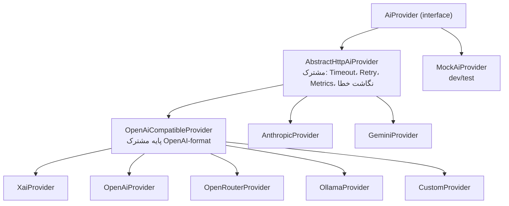
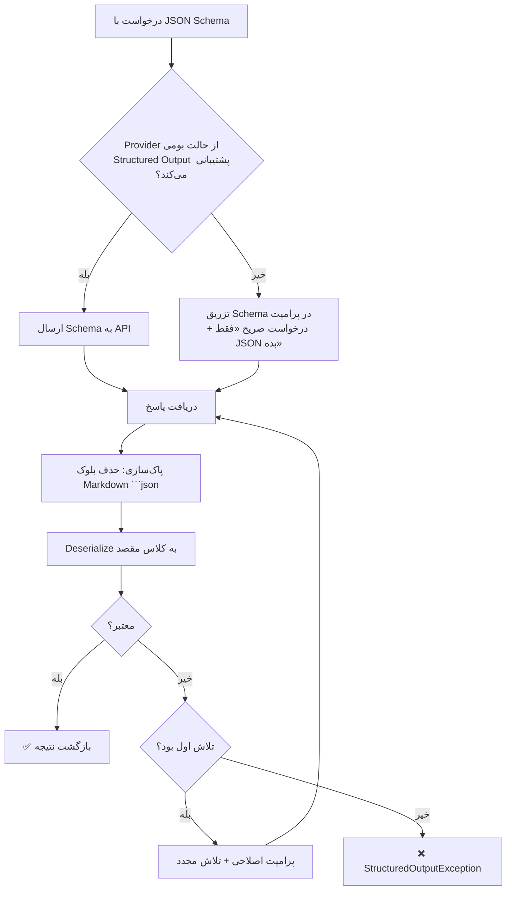
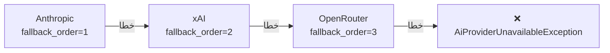

# معماری Provider هوش مصنوعی

> بخش D، ۱۴ تا ۲۵، ۵۰ و ۵۱ خواسته‌ها · نسخه 1.0

---

## ۱. اصل طراحی

> **هیچ Provider و هیچ Model ID در کد Java نیست.** Provider، مدل، قیمت، Timeout، ترتیب Failover و تخصیص، همه **داده** هستند و Super Admin از پنل مدیریت می‌کند.

تابع `models()` در اینترفیس Provider به Admin اجازه می‌دهد فهرست مدل‌ها را **از خود API Provider** دریافت کند — پس افزودن مدل جدید توسط Provider، نیازی به Release ما ندارد.

---

## ۲. اینترفیس Provider (بخش ۲۱ خواسته‌ها)

```java
public interface AiProvider {

    /** کد یکتا — با ai_providers.code مطابقت دارد */
    String code();

    /** آیا این Provider پیکربندی شده و فعال است */
    boolean isAvailable();

    /** تولید متن آزاد */
    AiResponse generate(AiRequest request);

    /** تحلیل (پیش‌فرض: generate با پرامپت تحلیلی) */
    default AiResponse analyze(AiRequest request) {
        return generate(request);
    }

    /**
     * تولید خروجی ساختاریافته — خروجی به responseType نگاشت می‌شود.
     * اگر Provider از Structured Output پشتیبانی نکند، از الگوی
     * «تولید JSON + اعتبارسنجی + تلاش مجدد» استفاده می‌شود.
     */
    <T> AiStructuredResponse<T> generateStructured(AiRequest request, Class<T> responseType);

    /** آیا این Provider قابلیت مشخصی را پشتیبانی می‌کند */
    boolean supports(String capability);   // VISION|JSON_MODE|TOOL_USE|STREAMING|REASONING

    /** فهرست مدل‌های موجود — از API خود Provider خوانده می‌شود */
    List<AiModelDescriptor> models();

    /** بررسی سلامت — برای Health Check و تست پنل */
    ProviderHealth health();
}
```

### مدل‌های درخواست/پاسخ

```java
public record AiRequest(
    String modelId,              // شناسه دقیق برای API Provider
    String systemPrompt,         // فقط از PromptVersion
    String userPrompt,
    List<AiMessage> history,     // برای گفت‌وگوی دستیار
    Double temperature,
    Integer maxTokens,
    Double topP,
    List<String> stopSequences,
    String jsonSchema,           // برای خروجی ساختاریافته
    String traceId,
    Duration timeout,
    Map<String, Object> providerOptions   // تنظیمات اختصاصی Provider
) {}

public record AiResponse(
    String content,
    Integer inputTokens,
    Integer outputTokens,
    Integer cachedTokens,
    String finishReason,         // stop | length | content_filter | error
    String modelId,
    Duration duration,
    Map<String, Object> rawMetadata
) {}

public record AiStructuredResponse<T>(
    T parsed,
    String rawContent,
    boolean schemaValid,
    Integer inputTokens,
    Integer outputTokens,
    Integer cachedTokens,
    Duration duration,
    List<String> validationErrors
) {}

public record AiModelDescriptor(
    String modelId,
    String displayName,
    Integer contextWindow,
    Integer maxOutputTokens,
    Set<String> capabilities
) {}

public record ProviderHealth(
    boolean healthy,
    String message,
    Duration latency,
    Instant checkedAt
) {}
```

---

## ۳. پیاده‌سازی‌ها



> **نکته معمارانه:** xAI، OpenAI، OpenRouter، Ollama و Custom همگی از قالب OpenAI پیروی می‌کنند. با استخراج `OpenAiCompatibleProvider`، **پنج Provider با یک کلاس** پوشش داده می‌شوند و فقط تفاوت‌های کوچک (Base URL، نگاشت مدل، هدرها) پیکربندی می‌شوند. این ریسک نگهداری را به‌شدت کم می‌کند.

### کلاس پایه — مسئولیت‌های مشترک

```java
public abstract class AbstractHttpAiProvider implements AiProvider {

    protected final RestClient restClient;
    protected final AiProviderConfig config;
    protected final MeterRegistry meters;

    protected <T> T withRetry(String operation, Supplier<T> call) {
        RetryPolicy policy = config.retryPolicy();
        RuntimeException last = null;

        for (int attempt = 1; attempt <= policy.maxAttempts(); attempt++) {
            try {
                return call.get();
            } catch (ProviderRateLimitException e) {
                last = e;
                sleep(backoff(attempt) + jitter());     // Backoff نمایی + Jitter
            } catch (ProviderServerException e) {
                last = e;                                // 5xx قابل تلاش مجدد
                sleep(backoff(attempt) + jitter());
            } catch (ProviderClientException e) {
                throw e;                                 // 4xx تلاش مجدد ندارد
            }
        }
        throw last;
    }

    /** هر Provider این را پیاده می‌کند — نگاشت خطای اختصاصی به خطای دامنه */
    protected abstract AiProviderException mapError(int status, String body);

    protected void recordMetrics(String model, String status, Duration d, int in, int out) {
        meters.counter("ai.request", "provider", code(), "model", model, "status", status)
              .increment();
        meters.timer("ai.duration", "provider", code(), "model", model)
              .record(d);
        meters.counter("ai.tokens.input", "provider", code()).increment(in);
        meters.counter("ai.tokens.output", "provider", code()).increment(out);
    }
}
```

> **Jitter الزامی است.** بدون Jitter، اگر Provider یک بار خطای 429 بدهد، همه درخواست‌های معوق **همزمان** دوباره تلاش می‌کنند و Provider را دوباره سرریز می‌کنند (Thundering Herd).

### نگاشت خطا — یکدست‌سازی

| خطای Provider | استثنای دامنه | تلاش مجدد؟ | Fallback؟ |
|---|---|---|---|
| `401` / `403` | `ProviderAuthException` | ❌ | ✅ |
| `429` | `ProviderRateLimitException` | ✅ | ✅ |
| `400` (درخواست بد) | `ProviderRequestException` | ❌ | ❌ |
| `5xx` | `ProviderServerException` | ✅ | ✅ |
| Timeout | `ProviderTimeoutException` | ✅ | ✅ |
| پاسخ نامعتبر (JSON خراب) | `ProviderResponseException` | ✅ یک‌بار | ✅ |
| نقض Schema | `StructuredOutputException` | ✅ یک‌بار با پرامپت اصلاحی | ✅ |

---

## ۴. Provider آنتروپیک

```java
@Component
@ConditionalOnProperty(name = "app.mock.ai", havingValue = "false")
public class AnthropicProvider extends AbstractHttpAiProvider {

    @Override public String code() { return "ANTHROPIC"; }

    @Override
    public boolean supports(String capability) {
        return switch (capability) {
            case "VISION", "TOOL_USE", "STREAMING", "REASONING", "JSON_MODE" -> true;
            default -> false;
        };
    }

    @Override
    public AiResponse generate(AiRequest req) {
        AnthropicMessagesRequest body = new AnthropicMessagesRequest(
            config.baseUrl() != null ? fetchModelId(req) : fetchModelId(req),
            req.maxTokens(),
            req.systemPrompt(),                 // ← در این API، system پارامتر جداگانه است
            List.of(new AnthropicMessage("user", req.userPrompt())),
            req.temperature(), req.topP(), req.stopSequences(), false);

        AnthropicMessagesResponse response = withRetry("generate", () ->
            restClient.post()
                .uri(config.baseUrl() + "/v1/messages")
                .header("x-api-key", config.apiKey())
                .header("anthropic-version", config.apiVersion())
                .contentType(MediaType.APPLICATION_JSON)
                .body(body)
                .retrieve()
                // ...
                .body(AnthropicMessagesResponse.class));

        return new AiResponse(
            extractText(response),
            response.usage().inputTokens(),
            response.usage().outputTokens(),
            response.usage().cacheReadInputTokens(),
            response.stopReason(),
            response.model(),
            Duration.ofMillis(response.measuredDurationMs()),
            Map.of("anthropic-version", config.apiVersion()));
    }

    @Override
    public <T> AiStructuredResponse<T> generateStructured(AiRequest req, Class<T> type) {
        // الگوی عمومی: JSON Schema را در پرامپت می‌دهیم، JSON برمی‌گیریم، اعتبارسنجی می‌کنیم
        // و در صورت نقض، یک‌بار با پرامپت اصلاحی دوباره تلاش می‌کنیم
        return StructuredOutputSupport.generateWithSchema(
                this, req, type, config.objectMapper());
    }
}
```

> ⚠️ **وضعیت راستی‌آزمایی:** جزئیات دقیق این Provider (نام فیلدهای بدنه، هدر `anthropic-version`، مسیر `/v1/messages`، نام فیلدهای Usage، و اینکه کدام مکانیزم برای خروجی ساختاریافته استفاده شود) **باید پیش از پیاده‌سازی از مستندات رسمی Anthropic تأیید شود.** در این سند معماری و الگو آمده؛ مقادیر ثابت (نسخه API، مسیر، نام فیلد) در `ProviderConfiguration` در دیتابیس نگهداری می‌شوند تا بدون تغییر کد قابل اصلاح باشند.
>
> **قاعده پروژه (بخش ۷۳ خواسته‌ها):** حدس زدن مجاز نیست. هر مقدار مشکوک به‌عنوان `TODO(verify-docs)` علامت‌گذاری و در `docs/troubleshooting.md` ثبت می‌شود.

### Model Catalog — چرا در کد نیست

شناسه مدل‌ها (مثل `claude-opus-5-5`، `claude-sonnet-5`، `claude-haiku-4-5-20251001`) در جدول `ai_models` ذخیره می‌شوند:

```java
@Entity
@Table(name = "ai_models")
public class AiModel {
    private String modelId;          // ← مقدار دقیق برای API
    private String displayName;      // ← «سونات ۵» برای نمایش
    private Integer contextWindow;
    private BigDecimal inputCostPerMillion;
    private BigDecimal outputCostPerMillion;
    private BigDecimal cachedInputCostPerMillion;
    private Set<String> capabilities;
    private Instant lastSyncedAt;
}
```

**سه راه ورود مدل:**
1. **همگام‌سازی خودکار** — Admin دکمه «دریافت مدل‌ها» می‌زند → `provider.models()` صدا زده می‌شود → مدل‌های جدید پیشنهاد می‌شوند.
2. **افزودن دستی** — Admin مدل را دستی تعریف می‌کند.
3. **Seed اولیه** — در Migration با مقادیر تأییدشده.

در هر سه حالت، **هیچ‌کدام نیاز به Deploy ندارد.**

---

## ۵. خروجی ساختاریافته (Structured Output)

سه لایه دفاعی، به ترتیب:



```java
public final class StructuredOutputSupport {

    public static <T> AiStructuredResponse<T> generateWithSchema(
            AiProvider provider, AiRequest req, Class<T> type, ObjectMapper mapper) {

        AiResponse first = provider.generate(req.withJsonSchema(schemaOf(type)));
        ValidationResult<T> parsed = tryParse(first.content(), type, mapper);

        if (parsed.valid()) {
            return AiStructuredResponse.ok(parsed.value(), first);
        }

        // تلاش مجدد با بازخورد مشخص
        String repairPrompt = """
            پاسخ قبلی شما معتبر نبود.
            خطا: %s
            لطفاً فقط یک شیء JSON معتبر و بدون هیچ متن اضافه برگردانید.
            """.formatted(String.join("; ", parsed.errors()));

        AiResponse second = provider.generate(req.withUserPrompt(
            req.userPrompt() + "\n\n" + repairPrompt));

        ValidationResult<T> retried = tryParse(second.content(), type, mapper);
        if (retried.valid()) {
            return AiStructuredResponse.ok(retried.value(), second);
        }
        throw new StructuredOutputException(type, retried.errors(), second.content());
    }

    /** حذف بلوک Markdown — خطای بسیار رایج مدل‌ها */
    static String stripMarkdownFence(String raw) {
        String t = raw.trim();
        if (t.startsWith("```")) {
            int firstNewline = t.indexOf('\n');
            int lastFence = t.lastIndexOf("```");
            if (firstNewline > 0 && lastFence > firstNewline) {
                return t.substring(firstNewline + 1, lastFence).trim();
            }
        }
        return t;
    }
}
```

> **مهم:** در `AI_EVALUATIONS` اگر خروجی Schema را نقض کند، **ذخیره نمی‌شود**. `status = FAILED` ثبت می‌گردد تا معلم ببیند و دستی تصحیح کند. هرگز داده نیمه‌معتبر ذخیره نمی‌شود.

---

## ۶. رزولوشن Provider و Model (بخش ۱۶ خواسته‌ها)

```text
USER (۱)
  ↓
CLASS (۲)
  ↓
TENANT (۳)
  ↓
PLAN (۴)
  ↓
FEATURE (۵)
  ↓
GLOBAL (۶)
```

```java
@Component
@RequiredArgsConstructor
public class ProviderResolver {

    private static final List<ScopeType> ORDER = List.of(
        ScopeType.USER, ScopeType.CLASS, ScopeType.TENANT,
        ScopeType.PLAN, ScopeType.FEATURE, ScopeType.GLOBAL);

    public ResolvedProvider resolve(String featureCode, ResolutionContext ctx) {
        for (ScopeType scope : ORDER) {
            Optional<UUID> scopeId = ctx.scopeIdFor(scope);
            if (scopeId.isEmpty() && scope != ScopeType.GLOBAL) continue;

            var candidates = assignmentRepo.findActiveChain(
                featureCode, scope, scopeId.orElse(null), ctx.tenantId());

            for (AiProviderAssignment a : candidates) {          // مرتب بر اساس priority
                AiProvider provider = providerRepo.findById(a.getProviderId())
                        .orElseThrow(ResourceNotFoundException::new);
                if (!provider.isEnabled()) continue;

                AiModel model = a.getModelId() != null
                        ? modelRepo.findById(a.getModelId()).orElseThrow()
                        : modelRepo.findDefaultFor(provider.getId()).orElseThrow();

                if (!model.isEnabled()) continue;

                return new ResolvedProvider(provider, model, scope, a.getOverrides());
            }
        }
        throw new NoProviderConfiguredException(featureCode);
    }
}
```

### نمونه پیکربندی واقعی

```text
GLOBAL              → xAI      / grok-4        (ارزان، پیش‌فرض)
PLAN_PRO            → Anthropic / claude-sonnet-5
TENANT (معلم الف)   → OpenAI   / gpt-5
FEATURE_AI_HOMEWORK → xAI      / grok-4-fast
CLASS (کلاس ۵ الف)  → Anthropic / claude-opus-5-5
```

نتیجه برای «تصحیح تکلیف کلاس ۵ الف توسط معلم الف»:

```text
جست‌وجو: USER (معلم الف) → ❌ تعریف نشده
         CLASS (کلاس ۵ الف) → ✅ یافت شد → Anthropic / claude-opus-5-5
```

> برای «تصحیح تکلیف کلاس دیگری از معلم الف»: USER ❌ → CLASS ❌ → TENANT ✅ → OpenAI / gpt-5

---

## ۷. زنجیره Failover (بخش ۵۱ خواسته‌ها)



```java
@Service
@RequiredArgsConstructor
public class ProviderBroker {

    private final ProviderResolver resolver;
    private final AiUsageRecorder usageRecorder;
    private final CircuitBreakerRegistry circuitBreakers;

    public AiResponse execute(String featureCode, ResolutionContext ctx, AiRequest req) {
        ResolvedProvider primary = resolver.resolve(featureCode, ctx);
        List<ResolvedProvider> chain = resolver.failoverChain(primary);

        List<ProviderFailure> failures = new ArrayList<>();

        for (ResolvedProvider rp : chain) {
            CircuitBreaker cb = circuitBreakers.forProvider(rp.provider().getCode());

            if (!cb.tryAcquire()) {
                failures.add(ProviderFailure.circuitOpen(rp.provider().getCode()));
                continue;                                   // سریع رد شو
            }

            try {
                AiResponse response = rp.provider().generate(req.withModel(rp.model().getModelId()));
                cb.recordSuccess();

                usageRecorder.recordSuccess(ctx, featureCode, rp, response,
                    failures.isEmpty() ? null : failures.get(0).providerCode());
                return response;

            } catch (AiProviderException e) {
                cb.recordFailure();
                failures.add(ProviderFailure.of(rp.provider().getCode(), e));
                log.warn("Provider {} شکست خورد: {}", rp.provider().getCode(), e.getMessage());

                if (!e.isFallbackEligible()) {
                    // خطای پیکربندی است، نه خطای گذرا — Fallback بی‌فایده است
                    usageRecorder.recordFailure(ctx, featureCode, rp, e);
                    throw e;
                }
            }
        }

        usageRecorder.recordAllFailed(ctx, featureCode, failures);
        throw new AllProvidersFailedException(featureCode, failures);
    }
}
```

### Circuit Breaker

پارامترها **قابل تنظیم از پنل Admin**:

| پارامتر | مقدار پیش‌فرض |
|---|---|
| آستانه باز شدن | ۵۰٪ خطا در ۱۰ درخواست اخیر |
| حداقل تعداد درخواست | ۵ |
| مدت باز ماندن | ۶۰ ثانیه |
| درخواست آزمایشی در حالت نیمه‌باز | ۳ |
| پنجره سنجش | ۶۰ ثانیه |

فاز اول: `resilience4j` درون‌حافظه‌ای.
فاز ۱۲: با Redis برای حالت چندنمونه‌ای.

> **نکته مهم:** `AI_USAGE_RECORDS` **هر تلاش** را ثبت می‌کند، از جمله تلاش‌های شکست‌خورده و Fallback. ستون `fallback_from_provider_id` نشان می‌دهد این درخواست پس از شکست Provider دیگری موفق شده. بدون این، محاسبه هزینه و تشخیص خرابی Provider غیرممکن است.

---

## ۸. مدیریت هزینه (بخش ۲۵ خواسته‌ها)

```java
@Component
@RequiredArgsConstructor
public class AiCostCalculator {

    public CostBreakdown calculate(AiModel model, AiResponse response) {
        BigDecimal million = BigDecimal.valueOf(1_000_000);

        BigDecimal input = BigDecimal.valueOf(response.inputTokens())
            .divide(million, 10, RoundingMode.HALF_UP)
            .multiply(model.getInputCostPerMillion());

        BigDecimal cached = BigDecimal.valueOf(
                response.cachedTokens() == null ? 0 : response.cachedTokens())
            .divide(million, 10, RoundingMode.HALF_UP)
            .multiply(model.getCachedInputCostPerMillion());

        BigDecimal output = BigDecimal.valueOf(response.outputTokens())
            .divide(million, 10, RoundingMode.HALF_UP)
            .multiply(model.getOutputCostPerMillion());

        return new CostBreakdown(
            input.add(cached).add(output),
            input, cached, output,
            model.getCurrency());
    }
}
```

**قواعد:**
- `estimated_cost` **قبل** از فراخوانی محاسبه می‌شود (پیش‌بینی بر اساس طول پرامپت + `maxTokens`).
- `actual_cost` **بعد** از فراخوانی، بر اساس توکن‌های واقعی.
- هر دو ذخیره می‌شوند تا دقت تخمین قابل اندازه‌گیری باشد.
- اگر Provider توکن گزارش نکند (برخی Providerها نمی‌دهند)، تخمین محلی استفاده و `metadata.tokenSource = "ESTIMATED"` ثبت می‌شود.

### گزارش‌های هزینه

```text
هزینه به تفکیک کاربر     → GET /api/v1/admin/ai-cost/by-user
هزینه به تفکیک معلم      → GET /api/v1/admin/ai-cost/by-tenant
هزینه به تفکیک Feature   → GET /api/v1/admin/ai-cost/by-feature
هزینه به تفکیک Provider  → GET /api/v1/admin/ai-cost/by-provider
هزینه به تفکیک Model     → GET /api/v1/admin/ai-cost/by-model
هزینه به تفکیک روز       → GET /api/v1/admin/ai-cost/daily
```

---

## ۹. Provider Playground (بخش ۵۰)

```text
POST /api/v1/admin/ai/playground
{
  "providerId": "...", "modelId": "...",
  "systemPrompt": "...", "userPrompt": "...",
  "variables": { },
  "temperature": 0.2, "maxTokens": 1024,
  "compareWith": [ { "providerId": "...", "modelId": "..." } ]
}
```

پاسخ موازی از Virtual Threadها (چون `StructuredTaskScope` هنوز preview است):

```java
try (var executor = Executors.newVirtualThreadPerTaskExecutor()) {
    var futures = targets.stream()
        .map(t -> executor.submit(() -> runSingle(t, request)))
        .toList();
    // جمع‌آوری نتایج با timeout کلی
}
```

پاسخ شامل: خروجی، مدت زمان، توکن، هزینه تخمینی، وضعیت — **برای مقایسه کنار هم**.

---

## ۱۰. حالت Mock

```java
@Component
@ConditionalOnProperty(name = "app.mock.ai", havingValue = "true")
public class MockAiProvider implements AiProvider {

    @Override public String code() { return "MOCK"; }
    @Override public boolean isAvailable() { return true; }

    @Override
    public AiResponse generate(AiRequest req) {
        // پاسخ قطعی و تکرارپذیر — برای تست
        String content = "پاسخ آزمایشی برای: " + summarize(req.userPrompt());
        return new AiResponse(content, 100, 50, 0, "stop",
            req.modelId(), Duration.ofMillis(120), Map.of("mock", true));
    }

    @Override
    public <T> AiStructuredResponse<T> generateStructured(AiRequest req, Class<T> type) {
        // تولید نمونه ساختاریافته از خود کلاس — بدون فراخوانی شبکه
        T instance = StructuredOutputFixtures.createSample(type);
        return new AiStructuredResponse<>(instance, "{}", true, 100, 50, 0,
            Duration.ofMillis(120), List.of());
    }
}
```

`StructuredOutputFixtures.createSample(type)` با Reflection یک نمونه معتبر می‌سازد. این یعنی **تمام جریان تصحیح تکلیف بدون هیچ API واقعی قابل تست است.**

---

## ۱۱. تست‌های الزامی

| تست | نوع | بررسی |
|---|---|---|
| `ProviderResolverPriorityTest` | Integration | ترتیب ۶ سطحی |
| `ProviderResolverDisabledSkippedTest` | Integration | Provider غیرفعال رد شود |
| `FailoverChainTest` | Integration | خطای Provider اول → دومی پاسخ دهد |
| `FailoverRecordsUsageTest` | Integration | هر تلاش در `ai_usage_records` ثبت شود |
| `CircuitBreakerOpensTest` | Integration | پس از ۵ خطا، درخواست‌ها سریع رد شوند |
| `StructuredOutputValidTest` | Unit | JSON معتبر → نگاشت درست |
| `StructuredOutputMarkdownFenceTest` | Unit | پاسخ داخل ```json پاک‌سازی شود |
| `StructuredOutputRetryTest` | Unit | پاسخ نامعتبر → تلاش مجدد موفق |
| `StructuredOutputFailLoudTest` | Unit | دو بار نامعتبر → استثنا، نه مقدار پیش‌فرض |
| `CostCalculationTest` | Unit | محاسبه توکن ورودی/خروجی/کش‌شده |
| `CostWithNullTokensTest` | Unit | Provider بدون گزارش توکن |
| `ProviderErrorMappingTest` | Unit | نگاشت 4xx/5xx/429/timeout به استثناهای دامنه |
| `ApiKeyNotLoggedTest` | Unit | کلید در هیچ Logی نیاید |
| `MockProviderDeterministicTest` | Unit | پاسخ Mock تکرارپذیر باشد |
| `ProviderTimeoutTest` | Integration | Timeout اعمال شود |
| `RetryWithJitterTest` | Unit | فاصله تلاش‌ها یکنواخت نباشد |
