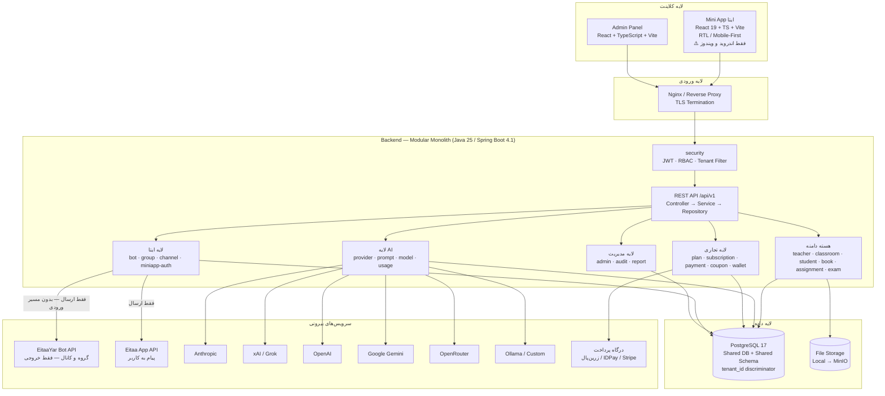
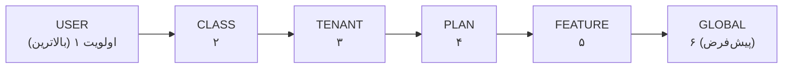
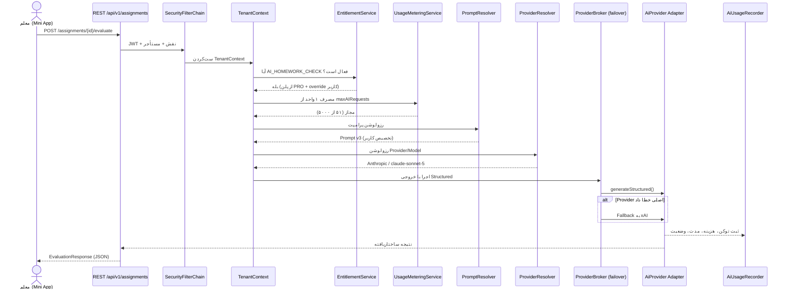
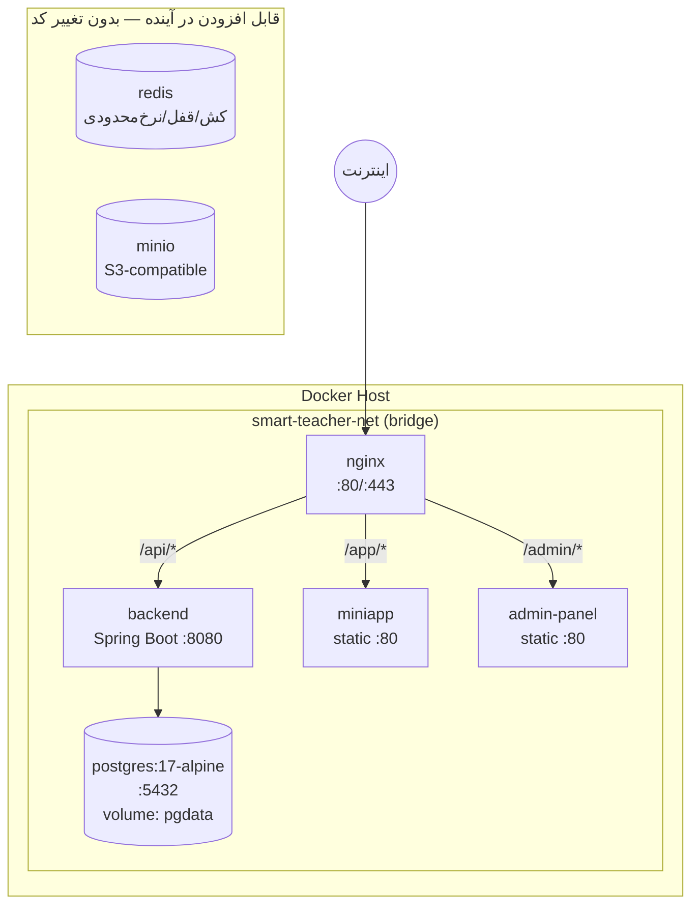

# معماری سیستم — دستیار هوشمند معلم

> نام داخلی: **Smart Teacher** · نسخه سند: 1.0 · تاریخ: 2026-09-28

---

## ۱. خلاصه اجرایی

«دستیار هوشمند معلم» یک پلتفرم **SaaS چندمستأجری (Multi-Tenant)** برای معلمان، مدارس و مؤسسات آموزشی است که سه لایه اصلی دارد:

۱. **Mini App ایتا** — رابط اصلی معلم (موبایل، RTL، فارسی)
۲. **پنل مدیریت (Admin Panel)** — رابط Super Admin برای مدیریت محصول، مالی، AI و کاربران
۳. **Backend** — یک **Modular Monolith** روی Java 25 / Spring Boot که تمام دامنه، امنیت، AI و صورتحساب را مدیریت می‌کند

نکته کلیدی: این محصول از روز اول به‌عنوان یک **محصول تجاری** طراحی می‌شود، نه پروژه دانشگاهی. یعنی Providerهای AI، Promptها، پلن‌ها، قیمت‌ها، محدودیت‌ها و Featureها **داده** هستند، نه کد. Super Admin می‌تواند بدون یک خط تغییر کد یا ری‌دیپلوی، رفتار محصول را تغییر دهد.

---

## ۲. نسخه‌های پایه (راستی‌آزمایی‌شده)

تمام نسخه‌های زیر در تاریخ 2026-09-28 از Maven Central و محیط توسعه راستی‌آزمایی شده‌اند. هیچ نسخه‌ای حدس زده نشده است.

| مؤلفه | نسخه | وضعیت راستی‌آزمایی |
|---|---|---|
| JDK | **25.0.2 (LTS)** | `jdk-25.0.2` روی سیستم نصب است — `java version "25.0.2" 2026-01-20 LTS` |
| Spring Boot | **4.1.1** | Maven Central ≥ 4.1.1 منتشر شده |
| Spring Modulith | **2.1.1** | Maven Central |
| PostgreSQL | **17-alpine** | Image رسمی Docker |
| Flyway | **13.8.0** | `flyway-core` + `flyway-database-postgresql` |
| springdoc-openapi | **3.1.1** | `springdoc-openapi-starter-webmvc-ui` |
| Testcontainers | **1.21.4** | `org.testcontainers:postgresql` |
| PostgreSQL JDBC | **42.7.13** | Maven Central |
| jjwt | **0.13.0** | `io.jsonwebtoken:jjwt-api/impl/jackson` |
| MapStruct | **1.6.3** | آخرین نسخه Stable (1.7 هنوز Beta است) |
| ArchUnit | **1.5.1** | `archunit-junit5` |
| Maven | **3.9.14** | نصب‌شده روی سیستم |
| Node.js | **22.18.0** | نصب‌شده روی سیستم |

> **هشدار مهم محیط توسعه:** `JAVA_HOME` فعلی سیستم روی `jdk-21.0.10` تنظیم است، نه 25. پروژه از **Maven Toolchains** استفاده می‌کند تا بیلد مستقل از `JAVA_HOME` همیشه با JDK 25 انجام شود. جزئیات در `docs/development.md`.

---

## ۳. معماری کلان



### 🔴 نکته حیاتی درباره یکپارچه‌سازی ایتا

معماری با فرض **راستی‌آزمایی‌شده** مستندات رسمی ایتا ترسیم شده است ([`docs/eitaa.md`](eitaa.md) نسخه ۲.۰):

| واقعیت | پیامد معماری |
|---|---|
| Bot API فقط **۳ متد** دارد: `getMe`, `sendMessage`, `sendFile` | `EitaaAdapter` کوچک و دقیق است — بدون انتزاع بی‌مصرف |
| **هیچ Webhook / Polling / getUpdates وجود ندارد** | ❌ **هیچ Endpoint ورودی از ایتا نداریم** — سطح حمله حذف شده |
| **دو مسیر ارسال جدا**: گروه/کانال (BOT) و کاربر (APP) | دو پیاده‌سازی Adapter با قرارداد متفاوت |
| **Push Notification ممکن نیست** | اعلان = پیام متنی به کاربر (مسیر APP) |
| Mini App فقط **اندروید + ویندوز** | گارد پلتفرم در Frontend + مسیر جایگزین ربات |

> ✅ **این یک مزیت امنیتی است، نه فقط محدودیت.** چون ایتا هرگز به سرور ما درخواست نمی‌زند،
> کلاس‌هایی از آسیب‌پذیری (جعل Webhook، Replay، DoS ورودی) از معماری حذف می‌شوند.

---

### چرا Modular Monolith و نه Microservice؟

- تیم کوچک است؛ هزینه عملیاتی Microservice (سرویس‌دیسکاوری، توزیع تراکنش، Observability توزیع‌شده، CI/CD چندگانه) در فاز اول توجیه ندارد.
- تمام دامنه‌ها روی **یک دیتابیس مشترک** کار می‌کنند و تراکنش‌های ACID می‌خواهند (مثلاً: ثبت پرداخت + فعال‌سازی اشتراک + ثبت مصرف، باید اتمیک باشد).
- **مرزهای ماژولار با Spring Modulith سخت‌افزاری (enforced) می‌شوند** — پس اگر روزی لازم شد یک ماژول جدا شود، مرزها از قبل تمیز است.
- `ApplicationModules.verify()` در تست‌ها اجرا می‌شود و **بیلد را در صورت نقض مرز fail می‌کند**. یعنی معماری قابل فرسایش نیست.

---

## ۴. ماژول‌های سیستم (Modular Monolith)

ساختار پکیج پایه: `ir.omid.smartteacher`

```text
ir.omid.smartteacher
├── common          ابزارهای مشترک، BaseEntity، خطاها، صفحه‌بندی
├── config          تنظیمات Spring، Jackson، OpenAPI، Async
├── security        امنیت، JWT، RBAC، رمزنگاری، Tenant Guard
├── tenant          مدیریت مستأجر، عضویت، حل مستأجر جاری
├── admin           امکانات پنل مدیریت (پلتفرم‌سطح)
├── user            کاربران، پروفایل، نقش‌ها
├── teacher         دامنه معلم
├── school          مدارس و سازمان‌ها
├── classroom       کلاس‌ها و ثبت‌نام
├── student         دانش‌آموزان
├── eitaa           اتصال به ایتا (Adapter دو-مسیره، Mini App Auth، initData)
├── group           گروه‌های ایتا متصل به کلاس
├── channel         کانال‌های ایتا
├── book            کتاب، صفحه، OCR، تحلیل
├── assignment      تکلیف، ارسال، تصحیح AI
├── exam            آزمون، سؤال، تلاش، نمره
├── ai              تنظیمات و رزولوشن AI، دستیار معلم
├── prompt          قالب پرامپت، نسخه‌بندی، تخصیص
├── provider        Providerهای AI + مدل‌ها + هزینه
├── subscription    اشتراک
├── plan            پلن‌ها، امکانات، محدودیت‌ها
├── payment         پرداخت، درگاه‌ها، فاکتور
├── coupon          کد تخفیف و تخفیف
├── wallet          کیف پول و اعتبار
├── notification    اعلان‌ها
├── message         پیام و پیام زمان‌بندی‌شده
├── automation      قواعد خودکارسازی
├── report          گزارش‌ها و داشبورد
├── usage           اندازه‌گیری مصرف و Entitlement
├── file            ذخیره‌سازی فایل (Local/MinIO adapter)
└── audit           لاگ حسابرسی
```

### قواعد سخت مرزها (اجرا شده با Spring Modulith + ArchUnit)

| قاعده | توضیح |
|---|---|
| **دسترسی فقط از API ماژول** | هر ماژول فقط پکیج ریشه خود را `public` می‌کند (مثل `teacher.TeacherFacade`). تمام کلاس‌های داخلی در زیرپکیج `internal` قرار می‌گیرند. |
| **ممنوعیت دسترسی مستقیم به Repository ماژول دیگر** | هیچ ماژولی نباید `Repository` ماژول دیگر را تزریق کند؛ فقط از طریق Facade یا رویداد. |
| **ارتباط غیرهمزمان با رویداد** | رویدادهای دامنه از طریق `ApplicationEventPublisher` / `@ApplicationModuleListener` منتشر می‌شوند (مثلاً `AssignmentSubmittedEvent` → ماژول `assignment` مصرف می‌کند). |
| **ممنوعیت وابستگی چرخه‌ای** | `ApplicationModules.verify()` بیلد را fail می‌کند. |
| **ممنوعیت Native Query بدون فیلتر مستأجر** | تست ArchUnit هر `@Query(nativeQuery = true)` را ممنوع می‌کند مگر در پکیج `internal.report` با annotate صریح `@TenantBypassAllowed`. |

> **نکته حیاتی:** مکانیزم `@TenantId` هایبرنیت روی **Native Query اعمال نمی‌شود**. به همین دلیل Native Query به‌صورت پیش‌فرض ممنوع و با تست معماری کنترل می‌شود.

---

## ۵. لایه‌بندی درون هر ماژول

هر ماژول دقیقاً همین ساختار را دارد:

```text
<module>/
├── <Module>Facade.java          ← تنها کلاس public برای ماژول‌های دیگر (اختیاری)
├── package-info.java            ← @ApplicationModule(allowedDependencies = {...})
└── internal/
    ├── api/                     ← Controller + DTO (Request/Response)
    │   ├── <X>Controller.java
    │   ├── dto/
    │   └── mapper/              ← MapStruct Mapper
    ├── domain/                  ← Entity + Value Object + Domain Service
    │   ├── <X>.java
    │   └── <X>Repository.java
    ├── application/             ← Service Interface + Impl (منطق کسب‌وکار، تراکنش، امنیت)
    │   ├── <X>Service.java
    │   └── <X>ServiceImpl.java
    └── event/                   ← رویدادهای دامنه منتشرشده/مصرف‌شده
```

**قاعده جریان:** `Controller → Service → Repository`. Controller هرگز به Repository دسترسی ندارد. Entity هرگز از لایه `api` بیرون نمی‌رود.

---

## ۶. موتور رزولوشن پیکربندی (هسته معماری)

بزرگ‌ترین ایده معماری این سیستم: **یک موتور رزولوشن عمومی** که هم برای Provider، هم Model، هم Prompt، هم Feature، هم Limit و هم Configuration استفاده می‌شود.



**قاعده:** خاص‌ترین تنظیم، عمومی‌ترین را Override می‌کند. اگر در سطح USER مقدار تعریف شده باشد، سطوح پایین‌تر حتی نگاه هم نمی‌شوند.

### پیاده‌سازی

```java
public enum ScopeType { USER, CLASS, TENANT, PLAN, FEATURE, GLOBAL }

public interface ScopedResolver<T> {
    /** کلید منطقی — مثلاً "AI_PROVIDER" یا "PROMPT_AI_HOMEWORK_CHECK" */
    String key();
    /** ترتیب صعودی اولویت */
    List<ScopeType> scopeOrder();
    Optional<T> resolve(ResolutionContext ctx);
}
```

`ResolutionContext` شامل `userId`, `classId`, `tenantId`, `planId`, `featureCode` است — هر کدام در دسترس نباشد، آن سطح رد می‌شود.

جداول تخصیص، همه یک شکل دارند:

```sql
CREATE TABLE ai_provider_assignments (
    id           UUID PRIMARY KEY,
    scope_type   VARCHAR(20) NOT NULL,   -- USER|CLASS|TENANT|PLAN|FEATURE|GLOBAL
    scope_id     UUID        NULL,       -- NULL فقط برای GLOBAL
    provider_id  UUID        NOT NULL REFERENCES ai_providers(id),
    model_id     UUID        NULL REFERENCES ai_models(id),
    priority     INT         NOT NULL DEFAULT 100,  -- برای fallback زنجیره‌ای
    enabled      BOOLEAN     NOT NULL DEFAULT TRUE,
    tenant_id    UUID        NULL        -- NULL یعنی تخصیص پلتفرم‌سطح
);
```

همین ساختار برای `ai_prompt_assignments`، `feature_overrides` و `limit_overrides` تکرار می‌شود. **یک الگو، شش کاربرد.**

مستندات کامل: `docs/ai-providers.md` و `docs/prompt-system.md`.

---

## ۷. Component Diagram — جریان یک درخواست AI (تصحیح تکلیف)



---

## ۸. معماری استقرار (Docker)



| سرویس | Image | پورت | توضیح |
|---|---|---|---|
| `postgres` | `postgres:17-alpine` | 5432 | دیتابیس اصلی، Volume پایدار |
| `backend` | `eclipse-temurin:25-jre` | 8080 | اپلیکیشن Spring Boot |
| `miniapp` | `nginx:alpine` | 80 | فایل‌های استاتیک Mini App |
| `admin-panel` | `nginx:alpine` | 80 | فایل‌های استاتیک پنل مدیریت |
| `nginx` | `nginx:alpine` | 80/443 | Reverse Proxy، TLS |

`file` ماژول از ابتدا با اینترفیس `FileStorage` طراحی می‌شود و پیاده‌سازی `LocalFileStorage` دارد؛ افزودن `MinioFileStorage` در آینده فقط یک Bean جدید است.

---

## ۹. حالت Mock (توسعه بدون سرویس بیرونی)

سیستم باید بدون هیچ API واقعی قابل اجرا باشد:

```yaml
app:
  mock:
    eitaa: true      # AiProvider/EitaaAdapter ماک می‌شود
    ai: true         # پاسخ‌های AI از پیش تعریف‌شده و قطعی
    payment: true    # درگاه پرداخت جعلی با verify خودکار
```

پیاده‌سازی با `@ConditionalOnProperty` — Bean واقعی و Mock هرگز همزمان فعال نمی‌شوند. جزئیات در `docs/development.md`.

---

## ۱۰. Observability

| قابلیت | پیاده‌سازی |
|---|---|
| Health | `/actuator/health` (+ `health/readiness`, `health/liveness`) |
| Metrics | Micrometer + `/actuator/metrics` |
| Prometheus | `/actuator/prometheus` (در پروفایل prod) |
| Trace ID | فیلتر `MDC` — `traceId` در تمام Log و در پاسخ خطا |
| AI Metrics | `ai.request.count{provider,model,feature,status}`، `ai.tokens`، `ai.cost` |
| Business Metrics | `subscription.active`، `usage.limit.rejected` |
| Audit | تمام عملیات حساس در جدول `audit_logs` |

**قاعده امنیتی:** Actuator در `prod` فقط روی شبکه داخلی expose می‌شود و `/actuator/env` و `/actuator/configprops` **همیشه بسته** هستند (خطر نشت Secret).

---

## ۱۱. اهداف غیرکارکردی

| هدف | مقدار |
|---|---|
| زمان پاسخ API (p95، بدون AI) | < 300ms |
| زمان پاسخ API (p95، با AI) | غیرهمزمان یا < 30s با Timeout قابل تنظیم |
| همزمانی هدف فاز اول | 500 کاربر فعال همزمان |
| RPO / RTO | 24h / 4h (فاز اول، Backup روزانه) |
| پوشش تست منطق کسب‌وکار | ≥ 70% (فاز ۱)، ≥ 80% (فاز ۱۲) |
| زمان بیلد کامل | < 5 دقیقه |
| حجم صفحه Mini App (gzip) | < 300KB |

---

## ۱۲. اسناد مرتبط

| سند | محتوا |
|---|---|
| `docs/database.md` | ERD کامل و طراحی جداول |
| `docs/multi-tenancy.md` | استراتژی جداسازی مستأجر |
| `docs/security.md` | احراز هویت، رمزنگاری، RBAC، ضد-IDOR |
| `docs/eitaa.md` | یکپارچه‌سازی ایتا (Bot API **فقط خروجی** + Mini App SDK + initData) |
| `docs/ai-providers.md` | معماری Provider، رزولوشن، Failover، هزینه |
| `docs/prompt-system.md` | سیستم پرامپت و نسخه‌بندی |
| `docs/billing.md` | پلن، اشتراک، Entitlement، مصرف |
| `docs/payments.md` | معماری درگاه پرداخت |
| `docs/api.md` | قرارداد API |
| `docs/admin-panel.md` | معماری پنل مدیریت |
| `docs/mini-app.md` | معماری Mini App |
| `docs/roadmap.md` | نقشه راه فازها |
| `docs/development.md` | راه‌اندازی محیط توسعه |
