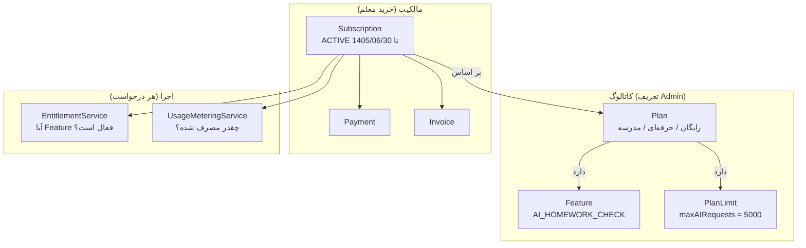
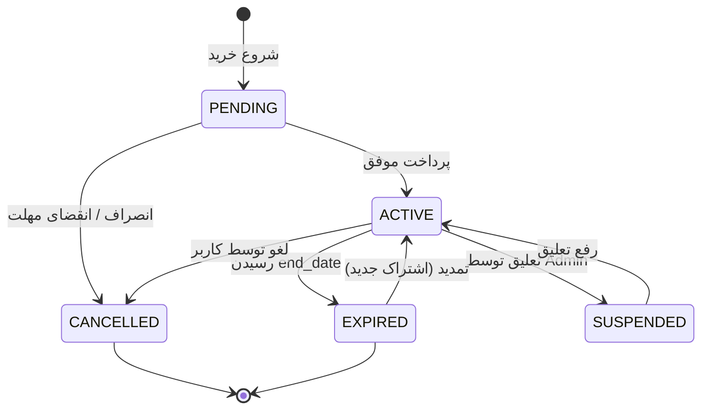

# معماری اشتراک و صورتحساب (Subscription & Billing)

> بخش F، ۲۶ تا ۳۵ خواسته‌ها · نسخه 1.0

---

## ۱. اصل طراحی

> **پلن، قیمت، امکانات و محدودیت‌ها داده هستند.** Super Admin همه را از پنل تغییر می‌دهد. هیچ‌کدام در کد نیستند.

---

## ۲. مدل مفهومی



**تفکیک حیاتی:**
- **Entitlement** = «آیا اجازه داری؟» (بله/خیر)
- **Limit** = «چقدر می‌توانی؟» (عدد)

این دو **مستقل** بررسی می‌شوند. ممکن است Feature فعال باشد ولی سقف مصرف پر شده باشد.

---

## ۳. پلن‌ها

```java
@Entity
@Table(name = "plans")
public class Plan {
    private String code;                // FREE | BASIC | PRO | SCHOOL | ENTERPRISE
    private String name;                // «حرفه‌ای»
    private String description;
    private BigDecimal price;
    private String currency;            // IRT
    private BillingPeriod billingPeriod;// MONTHLY | QUARTERLY | YEARLY | LIFETIME
    private Integer trialDays;
    private boolean isPublic;           // نمایش در اپ
    private boolean isDefault;          // پلن ثبت‌نام
    private int sortOrder;
    private boolean active;
}
```

### پلن‌های پیش‌فرض (Seed — قابل تغییر کامل)

| کد | نام | قیمت | دوره |
|---|---|---|---|
| `FREE` | رایگان | ۰ | MONTHLY |
| `BASIC` | پایه | قابل تنظیم | MONTHLY |
| `PRO` | حرفه‌ای | قابل تنظیم | MONTHLY |
| `SCHOOL` | مدرسه | قابل تنظیم | YEARLY |
| `ENTERPRISE` | سازمانی | تماس بگیرید | YEARLY |

> هیچ‌کدام در کد Hardcode نیستند — همه در `V18__seed_default_plans.sql`.

---

## ۴. امکانات (Features) و Entitlement

### کاتالوگ Feature

```text
AI_CHAT                     گفت‌وگو با دستیار هوشمند
AI_BOOK_ANALYSIS            تحلیل کتاب و صفحه
AI_HOMEWORK_CHECK           بررسی تکلیف با AI
AI_EXAM_GENERATION          تولید آزمون
AI_FEEDBACK                 نوشتن بازخورد
AI_STUDENT_ANALYSIS         تحلیل عملکرد دانش‌آموز
EITAA_GROUP_MANAGEMENT      مدیریت گروه‌های ایتا
EITAA_CHANNEL_MANAGEMENT    مدیریت کانال‌ها
SCHEDULED_MESSAGES          پیام‌های زمان‌بندی‌شده
AUTOMATION_RULES            قواعد خودکارسازی
ADVANCED_REPORTS            گزارش‌های پیشرفته
MULTIPLE_CLASSES            چند کلاس
MULTIPLE_SCHOOLS            چند مدرسه
OCR                         تشخیص متن از تصویر
EXAM_ONLINE                 آزمون آنلاین
```

### جدول‌های مرتبط

```sql
CREATE TABLE features (
    id              UUID PRIMARY KEY,
    code            VARCHAR(60) NOT NULL UNIQUE,
    name            VARCHAR(200) NOT NULL,
    category        VARCHAR(30)  NOT NULL,   -- AI | EITAA | REPORT | MANAGEMENT
    description     TEXT,
    default_enabled BOOLEAN NOT NULL DEFAULT FALSE,
    sort_order      INT NOT NULL DEFAULT 0
);

CREATE TABLE plan_features (
    id           UUID PRIMARY KEY,
    plan_id      UUID NOT NULL REFERENCES plans(id) ON DELETE CASCADE,
    feature_code VARCHAR(60) NOT NULL REFERENCES features(code),
    enabled      BOOLEAN NOT NULL DEFAULT TRUE,
    config       JSONB NOT NULL DEFAULT '{}',
    UNIQUE (plan_id, feature_code)
);

-- بازنویسی در سطح مستأجر (توسط Admin)
CREATE TABLE feature_overrides (
    id           UUID PRIMARY KEY,
    tenant_id    UUID NOT NULL REFERENCES tenants(id) ON DELETE CASCADE,
    feature_code VARCHAR(60) NOT NULL,
    enabled      BOOLEAN NOT NULL,
    reason       TEXT,
    expires_at   TIMESTAMPTZ,          -- NULL = دائمی
    granted_by   UUID REFERENCES users(id),
    created_at   TIMESTAMPTZ NOT NULL DEFAULT now(),
    UNIQUE (tenant_id, feature_code)
);

-- بازنویسی در سطح یک کاربر مشخص
CREATE TABLE user_feature_overrides (
    id           UUID PRIMARY KEY,
    user_id      UUID NOT NULL REFERENCES users(id) ON DELETE CASCADE,
    feature_code VARCHAR(60) NOT NULL,
    enabled      BOOLEAN NOT NULL,
    reason       TEXT,
    expires_at   TIMESTAMPTZ,
    granted_by   UUID REFERENCES users(id),
    UNIQUE (user_id, feature_code)
);
```

### الگوریتم رزولوشن Entitlement

```text
۱. آیا Override کاربر وجود دارد؟        → همان
۲. آیا Override مستأجر وجود دارد؟        → همان
۳. آیا Override مستأجر والد وجود دارد؟   → همان (مدرسه)
۴. آیا PlanFeature پلن فعال است؟         → همان
۵. مقدار پیش‌فرض Feature                  → default_enabled
```

```java
@Service
@RequiredArgsConstructor
public class EntitlementService {

    public boolean isEnabled(String featureCode, ResolutionContext ctx) {
        Instant now = Instant.now();

        // ۱. کاربر
        Optional<Boolean> userOverride = userFeatureOverrideRepo
            .findActive(ctx.userId(), featureCode, now)
            .map(UserFeatureOverride::isEnabled);
        if (userOverride.isPresent()) return userOverride.get();

        // ۲ و ۳. مستأجر و والدهایش
        for (UUID tenantId : ctx.tenantChain()) {
            Optional<Boolean> tenantOverride = featureOverrideRepo
                .findActive(tenantId, featureCode, now)
                .map(FeatureOverride::isEnabled);
            if (tenantOverride.isPresent()) return tenantOverride.get();
        }

        // ۴. پلن
        UUID planId = ctx.activePlanId();
        if (planId != null) {
            Optional<Boolean> planFeature = planFeatureRepo
                .findEnabled(planId, featureCode);
            if (planFeature.isPresent()) return planFeature.get();
        }

        // ۵. پیش‌فرض
        return featureRepo.findByCode(featureCode)
            .map(Feature::isDefaultEnabled)
            .orElse(false);
    }
}
```

### استفاده در سرویس

```java
@PreAuthorize("hasAuthority('ASSIGNMENT:GRADE')")
public EvaluationResponse evaluate(UUID submissionId) {
    ResolutionContext ctx = resolutionContextFactory.current();

    if (!entitlementService.isEnabled(FeatureCodes.AI_HOMEWORK_CHECK, ctx)) {
        throw new FeatureNotEntitledException(FeatureCodes.AI_HOMEWORK_CHECK);
    }
    // ...
}
```

پاسخ خطا:

```json
{
  "timestamp": "2026-09-28T10:15:30Z",
  "status": 403,
  "code": "FEATURE_NOT_ENTITLED",
  "message": "این قابلیت در پلن فعلی شما فعال نیست. برای ارتقا به بخش «اشتراک من» مراجعه کنید.",
  "traceId": "0191f2a3-..."
}
```

---

## ۵. محدودیت مصرف — دو لایه

### لایه ۱: محدودیت پلن (تعریف Admin)

```sql
CREATE TABLE plan_limits (
    id           UUID PRIMARY KEY,
    plan_id      UUID NOT NULL REFERENCES plans(id) ON DELETE CASCADE,
    metric       VARCHAR(50) NOT NULL,
    limit_value  BIGINT NOT NULL,        -- -1 = نامحدود
    period       VARCHAR(20) NOT NULL,   -- TOTAL | DAILY | MONTHLY | YEARLY
    UNIQUE (plan_id, metric, period)
);
```

**متریک‌های استاندارد:**

| متریک | معنا | دوره معمول |
|---|---|---|
| `maxStudents` | تعداد دانش‌آموز | TOTAL |
| `maxClasses` | تعداد کلاس | TOTAL |
| `maxBooks` | تعداد کتاب | TOTAL |
| `maxBookPages` | تعداد صفحه کتاب | TOTAL |
| `maxAssignments` | تعداد تکلیف | MONTHLY |
| `maxExams` | تعداد آزمون | MONTHLY |
| `maxAIRequests` | تعداد درخواست AI | MONTHLY |
| `maxAITokens` | مجموع توکن | MONTHLY |
| `maxMessages` | تعداد پیام ایتا | MONTHLY |
| `maxGroups` | تعداد گروه متصل | TOTAL |
| `maxChannels` | تعداد کانال | TOTAL |
| `maxScheduledMessages` | پیام زمان‌بندی‌شده فعال | TOTAL |
| `maxAutomationRules` | قاعده خودکار | TOTAL |
| `storageBytes` | حجم ذخیره‌سازی | TOTAL |

### لایه ۲: بازنویسی برای یک مستأجر خاص

```sql
CREATE TABLE limit_overrides (
    id           UUID PRIMARY KEY,
    tenant_id    UUID NOT NULL REFERENCES tenants(id) ON DELETE CASCADE,
    metric       VARCHAR(50) NOT NULL,
    limit_value  BIGINT NOT NULL,
    expires_at   TIMESTAMPTZ,
    reason       TEXT,
    granted_by   UUID REFERENCES users(id),
    UNIQUE (tenant_id, metric)
);
```

> **کاربرد عملی:** Admin می‌تواند به یک معلم خاص «۱۰۰۰ درخواست اضافه» بدهد بدون تغییر پلن. این برای پشتیبانی و مشتریان ویژه حیاتی است.

---

## ۶. اندازه‌گیری مصرف (Usage Metering)

### مدل داده

```sql
CREATE TABLE usage_counters (
    id             UUID PRIMARY KEY,
    tenant_id      UUID NOT NULL REFERENCES tenants(id) ON DELETE CASCADE,
    user_id        UUID,                       -- NULL = در سطح مستأجر
    metric         VARCHAR(50) NOT NULL,
    period_start   TIMESTAMPTZ NOT NULL,
    period_end     TIMESTAMPTZ NOT NULL,
    limit_value    BIGINT NOT NULL,            -- کپی در لحظه شروع دوره
    used_value     BIGINT NOT NULL DEFAULT 0,
    reserved_value BIGINT NOT NULL DEFAULT 0,
    UNIQUE (tenant_id, user_id, metric, period_start)
);
```

### چرا `limit_value` کپی می‌شود؟

اگر Admin وسط ماه سقف پلن را از ۱۰۰ به ۵۰ کاهش دهد، کاربری که ۸۰ مصرف کرده نباید **ناگهان بدهکار** شود. تغییر در دوره **بعدی** اعمال می‌شود. این یک تصمیم محصولی آگاهانه است.

### الگوریتم اتمیک با رزرو

مشکل: اگر بررسی و مصرف جدا باشند، دو درخواست همزمان می‌توانند از سقف عبور کنند.

```java
@Service
@RequiredArgsConstructor
public class UsageMeteringService {

    /**
     * بررسی و رزرو اتمیک. اگر مجاز نباشد، استثنا پرتاب می‌کند.
     * @return شناسه رزرو — برای تأیید یا آزادسازی
     */
    @Transactional
    public ReservationToken checkAndReserve(String metric, long amount, ResolutionContext ctx) {
        long limit = resolveLimit(metric, ctx);

        if (limit == UNLIMITED) {
            return ReservationToken.unlimited(ctx.tenantId(), metric);
        }

        UsageCounter counter = counterRepo.findCurrentForUpdate(   // SELECT ... FOR UPDATE
            ctx.tenantId(), ctx.userId(), metric)
            .orElseGet(() -> createCounter(ctx, metric, limit));

        long effective = counter.getUsedValue() + counter.getReservedValue();

        if (effective + amount > counter.getLimitValue()) {
            usageEventPublisher.publishLimitReached(ctx, metric, counter);

            throw new UsageLimitExceededException(
                metric,
                counter.getLimitValue(),
                counter.getUsedValue(),
                counter.getPeriodEnd());
        }

        counter.reserve(amount);
        counterRepo.save(counter);

        return ReservationToken.of(counter.getId(), amount, metric);
    }

    /** پس از موفقیت عملیات: رزرو → مصرف‌شده */
    @Transactional
    public void confirm(ReservationToken token, long actualAmount) {
        if (token.isUnlimited()) return;
        UsageCounter counter = counterRepo.findByIdForUpdate(token.counterId()).orElseThrow();
        counter.confirmReservation(token.amount(), actualAmount);
    }

    /** پس از شکست عملیات: آزادسازی رزرو */
    @Transactional
    public void release(ReservationToken token) {
        if (token.isUnlimited()) return;
        UsageCounter counter = counterRepo.findByIdForUpdate(token.counterId()).orElseThrow();
        counter.releaseReservation(token.amount());
    }
}
```

### چرخه کامل در یک درخواست AI

```java
public EvaluationResponse evaluate(UUID submissionId) {
    ResolutionContext ctx = ctxFactory.current();

    // ۱. Entitlement
    if (!entitlementService.isEnabled(FeatureCodes.AI_HOMEWORK_CHECK, ctx)) {
        throw new FeatureNotEntitledException(FeatureCodes.AI_HOMEWORK_CHECK);
    }

    // ۲. رزرو
    ReservationToken token = usageMetering.checkAndReserve(
        Metrics.AI_REQUESTS, 1, ctx);

    try {
        AiResponse response = providerBroker.execute(...);

        // ۳. تأیید با مقدار واقعی
        usageMetering.confirm(token, 1);
        usageMetering.record(Metrics.AI_TOKENS, response.totalTokens(), ctx);

        return mapToResponse(response);

    } catch (Exception e) {
        // ۴. آزادسازی در صورت شکست
        usageMetering.release(token);
        throw e;
    }
}
```

### پیام خطای سقف مصرف (بخش ۳۴ خواسته‌ها)

```json
{
  "timestamp": "2026-09-28T10:15:30Z",
  "status": 429,
  "code": "AI_USAGE_LIMIT_REACHED",
  "message": "سقف استفاده از هوش مصنوعی این پلن به پایان رسیده است. سقف: ۵۰۰۰ درخواست در ماه. تاریخ تمدید: ۱۴۰۵/۰۷/۰۱",
  "traceId": "0191f2a3-...",
  "details": {
    "metric": "AI_REQUESTS",
    "limit": 5000,
    "used": 5000,
    "resetsAt": "2026-09-22T00:00:00Z",
    "upgradeUrl": "/subscription/upgrade",
    "suggestedPlanCode": "PRO"
  }
}
```

> **نکته UX:** پیام باید **قابل اقدام** باشد. فقط گفتن «سقف پر است» کافی نیست — باید بگوید کی ریست می‌شود و چطور ارتقا دهد.

---

## ۷. اشتراک (Subscription)

```java
@Entity
@Table(name = "subscriptions")
public class Subscription {
    private UUID tenantId;
    private UUID planId;
    private UUID purchasedByUserId;
    private SubscriptionStatus status;
    private Instant startDate;
    private Instant endDate;
    private boolean autoRenew;
    private BigDecimal pricePaid;
    private BigDecimal discountAmount;
    private UUID couponId;
    private UUID previousSubscriptionId;   // زنجیره ارتقا/تمدید
    private Instant cancelledAt;
    private String cancellationReason;
}
```

```java
public enum SubscriptionStatus {
    PENDING,      // در انتظار پرداخت
    ACTIVE,       // فعال
    EXPIRED,      // منقضی‌شده
    CANCELLED,    // لغو توسط کاربر
    SUSPENDED     // تعلیق توسط Admin
}
```

### چرخه عمر



### جاب انقضا

```java
@Component
@RequiredArgsConstructor
public class SubscriptionExpiryJob {

    /** هر ساعت اجرا می‌شود */
    @Scheduled(cron = "0 7 * * * *")
    public void expireSubscriptions() {
        SystemJobRunner.run("subscription-expiry", () -> {
            List<Subscription> expiring = repo.findExpiringBefore(Instant.now());

            for (Subscription sub : expiring) {
                sub.expire();
                repo.save(sub);

                // بازگشت به پلن پیش‌فرض
                Subscription fallback = subscriptionService
                    .createFreeSubscription(sub.getTenantId());
                repo.save(fallback);

                // پاک‌سازی کش Entitlement
                entitlementCache.evictTenant(sub.getTenantId());

                notificationService.send(sub.getTenantId(),
                    NotificationType.SUBSCRIPTION_EXPIRED, sub);
            }
            return expiring.size();
        });
    }
}
```

> **مهم:** پس از انقضا، کاربر به پلن **رایگان** برمی‌گردد — نه اینکه دسترسی‌اش کاملاً قطع شود. داده‌هایش **حذف نمی‌شود**، فقط Featureهای پرمیوم قفل می‌شوند. این هم انسانی‌تر است و هم احتمال بازگشت کاربر را بالا می‌برد.

### هشدار پیش از انقضا

| زمان | اقدام |
|---|---|
| ۷ روز قبل | اعلان درون‌برنامه + پیام ایتا |
| ۳ روز قبل | اعلان + ایمیل |
| ۱ روز قبل | اعلان برجسته |
| روز انقضا | بازگشت به Free + اعلان |

---

## ۸. ارتقا و تمدید (بخش ۳۳ خواسته‌ها)

### محاسبه اعتبار باقی‌مانده در ارتقا (Proration)

اگر معلم وسط دوره حرفه‌ای به سازمانی ارتقا دهد:

```java
public BigDecimal calculateProrationCredit(Subscription current) {
    if (current.getStatus() != SubscriptionStatus.ACTIVE) return BigDecimal.ZERO;

    long totalDays = ChronoUnit.DAYS.between(current.getStartDate(), current.getEndDate());
    if (totalDays <= 0) return BigDecimal.ZERO;

    long remainingDays = ChronoUnit.DAYS.between(Instant.now(), current.getEndDate());
    if (remainingDays <= 0) return BigDecimal.ZERO;

    return current.getPricePaid()
        .multiply(BigDecimal.valueOf(remainingDays))
        .divide(BigDecimal.valueOf(totalDays), 2, RoundingMode.HALF_UP);
}
```

### جریان ارتقا

```text
۱. معلم پلن فعلی و امکاناتش را می‌بیند
۲. پلن جدید را انتخاب می‌کند
۳. سیستم نمایش می‌دهد:
   - قیمت پلن جدید
   - اعتبار باقی‌مانده پلن فعلی (منفی می‌شود)
   - تخفیف کوپن (در صورت وجود)
   - مبلغ نهایی
۴. تأیید → ایجاد Payment → هدایت به درگاه
۵. پرداخت → Verify → فعال‌سازی
۶. اشتراک قدیم CANCELLED، اشتراک جدید ACTIVE
۷. کش Entitlement پاک می‌شود
۸. مصرف دوره جدید از صفر شروع می‌شود
```

> **نکته:** در ارتقا، سقف مصرف **ریست نمی‌شود** به نفع کاربر — `used_value` دوره فعلی **حفظ** می‌شود ولی `limit_value` به سقف پلن جدید **افزایش** می‌یابد. این مانع سوءاستفاده «ارتقا برای ریست، سپس تنزل» می‌شود.

---

## ۹. کوپن و تخفیف (بخش ۳۰)

```java
@Entity
@Table(name = "coupons")
public class Coupon {
    private String code;                     // به‌صورت UPPERCASE ذخیره می‌شود
    private DiscountType discountType;       // PERCENTAGE | FIXED
    private BigDecimal discountValue;
    private BigDecimal maxDiscountAmount;    // سقف برای درصدی
    private BigDecimal minPurchaseAmount;
    private Integer usageLimit;              // کل
    private Integer usageLimitPerTenant;     // هر مستأجر
    private Integer usedCount;
    private Instant validFrom;
    private Instant validUntil;
    private UUID applicablePlanId;           // NULL = همه پلن‌ها
    private boolean active;
}
```

### قواعد اعتبارسنجی کوپن

```java
public CouponValidation validate(String code, UUID planId, UUID tenantId, BigDecimal amount) {
    Coupon coupon = repo.findByCodeIgnoreCase(code.trim())
        .orElseThrow(() -> new InvalidCouponException("کد تخفیف یافت نشد"));

    if (!coupon.isActive())                       return CouponValidation.invalid("کد تخفیف غیرفعال است");
    Instant now = Instant.now();
    if (now.isBefore(coupon.getValidFrom()))      return CouponValidation.invalid("کد تخفیف هنوز فعال نشده است");
    if (now.isAfter(coupon.getValidUntil()))      return CouponValidation.invalid("کد تخفیف منقضی شده است");
    if (coupon.getUsageLimit() != null
        && coupon.getUsedCount() >= coupon.getUsageLimit())
                                                  return CouponValidation.invalid("ظرفیت استفاده از این کد تکمیل شده است");
    if (coupon.getApplicablePlanId() != null
        && !coupon.getApplicablePlanId().equals(planId))
                                                  return CouponValidation.invalid("این کد برای پلن انتخابی معتبر نیست");
    if (amount.compareTo(coupon.getMinPurchaseAmount()) < 0)
                                                  return CouponValidation.invalid("حداقل مبلغ خرید رعایت نشده است");

    long usedByTenant = redemptionRepo.countByCouponAndTenant(coupon.getId(), tenantId);
    if (coupon.getUsageLimitPerTenant() != null
        && usedByTenant >= coupon.getUsageLimitPerTenant())
                                                  return CouponValidation.invalid("شما قبلاً از این کد استفاده کرده‌اید");

    return CouponValidation.valid(calculateDiscount(coupon, amount));
}

private BigDecimal calculateDiscount(Coupon c, BigDecimal amount) {
    BigDecimal discount = switch (c.getDiscountType()) {
        case PERCENTAGE -> amount.multiply(c.getDiscountValue())
                                 .divide(BigDecimal.valueOf(100), 2, RoundingMode.HALF_UP);
        case FIXED      -> c.getDiscountValue();
    };
    if (c.getMaxDiscountAmount() != null) {
        discount = discount.min(c.getMaxDiscountAmount());
    }
    return discount.min(amount);      // تخفیف هرگز بیشتر از مبلغ نباشد
}
```

> **نکته:** کوپن به `UPPERCASE` تبدیل می‌شود تا `SAVE20` و `save20` یکسان باشند.

### ثبت مصرف کوپن — اتمیک

```sql
UPDATE coupons
   SET used_count = used_count + 1
 WHERE id = ?
   AND (usage_limit IS NULL OR used_count < usage_limit)
```

اگر `affectedRows = 0` باشد، یعنی ظرفیت در همان لحظه پر شده — پرداخت **باید** Rollback شود. این از سوءاستفاده همزمان جلوگیری می‌کند.

---

## ۱۰. کیف پول و اعتبار (بخش ۳۵)

```java
@Entity
@Table(name = "wallets")
public class Wallet {
    private UUID tenantId;
    private BigDecimal balance;
    private String currency;
}
```

### انواع تراکنش

| نوع | توضیح |
|---|---|
| `PURCHASED` | اعتبار خریداری‌شده با پول |
| `BONUS` | اعتبار هدیه ثبت‌نام |
| `PROMOTIONAL` | اعتبار کمپین |
| `CREDIT` | افزایش توسط Admin |
| `DEBIT` | مصرف |
| `REFUND` | بازگشت |
| `ADJUSTMENT` | اصلاح دستی |

### اعتبار AI در برابر اشتراک

دو مفهوم متفاوت:
1. **سقف درخواست پلن** — بخشی از اشتراک، ماهانه ریست می‌شود
2. **اعتبار کیف پول** — مستقل، مصرف نمی‌شود تا تمام نشود

```text
ترتیب مصرف:
۱. ابتدا سقف پلن مصرف می‌شود
۲. وقتی سقف پر شد، اگر کیف پول موجودی دارد → از کیف پول کسر می‌شود
۳. اگر هیچ‌کدام → خطای AI_USAGE_LIMIT_REACHED
```

این یعنی معلمی که سقفش پر شده می‌تواند اعتبار بخرد و **بدون ارتقای پلن** ادامه دهد.

> **قاعده اتمی:** هر تغییر موجودی کیف پول باید با قفل ردیف (`SELECT ... FOR UPDATE`) انجام شود. موجودی هرگز با `read-then-write` ساده به‌روز نمی‌شود.

---

## ۱۱. داشبورد فروش (بخش ۳۱)

```text
فروش امروز
فروش این ماه
فروش امسال
تعداد خرید
تعداد اشتراک فعال
اشتراک‌های در حال انقضا (۷ روز آینده)
درآمد خالص (پس از بازگشت وجه)
مجموع تخفیف‌ها
مجموع بازگشت وجه
میانگین ارزش هر مشتری (ARPU)
نرخ تبدیل Free → Paid
```

### نمودارها

```text
User Growth        — رشد کاربران (روزانه/ماهانه)
Revenue            — درآمد (روزانه/ماهانه/سالانه)
Subscriptions      — توزیع پلن‌ها + نرخ ریزش
AI Usage           — مصرف AI + هزینه
```

### پیاده‌سازی گزارش‌ها

کوئری‌های تجمیعی پلتفرم‌سطح نیاز به دور زدن `@TenantId` دارند و در `internal.platform.report` قرار می‌گیرند:

```java
@Repository
public class PlatformRevenueRepository {

    @TenantBypassAllowed(reason = "گزارش درآمد پلتفرم‌سطح")
    public RevenueSummary summarize(Instant from, Instant to) {
        return jdbcTemplate.queryForObject("""
            SELECT
                COUNT(*) FILTER (WHERE status = 'SUCCESS')                  AS transaction_count,
                COALESCE(SUM(amount) FILTER (WHERE status = 'SUCCESS'), 0)  AS gross_revenue,
                COALESCE(SUM(amount) FILTER (WHERE status = 'REFUNDED'), 0) AS refunded
            FROM payments
            WHERE created_at >= ? AND created_at < ?
            """, revenueRowMapper(), from, to);
    }
}
```

**این تنها جایی است که SQL خام مجاز است** و با `@TenantBypassAllowed` علامت‌گذاری می‌شود تا تست معماری آن را مجاز بداند.

---

## ۱۲. پنل صورتحساب معلم (بخش ۳۲)

```text
GET /api/v1/subscription/current
→ {
    "plan": { "code": "PRO", "name": "حرفه‌ای" },
    "status": "ACTIVE",
    "startDate": "2026-09-01T00:00:00Z",
    "endDate": "2026-10-01T00:00:00Z",
    "daysRemaining": 12,
    "autoRenew": true,
    "features": [ { "code": "AI_HOMEWORK_CHECK", "enabled": true }, ... ],
    "limits": [
      { "metric": "maxStudents", "limit": 500, "used": 120 },
      { "metric": "maxAIRequests", "limit": 5000, "used": 4210 },
      { "metric": "maxClasses", "limit": -1, "used": 8, "unlimited": true }
    ],
    "walletBalance": 250000
  }
```

---

## ۱۳. تست‌های الزامی

| تست | نوع | بررسی |
|---|---|---|
| `EntitlementUserOverrideWinsTest` | Integration | Override کاربر بر پلن اولویت دارد |
| `EntitlementTenantParentChainTest` | Integration | معلم، Override مدرسه را می‌گیرد |
| `EntitlementExpiredOverrideIgnoredTest` | Integration | Override منقضی نادیده گرفته شود |
| `EntitlementDefaultFallbackTest` | Integration | بازگشت به `default_enabled` |
| `UsageLimitExactlyAtBoundaryTest` | Integration | درخواست ۵۰۰۱ رد، ۵۰۰۰ پذیرفته |
| `UsageLimitConcurrentRequestsTest` | Integration | ۱۰۰ درخواست همزمان، سقف رعایت شود |
| `UsageReservationReleasedOnFailureTest` | Integration | شکست AI، رزرو آزاد شود |
| `UsageReservationConfirmedOnSuccessTest` | Integration | موفقیت، مصرف تأیید شود |
| `ExpiredSubscriptionBlocksPremiumTest` | Integration | اشتراک منقضی → ۴۰۳ |
| `ExpiryJobFallsBackToFreeTest` | Integration | انقضا → پلن رایگان |
| `ExpiryJobDoesNotDeleteDataTest` | Integration | داده‌ها حفظ شوند |
| `CouponValidationRuleTest` | Unit | همه قواعد کوپن |
| `CouponConcurrentRedemptionTest` | Integration | ظرفیت کوپن سرریز نشود |
| `CouponDiscountCappedAtAmountTest` | Unit | تخفیف > مبلغ → مبلغ |
| `ProrationCalculationTest` | Unit | اعتبار باقی‌مانده در ارتقا |
| `WalletConcurrentDebitTest` | Integration | موجودی منفی نشود |
| `WalletFallbackAfterPlanLimitTest` | Integration | مصرف از کیف پول پس از پر شدن سقف |
| `PlanLimitsNotHardcodedTest` | Integration | تغییر پلن، بلافاصله اثر کند |
