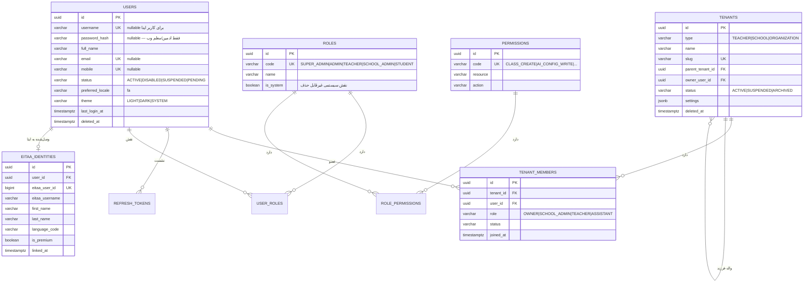
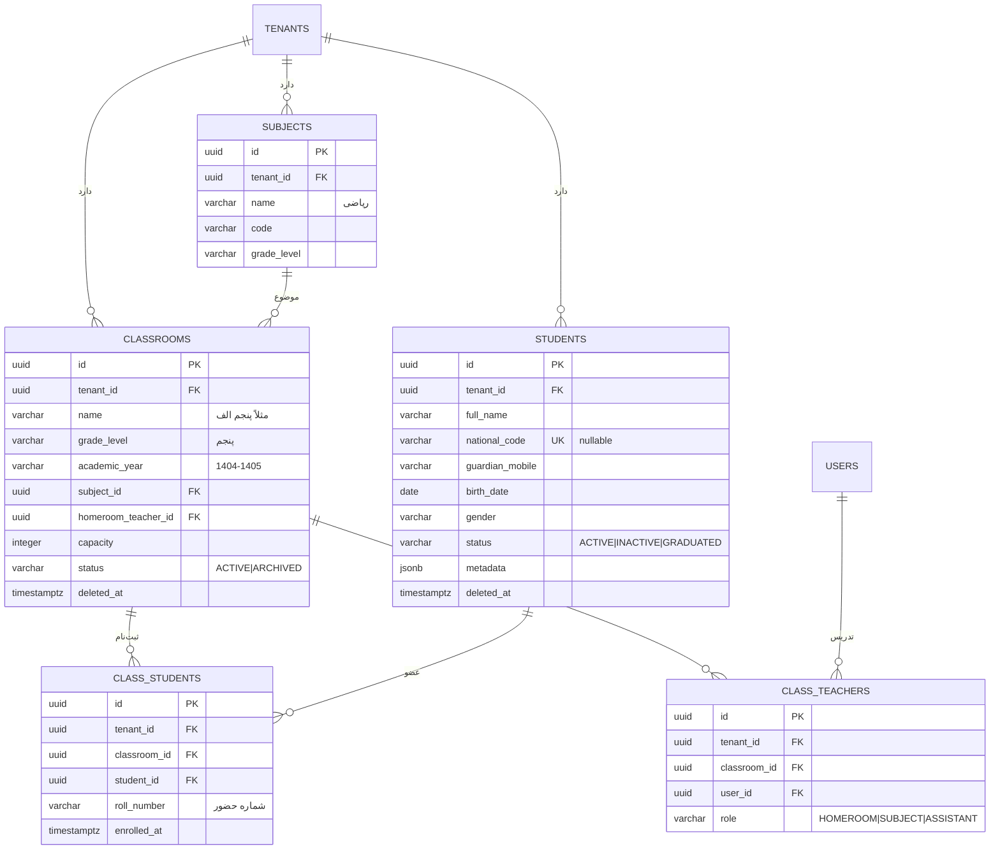
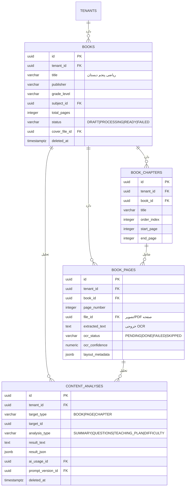
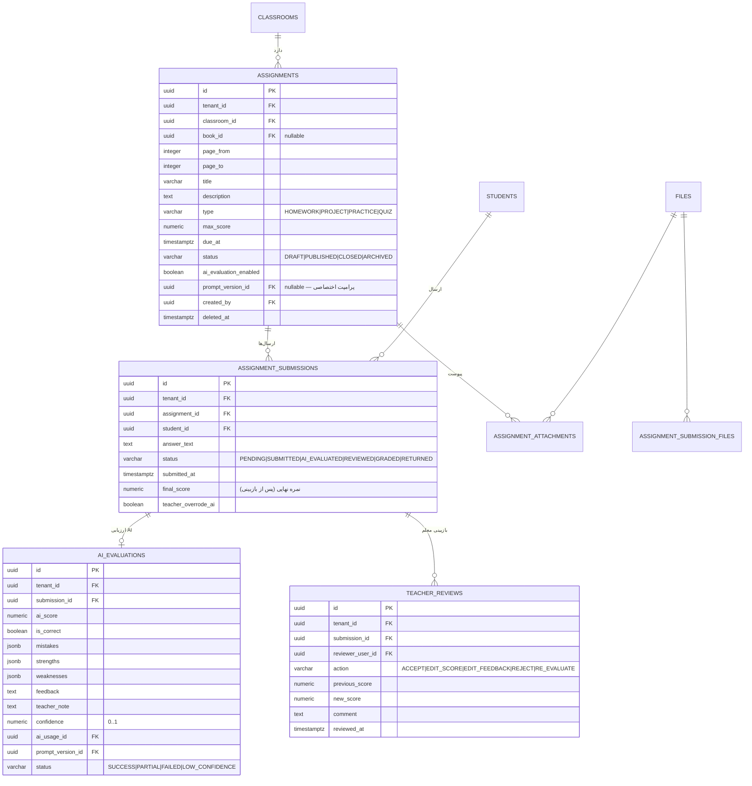
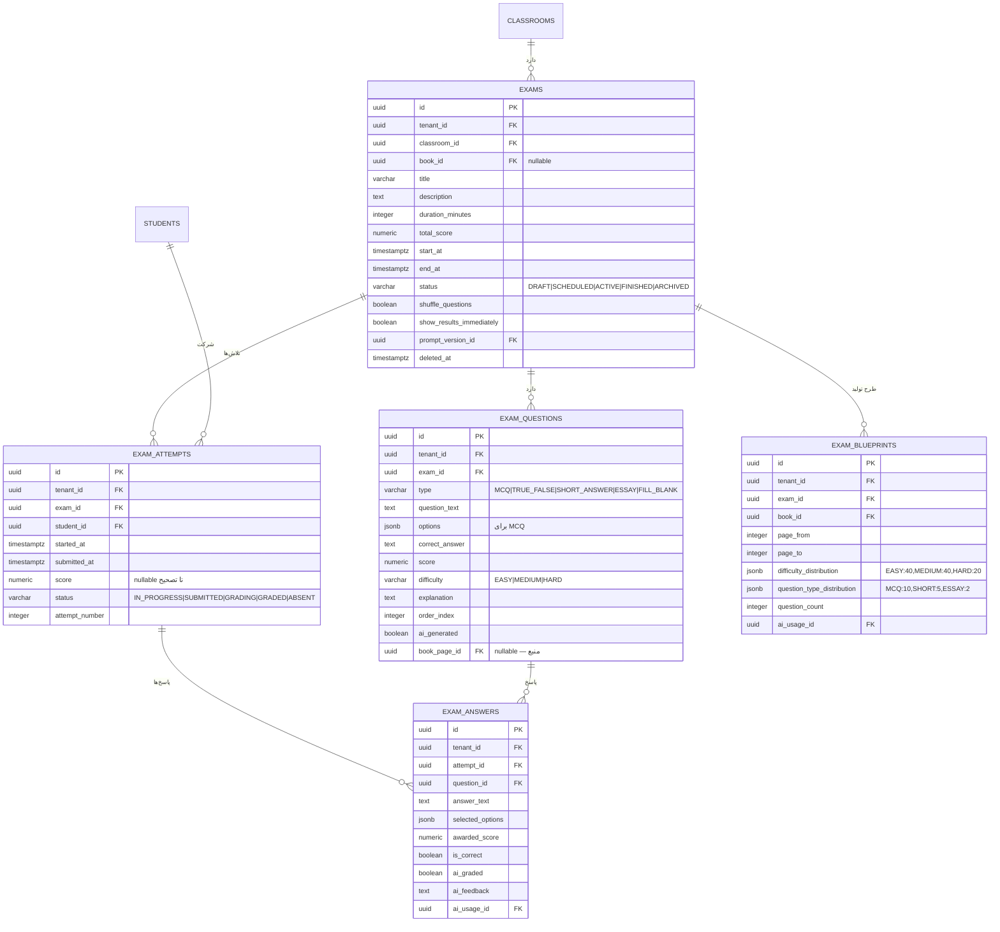
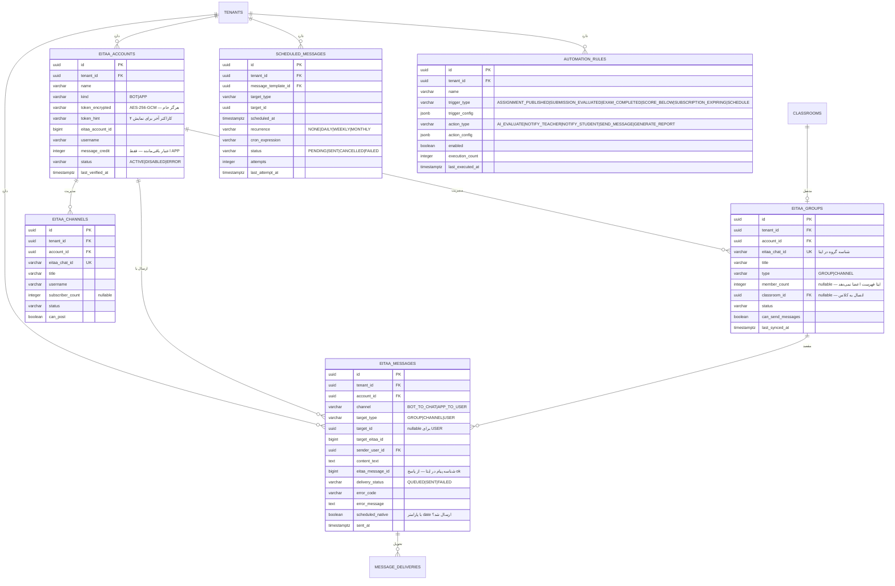
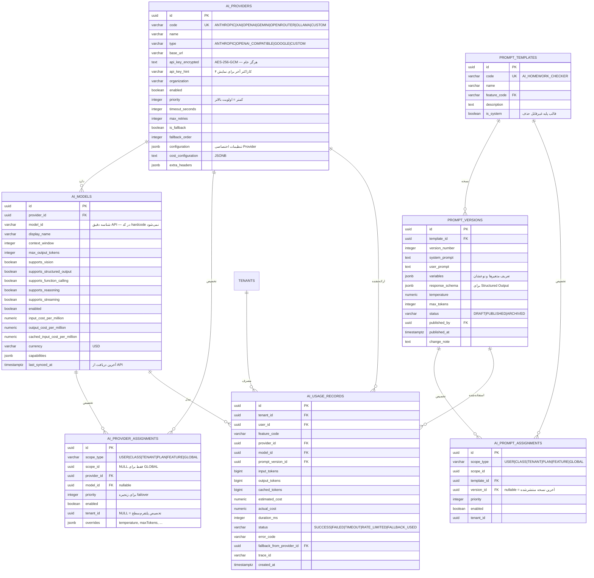

# طراحی دیتابیس و ERD

> بخش B سند طراحی · نسخه 1.0 · PostgreSQL 17

---

## ۱. قواعد عمومی طراحی

| قاعده | تصمیم | دلیل |
|---|---|---|
| کلید اصلی | `UUID` نسخه ۷ (زمان‌مرتب) | جلوگیری از حدس ID (ضد-IDOR)، مرتب‌سازی زمانی، ادغام آسان |
| تولید UUID | در Java (`UuidV7Generator`) | Postgres 17 تابع `uuidv7()` ندارد (در ۱۸ اضافه شد)؛ کنترل کامل در اپ |
| زمان | `TIMESTAMPTZ` | هرگز `TIMESTAMP` بدون منطقه زمانی |
| نام‌گذاری | `snake_case`، جدول جمع | یکدستی با SQL |
| پول | `NUMERIC(19,4)` | هرگز `float`/`double` برای پول |
| ارز | جدول `currencies` + کد ISO-4217 | چندارزی در آینده |
| Enum | `VARCHAR(30)` + `CHECK` یا جدول Lookup | `ENUM` بومی Postgres در Migration دردسر دارد |
| حذف | Soft Delete (`deleted_at`) برای موجودیت‌های دامنه | بازیابی و حسابرسی |
| کلیدهای بیرونی | `ON DELETE RESTRICT` پیش‌فرض | حذف آبشاری تصادفی داده آموزشی فاجعه است |
| JSON | `JSONB` | تنظیمات انعطاف‌پذیر (Provider config، Prompt variables) |
| بهینه‌سازی | `optimistic locking` با `version` | جلوگیری از گم‌شدن به‌روزرسانی همزمان |

### ستون‌های استاندارد هر جدول

```sql
id          UUID        PRIMARY KEY,
created_at  TIMESTAMPTZ NOT NULL DEFAULT now(),
updated_at  TIMESTAMPTZ NOT NULL DEFAULT now(),
created_by  UUID        NULL REFERENCES users(id),
updated_by  UUID        NULL REFERENCES users(id),
version     BIGINT      NOT NULL DEFAULT 0
```

و برای جدول‌های **Tenant-Owned**:

```sql
tenant_id   UUID NOT NULL REFERENCES tenants(id) ON DELETE RESTRICT
```

### ایندکس‌های الزامی

```sql
-- روی هر جدول Tenant-Owned
CREATE INDEX idx_<table>_tenant ON <table>(tenant_id);

-- برای کوئری‌های رایج، ایندکس ترکیبی با tenant_id در ابتدا
CREATE INDEX idx_students_tenant_class ON students(tenant_id, classroom_id);
```

> **قاعده حیاتی:** در جدول‌های Tenant-Owned، `tenant_id` **همیشه اولین ستون** ایندکس ترکیبی است. این هم کارایی را بالا می‌برد و هم جداسازی را در سطح Storage تقویت می‌کند.

---

## ۲. ERD — هویت و مستأجر (Identity & Tenancy)



**نکات:**
- `users` Platform-Owned است — `tenant_id` ندارد. یک کاربر می‌تواند عضو چند مستأجر باشد.
- `eitaa_identities` جداست تا `users` آلوده به جزئیات ایتا نشود و اتصال چند پیام‌رسان (فاز آینده) راحت باشد.
- `roles` و `permissions` جدولی‌اند تا نقش سفارشی در آینده بدون تغییر کد اضافه شود.

---

## ۳. ERD — آموزش (Teaching Domain)



---

## ۴. ERD — کتاب و محتوا (Content)



> **تصمیم طراحی:** `CONTENT_ANALYSES` به‌صورت **چندریختی (polymorphic)** طراحی شده (`target_type` + `target_id`) تا در فاز بعد بتوان تحلیل «فصل» یا «کل کتاب» را بدون جدول جدید اضافه کرد. هزینه: عدم امکان FK واقعی — با `CHECK` و تست پوشش داده می‌شود.

---

## ۵. ERD — تکلیف (Assignment)



> **نکته کلیدی (بخش ۴۰ خواسته‌ها — Human Review):** `TEACHER_REVIEWS` یک **لاگ Append-Only** است. هیچ‌وقت رکورد قبلی overwrite نمی‌شود. `ASSIGNMENT_SUBMISSIONS.final_score` تنها منبع حقیقت نهایی است و `AI_EVALUATIONS.ai_score` فقط پیشنهاد است.

---

## ۶. ERD — آزمون (Exam)



---

## ۷. ERD — ایتا (Eitaa Integration)

> ⚠️ **این بخش پس از راستی‌آزمایی مستندات رسمی ایتا بازنویسی شد** ([`docs/eitaa.md`](eitaa.md) نسخه ۲.۰).
> چون **ایتا هیچ مسیر دریافت پیام ندارد**، جدول `MESSAGE_INBOUND` و فیلدهای Webhook **حذف شدند**.



> ### 🔴 تغییرات نسبت به نسخه ۱.۰
>
> | تغییر | دلیل |
> |---|---|
> | جدول `MESSAGE_INBOUND` **حذف شد** | ایتا مسیر دریافت پیام ندارد |
> | `EITAA_BOTS` → `EITAA_ACCOUNTS` با فیلد `kind` | ایتا **دو نوع حساب** دارد: `BOT` (گروه/کانال) و `APP` (کاربر) |
> | `mode: WEBHOOK\|POLLING` **حذف شد** | هیچ‌کدام وجود ندارند |
> | `webhook_secret_encrypted` **حذف شد** | Webhook وجود ندارد |
> | `direction: INBOUND\|OUTBOUND` **حذف شد** | فقط خروجی وجود دارد |
> | `channel: BOT_TO_CHAT \| APP_TO_USER` **اضافه شد** | دو مسیر ارسال متفاوت با قرارداد متفاوت |
> | تریگر `MESSAGE_RECEIVED` **حذف شد** | ممکن نیست |
> | تریگرهای داخلی **اضافه شدند** | موتور قواعد روی رویدادهای سیستم کار می‌کند |

> `EITAA_GROUPS.eitaa_chat_id` یک **UK سراسری** است نه فقط در سطح مستأجر — چون یک گروه ایتا نمی‌تواند به دو مستأجر تعلق داشته باشد. این یک محدودیت عمدی و یک کنترل ضدسوءاستفاده است.

> ⚠️ **`message_credit` فقط برای `kind=APP` معنا دارد.** ایتا در ساخت هر برنامک **۵۰٬۰۰۰ پیام رایگان** می‌دهد
> و به‌ازای هر پیام به هر کاربر **۱ اعتبار** کسر می‌شود. موجودی از پنل ایتایار **دستی** استعلام و ثبت می‌شود —
> ایتا API استعلام موجودی ندارد. اگر این عدد به آستانه برسد، هشدار به Super Admin می‌رود.

---

## ۸. ERD — AI (Provider / Model / Prompt / Usage)



### نکته امنیتی حیاتی

ستون `api_key_encrypted` با `AttributeConverter` جاوایی رمزنگاری/رمزگشایی می‌شود:

- در Entity به‌صورت `String apiKey` دیده می‌شود، ولی در DB فقط `varbinary` رمزشده ذخیره می‌گردد.
- این فیلد **هرگز** در DTO پاسخ قرار نمی‌گیرد. DTO فقط `apiKeyHint` را برمی‌گرداند.
- `toString()` موجودیت Provider به‌صورت دستی نوشته شده و کلید را حذف می‌کند.
- در `docs/security.md` کامل توضیح داده شده.

---

## ۹. ERD — تجاری (Plan / Subscription / Payment / Wallet)

```mermaid
erDiagram
    PLANS ||--o{ PLAN_FEATURES : "دارد"
    FEATURES ||--o{ PLAN_FEATURES : "در"
    PLANS ||--o{ PLAN_LIMITS : "محدودیت"
    PLANS ||--o{ SUBSCRIPTIONS : "خرید"
    TENANTS ||--o{ SUBSCRIPTIONS : "دارد"
    SUBSCRIPTIONS ||--o{ PAYMENTS : "پرداخت"
    SUBSCRIPTIONS ||--o{ INVOICES : "فاکتور"
    COUPONS ||--o{ COUPON_REDEMPTIONS : "استفاده"
    TENANTS ||--o{ COUPON_REDEMPTIONS : "استفاده‌کننده"
    WALLETS ||--o{ WALLET_TRANSACTIONS : "تراکنش"
    TENANTS ||--o| WALLETS : "دارد"
    TENANTS ||--o{ USAGE_COUNTERS : "مصرف"

    PLANS {
        uuid id PK
        varchar code UK "FREE|BASIC|PRO|SCHOOL|ENTERPRISE"
        varchar name "حرفه‌ای"
        text description
        numeric price
        varchar currency "IRT|USD"
        varchar billing_period "MONTHLY|QUARTERLY|YEARLY|LIFETIME"
        integer trial_days
        boolean is_public "قابل نمایش در اپ"
        boolean is_default "پلن پیش‌فرض ثبت‌نام"
        integer sort_order
        boolean active
    }

    FEATURES {
        uuid id PK
        varchar code UK "AI_CHAT|AI_BOOK_ANALYSIS|..."
        varchar name
        varchar category "AI|EITAA|REPORT|MANAGEMENT"
        text description
        boolean default_enabled
    }

    PLAN_FEATURES {
        uuid id PK
        uuid plan_id FK
        varchar feature_code FK
        boolean enabled
        jsonb config "تنظیمات خاص Feature"
    }

    PLAN_LIMITS {
        uuid id PK
        uuid plan_id FK
        varchar metric "maxStudents|maxClasses|maxAIRequests|..."
        bigint limit_value "-1 = نامحدود"
        varchar period "TOTAL|DAILY|MONTHLY|YEARLY"
    }

    SUBSCRIPTIONS {
        uuid id PK
        uuid tenant_id FK
        uuid plan_id FK
        uuid purchased_by_user_id FK
        varchar status "PENDING|ACTIVE|EXPIRED|CANCELLED|SUSPENDED"
        timestamptz start_date
        timestamptz end_date
        boolean auto_renew
        numeric price_paid
        numeric discount_amount
        uuid coupon_id FK
        uuid previous_subscription_id FK "برای ارتقا/تمدید"
        timestamptz cancelled_at
        text cancellation_reason
    }

    PAYMENTS {
        uuid id PK
        uuid tenant_id FK
        uuid subscription_id FK "nullable"
        uuid invoice_id FK "nullable"
        varchar gateway_code "ZARINPAL|IDPAY|STRIPE|MOCK"
        varchar authority "شناسه درگاه"
        varchar reference_id "شناسه پیگیری"
        numeric amount
        varchar currency
        varchar status "PENDING|SUCCESS|FAILED|REFUNDED|CANCELLED"
        jsonb gateway_response
        timestamptz paid_at
        text failure_reason
    }

    INVOICES {
        uuid id PK
        uuid tenant_id FK
        varchar invoice_number UK "INV-1404-000123"
        uuid subscription_id FK
        numeric subtotal
        numeric discount
        numeric tax
        numeric total
        varchar currency
        varchar status "DRAFT|ISSUED|PAID|VOID|REFUNDED"
        timestamptz issued_at
        timestamptz due_at
        jsonb line_items
    }

    COUPONS {
        uuid id PK
        varchar code UK
        varchar discount_type "PERCENTAGE|FIXED"
        numeric discount_value
        numeric max_discount_amount "سقف برای درصدی"
        numeric min_purchase_amount
        integer usage_limit "کل"
        integer usage_limit_per_tenant
        integer used_count
        timestamptz valid_from
        timestamptz valid_until
        uuid applicable_plan_id FK "nullable = همه پلن‌ها"
        boolean active
    }

    COUPON_REDEMPTIONS {
        uuid id PK
        uuid coupon_id FK
        uuid tenant_id FK
        uuid user_id FK
        uuid subscription_id FK
        numeric discount_applied
        timestamptz redeemed_at
    }

    WALLETS {
        uuid id PK
        uuid tenant_id FK UK
        numeric balance
        varchar currency
        timestamptz updated_at
    }

    WALLET_TRANSACTIONS {
        uuid id PK
        uuid wallet_id FK
        uuid tenant_id FK
        varchar type "CREDIT|DEBIT|REFUND|BONUS|PROMOTIONAL|PURCHASED|ADJUSTMENT"
        numeric amount "مثبت یا منفی"
        numeric balance_after
        varchar reference_type "PAYMENT|SUBSCRIPTION|AI_USAGE|ADMIN_ADJUSTMENT"
        uuid reference_id
        uuid performed_by_user_id FK
        text description
    }

    USAGE_COUNTERS {
        uuid id PK
        uuid tenant_id FK
        uuid user_id FK "nullable — مصرف در سطح مستأجر"
        varchar metric "AI_REQUESTS|AI_TOKENS|MESSAGES|STORAGE_BYTES|..."
        bigint used_value
        bigint limit_value "کپی از پلن در شروع دوره — برای تاریخ‌نگاری"
        timestamptz period_start
        timestamptz period_end
        bigint reserved_value "برای رزرو قبل از عملیات طولانی"
    }
```

> **نکته طراحی `USAGE_COUNTERS`:** ستون `limit_value` **کپی** محدودیت پلن در لحظه شروع دوره است. چرا؟ اگر Admin وسط ماه محدودیت پلن را از ۱۰۰ به ۵۰ تغییر دهد، نباید کاربری که ۸۰ مصرف کرده ناگهان بدهکار شود. تغییر در دوره **بعدی** اعمال می‌شود. این یک تصمیم محصولی مهم است.
>
> ستون `reserved_value` برای عملیات طولانی AI است: قبل از فراخوانی Provider، مقدار تخمینی رزرو می‌شود؛ اگر فراخوانی شکست خورد، آزاد می‌شود. این از Race Condition در درخواست‌های همزمان جلوگیری می‌کند.

---

## ۱۰. ERD — زیرساخت (File / Audit / Notification / Report)

```mermaid
erDiagram
    FILES {
        uuid id PK
        uuid tenant_id FK "nullable برای فایل‌های پلتفرم"
        varchar storage_provider "LOCAL|MINIO|S3"
        varchar storage_key "مسیر ذخیره‌سازی"
        varchar original_filename
        varchar content_type
        bigint size_bytes
        varchar checksum_sha256
        varchar entity_type "BOOK_COVER|ASSIGNMENT_ATTACHMENT|..."
        uuid entity_id
        uuid uploaded_by FK
        varchar scan_status "PENDING|CLEAN|INFECTED|FAILED"
        timestamptz deleted_at
    }

    AUDIT_LOGS {
        uuid id PK
        uuid tenant_id FK "nullable برای رویدادهای پلتفرم"
        uuid actor_user_id FK
        varchar actor_type "USER|SYSTEM|API"
        varchar action "PROVIDER_CREATED|PLAN_PRICE_CHANGED|..."
        varchar entity_type
        uuid entity_id
        jsonb before_state
        jsonb after_state
        jsonb metadata
        varchar ip_address
        varchar user_agent
        varchar trace_id
        varchar severity "INFO|WARNING|CRITICAL"
        timestamptz created_at
    }

    NOTIFICATIONS {
        uuid id PK
        uuid tenant_id FK
        uuid user_id FK
        varchar type "SUBSCRIPTION_EXPIRING|AI_LIMIT_REACHED|..."
        varchar title
        text body
        varchar channel "IN_APP|EITAA|EMAIL|SMS"
        varchar status "PENDING|SENT|READ|FAILED"
        jsonb payload
        timestamptz read_at
        timestamptz created_at
    }

    SYSTEM_SETTINGS {
        uuid id PK
        varchar key UK
        text value
        varchar value_type "STRING|INT|BOOLEAN|JSON"
        varchar category
        boolean encrypted "اگر true، مقدار رمزنگاری‌شده"
        text description
        uuid updated_by FK
        timestamptz updated_at
    }

    SCHEDULER_JOBS {
        uuid id PK
        varchar job_name UK
        varchar job_group
        varchar cron_expression
        varchar status "RUNNING|PAUSED"
        timestamptz last_run_at
        timestamptz next_run_at
        integer last_duration_ms
        varchar last_status "SUCCESS|FAILED"
        text last_error
        integer consecutive_failures
    }

    SUPPORT_TICKETS {
        uuid id PK
        uuid tenant_id FK
        uuid user_id FK
        varchar subject
        text description
        varchar priority "LOW|NORMAL|HIGH|URGENT"
        varchar status "OPEN|IN_PROGRESS|ANSWERED|CLOSED"
        uuid assigned_to FK
        timestamptz closed_at
    }
```



---

## ۱۱. جداول اتصالی (Junction) — فهرست کامل

| جدول | طرفین | توضیح |
|---|---|---|
| `tenant_members` | users ↔ tenants | با `role` |
| `user_roles` | users ↔ roles | نقش پلتفرم‌سطح |
| `role_permissions` | roles ↔ permissions | |
| `class_students` | classrooms ↔ students | با `roll_number` |
| `class_teachers` | classrooms ↔ users | با `role` |
| `book_chapters` ↔ `book_pages` | از طریق `book_id` + بازه صفحه | |
| `assignment_attachments` | assignments ↔ files | |
| `assignment_submission_files` | submissions ↔ files | |
| `plan_features` | plans ↔ features | |
| `coupon_redemptions` | coupons ↔ tenants | |

---

## ۱۲. استراتژی Migration (Flyway)

```text
backend/src/main/resources/db/migration/
├── V1__baseline_extensions_and_helpers.sql
├── V2__identity_and_tenancy.sql
├── V3__roles_and_permissions.sql
├── V4__features_and_plans.sql
├── V5__subscriptions_payments_wallet.sql
├── V6__ai_providers_models.sql
├── V7__prompt_templates_versions.sql
├── V8__ai_usage_and_assignments.sql
├── V9__classrooms_students.sql
├── V10__books_and_pages.sql
├── V11__assignments_and_submissions.sql
├── V12__exams.sql
├── V13__eitaa_bots_groups_channels.sql
├── V14__messages_and_automation.sql
├── V15__files_audit_notifications.sql
├── V16__usage_counters.sql
├── V17__seed_roles_permissions_features.sql
├── V18__seed_default_plans.sql
└── V19__seed_default_prompts.sql
```

### وضعیت واقعی پیاده‌سازی (پایان گام ۱ فاز ۳)

⚠️ **فهرست بالا نقشه راه است، نه وضعیت فعلی.** فاز ۱ پنج Migration نخست را
ساخت و **شماره‌گذاری دو مورد جابه‌جا شد**؛ فازهای ۲ و ۳ هم Migrationهای
خودشان را با همان قاعده «بزرگ‌ترین شماره موجود + ۱» ساختند:

| فایل واقعی | وضعیت | جدول‌ها و اشیای ساخته‌شده |
|---|---|---|
| `V1__baseline_extensions_and_helpers.sql` | ✅ ساخته شد | افزونه‌های `pgcrypto` و `pg_trgm` · تابع `set_updated_at()` |
| `V2__identity_and_tenancy.sql` | ✅ ساخته شد | `users`, `tenants`, `tenant_members`, `eitaa_identities` + تریگرهای `updated_at` |
| `V3__roles_and_permissions.sql` | ✅ ساخته شد | `roles`, `permissions`, `role_permissions`, `user_roles` |
| `V4__refresh_tokens.sql` | ✅ ساخته شد | `refresh_tokens` — **در نقشه راه نبود** |
| `V5__audit_and_settings.sql` | ✅ ساخته شد | `audit_logs`, `system_settings`, `scheduler_jobs` + تابع `prevent_audit_mutation()` — **در نقشه راه نبود** |
| `V6__event_publication_registry.sql` | ✅ ساخته شد | جدول رجیستری Spring Modulith (`event_publication`) — **در نقشه راه نبود** |
| `V7__eitaa_write_access.sql` | ✅ ساخته شد | `eitaa_write_access` — نتیجه تأیید دسترسی نوشتن ربات (گام ۱ فاز ۲) |
| `V8__subjects_and_classrooms.sql` | ✅ ساخته شد | `subjects`, `classrooms` + کلید خارجی ترکیبی و ایندکس‌های جزئی (گام ۱ فاز ۳) — **در نقشه راه نبود** |
| `V9__fix_classroom_search_index.sql` | ✅ ساخته شد | اصلاح ایندکس تری‌گرام: `gin (name)` ← `gin (lower(name))` — **V8 را ویرایش نکردیم، به حکم قاعده ۱ پایین** |
| `V10__students_and_enrollment.sql` | ✅ ساخته شد | `students`, `class_students` + `uk_classrooms_tenant_id` (گام ۲ فاز ۳) |
| `V11__admin_password_hash_capacity.sql` | ✅ ساخته شد | ظرفیت هش رمز ادمین |
| `V12__files_and_books.sql` | ✅ ساخته شد | `files`, `books`, `book_chapters`, `book_pages` (گام ۱ فاز ۶) — **شماره نقشه راه V10 بود** |
| `V13__ai_providers_models_usage.sql` | ✅ ساخته شد | `ai_providers`, `ai_models`, `ai_usage_records` (گام ۱ فاز ۵) |
| `V14__features_and_overrides.sql` | ✅ ساخته شد | `features`, `feature_overrides` (فاز ۴) |
| `V15__assignments_and_submissions.sql` | ✅ ساخته شد | `assignments`, `assignment_submissions`, stub `ai_evaluations` (گام ۱ فاز ۷) — **شماره نقشه راه V11 بود** |
| `V16__exams.sql` | ✅ ساخته شد | آزمون‌ها (فاز ۸ گام ۱) |
| `V17__eitaa_groups_and_scheduled_messages.sql` | ✅ ساخته شد | گروه/پیام زمان‌بندی ایتا (فاز ۹) |
| `V18__plans_subscriptions_invoices.sql` | ✅ ساخته شد | پلن، اشتراک، فاکتور + seed (فاز ۱۰ گام ۱) |
| `V19__report_aggregation_indexes.sql` | ✅ ساخته شد | ایندکس تجمیع گزارش/نمودار (فاز ۱۱ گام ۱) |
| `V20__ai_provider_assignments.sql` | ✅ ساخته شد | `ai_provider_assignments` (فاز ۵ — ProviderResolver) |
| `V21__prompts.sql` | ✅ ساخته شد | `prompts` / `prompt_versions` / `prompt_assignments` + seed `AI_CHAT_SYSTEM` |
| `V22__content_analyses_and_storage.sql` | ✅ ساخته شد | `content_analyses` + سقف اختیاری `storageBytes` (فاز ۶ گام ۲) |
| `V23__ai_evaluations_and_teacher_reviews.sql` | ✅ ساخته شد | گسترش `ai_evaluations` + `teacher_reviews` Append-Only (فاز ۷ گام ۲) |
| `V24__exam_blueprints.sql` | ✅ ساخته شد | طرح تولید آزمون (فاز ۸ گام ۲) |
| `V25__eitaa_channels_automation.sql` | ✅ ساخته شد | کانال · automation_rules · message_credits (فاز ۹ گام ۲) |
| `V26__billing_coupons_wallets_plan_features.sql` | ✅ ساخته شد | کوپن/کیف‌پول/ویژگی پلن (فاز ۱۰) |

> **⚠️ چرا V9 به‌جای ویرایش V8؟** ایندکس تری‌گرامی که V8 ساخته بود روی
> `name` خام بود، ولی کوئری `lower(name) like :pattern` است و پستگرس آن
> دو را به هم نگاشت نمی‌کند. ایندکس هرگز انتخاب نمی‌شد — با `EXPLAIN` و
> `enable_seqscan = off` هم پلن `Seq Scan` ماند. V8 در دیتابیس توسعه
> اعمال شده بود، پس طبق قاعده ۱ ویرایشش checksum را می‌شکست؛ V9 همان
> ایندکس را `DROP` و درستش را می‌سازد. تست
> `searchIndexMatchesTheQueryExpression` این را قفل می‌کند.

**چرا فاز ۱ جابه‌جا شد؟** فاز ۱ به این دو جدول نیاز واقعی داشت: بدون `refresh_tokens`
چرخه احراز هویت کامل نمی‌شود، و بدون `audit_logs` رویدادهای امنیتی
(`SecurityAuditLog`) جایی برای نوشتن ندارند. جدول‌های Feature/Plan/Subscription
به فازهای ۴ و ۱۰ موکول شدند.

```text
⇒ شماره‌گذاری واقعی با نقشه راه بالا هم‌راستا نشد و مهم هم نیست:
   Flyway تنها ترتیب عددی را می‌خواند، نه نام را.

⇒ ردیف‌های V4 به بعد در نقشه راه بالا دیگر معتبر نیستند.
   عدد درست همیشه «بزرگ‌ترین عدد موجود + ۱» است.
```

> **⚠️ این جابه‌جایی عمداً اینجا ثبت شد.** قاعده ۱ پایین می‌گوید Migration
> اجراشده ویرایش نمی‌شود؛ اگر این اختلاف ثبت نمی‌شد، نفر بعدی فهرست نقشه راه
> را می‌خواند و `V6__ai_providers_models.sql` را می‌ساخت — در حالی که
> `V6` باید جدول‌های Feature/Plan را بسازد. یک Migration با شماره تکراری
> یا نام بی‌ربط، مهاجرت production را می‌شکند.

### قواعد Migration

1. **هرگز Migration اجراشده را ویرایش نکن.** برای تغییر، Migration جدید بساز.
2. **Migrationها در `prod` باید Backward-Compatible باشند** (چند ثانیه Downtime قابل قبول است، ولی داده نباید از دست برود).
3. **Seed داده‌های سیستمی** (`roles`, `permissions`, `features`, پلن FREE، پرامپت‌های پایه) در Migration انجام می‌شود — نه در کد — چون بخشی از Schema منطقی است.
4. **داده‌های نمایشی (Demo)** هرگز در Migration نیستند؛ در `scripts/demo-data.sql` جداگانه‌اند.
5. برای تغییرات مخرب (حذف ستون)، الگوی **Expand-Contract** در دو Release:
   - Release N: ستون جدید اضافه، هر دو نوشته شوند
   - Release N+1: کد از ستون قدیم استفاده نکند
   - Release N+2: ستون قدیم حذف شود

### Migration پایه — افزونه‌ها و توابع کمکی

```sql
-- V1__baseline_extensions_and_helpers.sql
CREATE EXTENSION IF NOT EXISTS "pgcrypto";
CREATE EXTENSION IF NOT EXISTS "pg_trgm";   -- جست‌وجوی متنی فارسی

-- تریگر به‌روزرسانی updated_at
CREATE OR REPLACE FUNCTION set_updated_at()
RETURNS TRIGGER AS $$
BEGIN
    NEW.updated_at = now();
    NEW.version = OLD.version + 1;
    RETURN NEW;
END;
$$ LANGUAGE plpgsql;
```

> **نکته:** از `uuid-ossp` استفاده نمی‌کنیم چون UUID v7 در آن نیست و ما UUID را در Java تولید می‌کنیم. `pgcrypto` فقط برای توابع کمکی و شاید `gen_random_bytes` لازم است.

---

## ۱۳. اندازه‌گیری و نگهداشت

| جدول | نرخ رشد تخمینی | استراتژی |
|---|---|---|
| `ai_usage_records` | بسیار بالا (هر درخواست AI) | Partition ماهانه در فاز ۱۲ + آرشیو پس از ۱۲ ماه |
| `messages` | بالا | آرشیو پس از ۶ ماه |
| `audit_logs` | متوسط | نگهداری ۲۴ ماه، سپس آرشیو سرد |
| `notifications` | بالا | حذف خوانده‌شده‌های قدیمی‌تر از ۹۰ روز |
| `usage_counters` | پایین | نگهداری دائمی (سابقه مصرف) |
| `exam_answers` | متوسط | همراه آزمون |

این‌ها در فاز اول فقط **مستند** می‌شوند و در فاز ۱۲ پیاده‌سازی می‌گردند. اما ایندکس‌های لازم از ابتدا ساخته می‌شوند تا مهاجرت دردناک نباشد.
