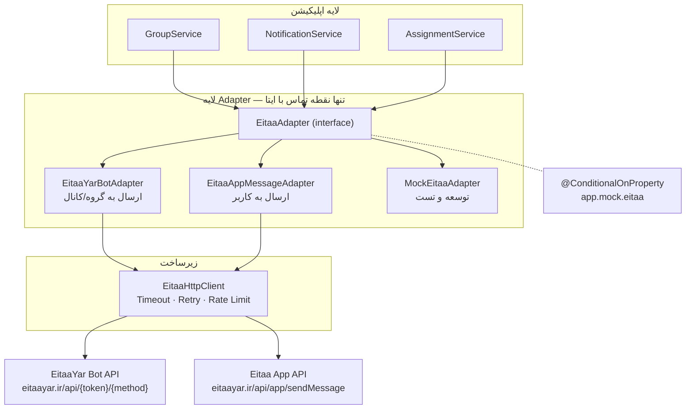
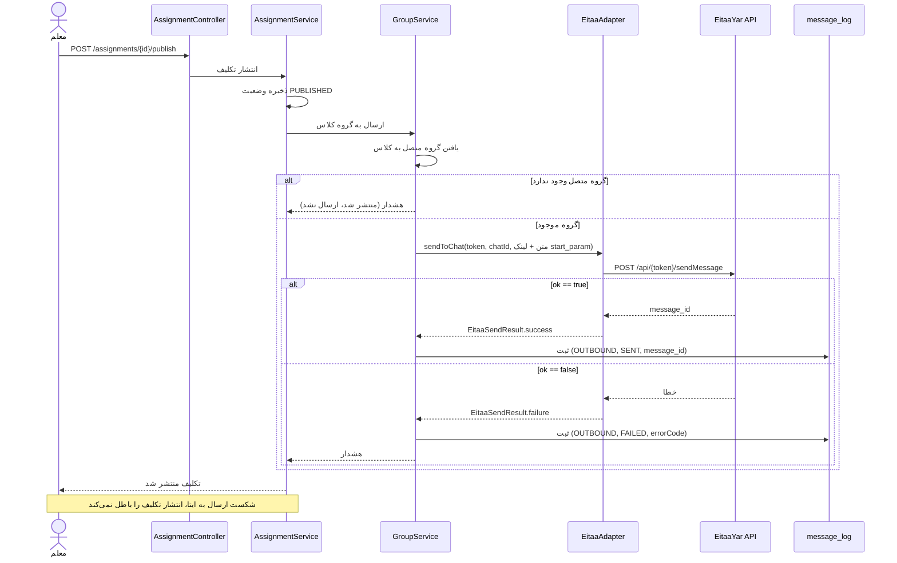

# یکپارچه‌سازی با ایتا

> بخش H، ۲، ۴۲، ۴۳ خواسته‌ها · نسخه **۲.۰** · آخرین راستی‌آزمایی مستندات: 2026-09-28

---

## ۰. وضعیت راستی‌آزمایی — قبل از هر چیز بخوانید

طبق قانون بخش ۷۳ خواسته‌ها («حدس نزن»)، این سند هر ادعا را دسته‌بندی می‌کند:

| نشان | معنا |
|---|---|
| ✅ **تأییدشده** | مستقیماً از مستندات رسمی ایتا خوانده شده — با ذکر منبع |
| ⚠️ **نیازمند تأیید** | مستندات ساکت است — **قبل از Production باید با آزمون واقعی تأیید شود** |
| ❌ **پشتیبانی‌نشده** | مستندات صریحاً یا ضمناً نشان می‌دهد وجود ندارد — **Fake نمی‌شود** |

> ### 🔴 تغییر مهم نسخه ۲.۰
>
> نسخه ۱.۰ این سند، دریافت پیام ورودی (Webhook / Long-Polling) را طراحی کرده بود.
> **راستی‌آزمایی مستندات رسمی نشان داد این قابلیت وجود ندارد.**
>
> **Bot API ایتا فقط ۳ متد دارد: `getMe`، `sendMessage`، `sendFile`.**
> نه `getUpdates`، نه `setWebhook`، نه هیچ مسیر ورودی دیگری.
> **ربات ایتا فقط می‌فرستد؛ نمی‌شنود.**
>
> طراحی «دریافت Update» به‌طور کامل حذف شد (بخش ۶). پیامدهای محصولی آن در بخش ۱۱ آمده است.

---

## ۱. معماری لایه ایتا



**قاعده آهنین:** هیچ سرویسی مستقیماً با HTTP به ایتا حرف نمی‌زند. همه از `EitaaAdapter` عبور می‌کنند.

---

## ۲. ✅ Mini App — راستی‌آزمایی‌شده

### ۲.۱ اسکریپت SDK

```html
<script src="https://developer.eitaa.com/eitaa-web-app.js"></script>
```

> ✅ **منبع:** `developer.eitaa.com/docs/Develop/JsSDK/`
>
> ⚠️ **الزام مستندات:** این فایل باید **مستقیماً از آدرس رسمی** بارگذاری شود.
> **دانلود و Self-host کردن آن ممنوع است** — به‌دلیل از دست رفتن به‌روزرسانی‌های امنیتی و ناهمخوانی با کلاینت.
> اسکریپت باید در `<head>` و **پیش از هر اسکریپت دیگری** قرار گیرد.

### ۲.۲ شیء Global

```javascript
window.Eitaa.WebApp.initData        // ← رشته خام برای اعتبارسنجی سمت سرور
window.Eitaa.WebApp.initDataUnsafe  // ← شیء — هرگز به آن اعتماد نکنید
```

> ✅ **تأییدشده:** شیء Global **`window.Eitaa.WebApp`** است.
> (در نسخه ۱.۰ به‌اشتباه `window.EitaaWebApp` حدس زده شده بود — اصلاح شد.)

### ۲.۳ 🔴 محدودیت پلتفرم — بسیار مهم

> ✅ **منبع:** `developer.eitaa.com/docs/QuickStart/`
>
> «برنامه‌ها و برنامک‌ها در حال حاضر فقط از طریق نسخه **اندروید** و **نسخه دسکتاپ (ویندوز)** ایتا قابل اجرا هستند.
> نسخه **iOS** یا **مرورگرهای دیگر** پشتیبانی نمی‌شوند.»

**پیامدهای محصولی — باید در Mini App و مستندات کاربر دیده شود:**

| پیامد | اقدام |
|---|---|
| کاربر iPhone نمی‌تواند Mini App را باز کند | پیام فارسی روشن در لینک: «این برنامه در نسخه اندروید و ویندوز ایتا قابل استفاده است» |
| وب‌پیام‌رسان ایتا پشتیبانی نمی‌شود | بنر اطلاع‌رسانی |
| **iOS: مسیر جایگزین لازم است** | معلم iOS می‌تواند از **ربات ایتا** برای ارسال تکلیف استفاده کند؛ ولی مدیریت از Mini App ممکن نیست (بخش ۱۱.۳) |

> ⚠️ **نیازمند پایش مستمر:** این محدودیت ممکن است در آینده برداشته شود.
> اسکریپت `scripts/check-eitaa-docs.sh` (بخش ۱۵) باید این صفحه را دوره‌ای بررسی کند.

### ۲.۴ الزامات فنی اجرا

| الزام | مقدار | منبع |
|---|---|---|
| پروتکل | **HTTPS اجباری** | `ArchitectureOverview` + `FAQ` |
| Redirect | **ممنوع** — آدرس نهایی خودِ اپ باشد | `QuickStart` |
| تست محلی | `localhost` با HTTPS مجاز است | `FAQ` |
| نصب | ندارد — از WebView باز می‌شود | `FAQ` |

### ۲.۵ فیلدهای `initData` ✅

| فیلد | نوع | توضیح | فقط برنامک؟ |
|---|---|---|---|
| `query_id` | String | شناسه یکتای جلسه | — |
| `user` | JSON (URL-encoded) | `id`, `first_name`, `last_name`, `language_code`, `allows_write_to_pm` | — |
| `chat_type` | String | `private` \| `group` \| `channelOrSupergroup` | ✅ |
| `chat_instance` | String | شناسه یکتای گفتگو | ✅ |
| `start_param` | String | پارامتر شروع — **برای Deep Link** | ✅ |
| `auth_date` | Integer | یونیکس تایم زمان باز شدن فرم | — |
| `device_id` | String | شناسه یکتای دستگاه+حساب | — |
| `hash` | String | امضای HMAC — **خودش جزء داده امضاشده نیست** | — |

> ⚠️ **نکته حیاتی `user.id`:** مستندات صریح می‌گوید این عدد ممکن است تا **۵۲ بیت** اهمیت داشته باشد.
> در Java از `Long` استفاده کنید، **هرگز از `Integer`** — وگرنه شناسه کاربر بی‌صدا خراب می‌شود.

> 💡 **`start_param` فرصت مهمی است:** با لینک `https://eitaa.com/<bot>?startapp=asg_123`
> کاربر مستقیم داخل **تکلیف شماره ۱۲۳** فرود می‌آید. این تنها مسیر Deep Link واقعی در ایتا است
> و جایگزین «دکمه شیشه‌ای» می‌شود که ایتا ندارد. در فاز ۹ استفاده می‌شود.

> 🔴 **قرارداد رمزگشایی — که در فاز ۲ لو رفت و اصلاح شد:**
> `initData` ذاتاً یک پرس‌وجوی URL است، پس **همه** مقادیرش percent-encoded سفر می‌کنند.
> دو مقدار اما **رشته معنادار** هستند و باید یک‌بار رمزگشایی شوند: `user`
> (که جدول بالا صریحاً «URL-encoded» می‌نامدش) و `start_param`.
> اگر `start_param` رمزگشایی نشود، `cls_1&exm_2` به `cls_1%26exm_2` تبدیل می‌شود و
> **هرگز با هیچ شناسه‌ای جور نمی‌شود** — یک Deep Link بی‌صدا خراب، بدون هیچ خطا یا لاگی.
>
> ⚠️ **رمزگشایی فقط پس از بررسی امضا.** `data_check_string` از مقادیر **خام و
> رمزگشایی‌نشده** ساخته می‌شود (همان چیزی که ایتا امضا کرده)؛ رمزگشایی پیش از امضا
> اعتبارسنجی را *همیشه* شکست می‌دهد.
>
> ⚠️ **پارامترهای دیگر رمزگشایی نمی‌شوند** (`query_id`, `chat_type`, `device_id`,
> `chat_instance`) — هیچ‌کدام به‌عنوان رشته قابل‌تفسیر مصرف نمی‌شوند و رمزگشایی
> بی‌دلیل، سطح حمله را بی‌جهت باز می‌کند.
>
> ⚠️ **اگر رمزگشایی `start_param` شکست بخورد، ورود رد نمی‌شود** — برخلاف `user`.
> `user` هویت را حمل می‌کند؛ `start_param` فقط میان‌بر راحتی است. خراب بودن یک لینک
> نباید جلوی ورود معلم را بگیرد. (پیاده‌سازی: `EitaaInitDataValidator.parseStartParam`)

---

## ۳. ✅ مرجع کامل SDK — راستی‌آزمایی‌شده

> **منبع:** `developer.eitaa.com/docs/Develop/JsSDK/`
> این جدول **کامل** است — همه چیزهایی که SDK ایتا دارد.

### ۳.۱ داده و وضعیت

| عضو | نوع | توضیح |
|---|---|---|
| `initData` | String | داده خام — **اعتبارسنجی حتماً در سرور** |
| `initDataUnsafe` | Object | **قابل اعتماد نیست** |
| `version` | String | نسخه SDK |
| `platform` | String | پلتفرم ایتای کاربر |
| `colorScheme` | String | `light` \| `dark` — در CSS: `var(--tg-color-scheme)` |
| `themeParams` | Object | تم فعلی — در CSS: `var(--tg-theme-*)` |
| `isExpanded` / `isActive` / `isFullscreen` | Boolean | وضعیت نمایش |
| `isOrientationLocked` / `isVerticalSwipesEnabled` | Boolean | v1.3 |
| `viewportHeight` / `viewportStableHeight` | Float | ارتفاع — در CSS: `var(--tg-viewport-*)` |
| `safeAreaInset` / `contentSafeAreaInset` | Object | در CSS: `var(--tg-safe-area-inset-*)` |
| `headerColor` / `backgroundColor` / `bottomBarColor` | String | `#RRGGBB` |

### ۳.۲ کنترل‌های UI

| عضو | نوع | توضیح |
|---|---|---|
| `MainButton` | BottomButton | دکمه اصلی پایین صفحه |
| `SecondaryButton` | BottomButton | دکمه ثانویه (v1.3) |
| `BackButton` | BackButton | دکمه برگشت در هدر — `show()` / `hide()` / `onClick(cb)` |
| `SettingsButton` | SettingsButton | آیتم تنظیمات در منوی زمینه |
| `HapticFeedback` | HapticFeedback | `impactOccurred(style)` · `notificationOccurred(type)` · `selectionChanged()` |

> ✅ **`HapticFeedback` واقعاً وجود دارد** — نسخه ۱.۰ آن را مشکوک علامت زده بود. اکنون تأییدشده است.

### ۳.۳ توابع

| تابع | کاربرد در پروژه ما |
|---|---|
| `ready()` | **الزامی** — پنهان کردن لودینگ |
| `expand()` | بزرگ کردن به تمام ارتفاع (Android only) |
| `close()` | بستن برنامک |
| `onEvent(type, handler)` / `offEvent(type, handler)` | رویدادها (`backButtonClicked`, `viewportChanged`, `popupClosed`, `qrTextReceived`) |
| `isVersionAtLeast(v)` | **مهم** — Feature Detection قبل از استفاده |
| `openLink(url[, opts])` | باز کردن لینک خارجی (فقط در پاسخ به تعامل کاربر) |
| `openEitaaLink(url)` | باز کردن لینک **داخل** ایتا |
| `showAlert(msg[, cb])` | هشدار ساده |
| `showConfirm(msg[, cb])` | تأیید (callback با Boolean) |
| `showPopup(params[, cb])` | پاپ‌آپ تا ۳ دکمه |
| `setHeaderColor` / `setBackgroundColor` / `setBottomBarColor` | رنگ‌آمیزی |
| `enableClosingConfirmation()` / `disableClosingConfirmation()` | تأیید قبل از بستن — **برای جلوگیری از از دست رفتن فرم نیمه‌کاره** |
| `enableVerticalSwipes()` / `disableVerticalSwipes()` | Android only |
| **`requestWriteAccess([cb])`** | **🔑 کلیدی — اجازه ارسال پیام به کاربر** (بخش ۵.۲) |
| **`requestContact([cb])`** | **🔑 دریافت شماره تلفن کاربر با hash قابل اعتبارسنجی** |
| `showScanQrPopup(params[, cb])` / `closeScanQrPopup()` | Android only |
| `downloadFile(params)` | v1.4 — Android only |
| `addToHomeScreen()` / `checkHomeScreenStatus` | Android only |
| `lockOrientation()` / `unlockOrientation()` | Android only |
| `requestFullScreen` / `exitFullScreen` | v1.3 |

### ۳.۴ رویدادهای قابل استفاده

```text
backButtonClicked      settingsButtonClicked    viewportChanged
themeChanged           popupClosed              qrTextReceived
mainButtonClicked      secondaryButtonClicked   invoiceClosed
```

### ۳.۵ ⚠️ موارد نیازمند تأیید

| مورد | وضعیت | رویکرد ما |
|---|---|---|
| `BottomButton` — متدهای دقیق (`setText`, `enable`, `disable`, `showProgress`) | ⚠️ در سند اصلی آمده ولی کامل خوانده نشد | `isVersionAtLeast()` + Fallback به دکمه HTML داخلی |
| متغیر CSS `--tg-theme-*` — پوشش در همه نسخه‌ها | ⚠️ | فقط از متغیرهای مستندشده استفاده می‌کنیم؛ بقیه Fallback |
| رفتار `start_param` در همه انواع لینک | ⚠️ | تست دستی در فاز ۲ |

> **قاعده:** هر متد SDK فقط پس از `isVersionAtLeast()` فراخوانی می‌شود. اگر موجود نبود، **Fallback خودمان** اجرا می‌شود — نه اینکه به وجود آن تکیه کنیم.

---

## ۴. ✅ Bot API ایتایار — راستی‌آزمایی‌شده

> **منبع:** «راهنمای رابط برنامه‌نویسی ایتایار» — سند رسمی PDF (نسخه آزمایشی)
> ⚠️ این سند خود را «نسخه آزمایشی» معرفی می‌کند. API ممکن است بدون اطلاع تغییر کند.

### ۴.۱ قالب آدرس

```text
https://eitaayar.ir/api/{TOKEN}/{METHOD_NAME}
```

| ویژگی | مقدار |
|---|---|
| `TOKEN` | توکن ربات از پنل ایتایار |
| `METHOD_NAME` | **حساس به بزرگی/کوچکی حروف نیست** (case-insensitive) |
| متدهای HTTP | `GET` و `POST` — هر دو |
| قالب پارامتر | `query string` · `application/json` · `x-www-form-urlencoded` · `multipart/form-data` |
| آزمون سریع | `https://eitaayar.ir/testApi` |

### ۴.۲ 🔴 قاعده طلایی پاسخ

> **اولین پارامتر هر پاسخ JSON، `ok` است.** مقدار `true` = موفق، `false` = خطا.
> **همیشه ابتدا `ok` را بررسی کنید.** اگر `true` نبود، درخواست را اصلاح و دوباره ارسال کنید.

```java
// این چک هرگز نباید فراموش شود
if (!response.path("ok").asBoolean(false)) {
    throw EitaaApiException.from(response);
}
```

### ۴.۳ 🔴 فهرست کامل متدها — فقط سه متد

| # | متد | کار |
|---|---|---|
| ۱ | `getMe` | اطلاعات ربات — بدون پارامتر |
| ۲ | `sendMessage` | ارسال پیام متنی |
| ۳ | `sendFile` | ارسال فایل/عکس/ویدیو/گیف/استیکر |

> ❌ **وجود ندارند:** `getUpdates` · `setWebhook` · `deleteMessage` · `editMessageText` ·
> `getChat` · `getChatMembersCount` · `getChatAdministrators` · `sendPoll` · `pinChatMessage` ·
> `setChatTitle` · `InlineKeyboard` · `CallbackQuery`
>
> **هیچ‌کدام در مستندات رسمی نیستند. پس وجود ندارند و Fake نمی‌شوند.**

### ۴.۴ `getMe`

```json
{ "ok": true,
  "result": { "id": 112233, "is_bot": true,
              "first_name": "ایتایار", "last_name": "eitaayar",
              "username": "testAdmin" } }
```

### ۴.۵ `sendMessage`

| پارامتر | اجباری | توضیح |
|---|---|---|
| `chat_id` | ✅ | شناسه کانال یا گروه · یا `username` بدون `@` |
| `text` | ✅ | متن پیام |
| `title` | — | فقط در پنل کاربرد دارد (جستجو/نمایش) |
| `disable_notification` | — | `1` = بدون اعلان |
| `reply_to_message_id` | — | پاسخ به پیام دیگر |
| **`date`** | — | **Unix Timestamp — ارسال زمان‌بندی‌شده!** |
| `pin` | — | `1` = سنجاق پس از ارسال |
| `viewCountForDelete` | — | حذف خودکار پس از N بازدید |

> 💡 **`date` یعنی ایتا خودش زمان‌بندی بومی دارد.** این در فاز ۹ استفاده می‌شود —
> ولی ما **همچنان** Scheduler خودمان را می‌سازیم (برای نمایش در UI، لغو، و گزارش).
> زمان‌بندی بومی به‌عنوان **لایه دوم اطمینان** به کار می‌رود، نه جایگزین.

> 💡 **`pin` روی کانال/گروه** یعنی می‌توانیم تکلیف فعال را سنجاق کنیم.
> ❌ ولی `pinChatMessage` برای سنجاق **پیام دلخواه** وجود ندارد — فقط پیام همان ارسال.

> 💡 **`viewCountForDelete`** برای حریم خصوصی آزمون مفید است: پیام حاوی لینک آزمون
> پس از N بازدید خودش پاک می‌شود.

پاسخ موفق:

```json
{ "ok": true,
  "result": { "message_id": 85917,
              "from": { "id": 112233, "is_bot": true, "username": "testAdmin" },
              "chat": { "id": 112233, "type": "public", "username": "eitaa" },
              "date": 1560849434,
              "text": "پیام ارسالی" } }
```

> **نکته مهم:** `message_id` برمی‌گردد — پس **می‌توانیم ارسال را ردیابی کنیم**. این برای `message_log` ضروری است.

### ۴.۶ `sendFile`

| پارامتر | اجباری | توضیح |
|---|---|---|
| `file` | ✅ | فایل — در `multipart/form-data` |
| `caption` | — | **جای `text`** — متن همراه فایل |
| بقیه | — | همانند `sendMessage` |

**قواعد ویژه فرمت:**

| هدف | قاعده |
|---|---|
| ارسال **گیف** | پسوند فایل را به `.gif` تغییر دهید (`sample.mp4` → `sample.gif`) |
| ارسال **استیکر** | پسوند فایل را به `.webp` تغییر دهید (`sample.png` → `sample.webp`) |

> ⚠️ **ابهام مستندات:** فهرست ابتدای سند متد سوم را `sendDocument` می‌نامد،
> ولی شرح کامل آن را `sendFile` می‌گوید. **در فاز ۲ هر دو نام آزموده می‌شود** و
> نام صحیح در `EitaaProperties` ثابت می‌شود. تا آن زمان `EitaaCapability.SEND_FILE`
> با نام قابل‌تنظیم کار می‌کند.

---

## ۵. 🔑 دو مسیر ارسال — تفاوت حیاتی

ایتا **دو API ارسال جداگانه** دارد. اشتباه گرفتن آن‌ها یک اشتباه رایج و پرهزینه است:

| | **مسیر الف — ربات ایتایار** | **مسیر ب — برنامه/برنامک** |
|---|---|---|
| Endpoint | `POST eitaayar.ir/api/{token}/sendMessage` | `POST eitaayar.ir/api/app/sendMessage` |
| بدنه | `chat_id`, `text`, … | `token`, `chat_id`, `text` |
| مقصد `chat_id` | **گروه یا کانال** | **کاربر خصوصی** (ایتا آیدی کاربر) |
| پاسخ موفق | `{"ok":true,"result":{...message_id...}}` | `{"ok":true,"result":"success"}` |
| پیش‌نیاز | ربات در گروه/کانال باشد | **کاربر اجازه ارسال داده باشد** |
| اعتبار | نامحدود (محدودیت ایتایار) | **۵۰٬۰۰۰ پیام رایگان** در ساخت برنامه؛ سپس خریداری |
| مصرف | — | **۱ اعتبار به‌ازای هر پیام به هر کاربر** |

### ۵.۱ قاعده انتخاب مسیر در کد

```java
public interface EitaaAdapter {
    // مسیر الف — گروه/کانال
    EitaaSendResult sendToChat(EitaaBotToken token, String chatId,
                               String text, EitaaSendOptions options);
    // مسیر ب — کاربر خصوصی
    EitaaSendResult sendToUser(EitaaAppToken token, Long eitaaUserId,
                               String text);
}
```

| سناریو | مسیر |
|---|---|
| ارسال تکلیف به گروه کلاس | **الف** |
| انتشار در کانال اطلاع‌رسانی مدرسه | **الف** |
| یادآوری شخصی به معلم | **ب** |
| اعلان نتیجه آزمون به دانش‌آموز | **ب** (نیازمند `allows_write_to_pm`) |

### ۵.۲ 🔑 `requestWriteAccess` — کلید مسیر ب

> ✅ **منبع:** `developer.eitaa.com/docs/Develop/SendMassage/`
>
> «ارسال پیام تنها زمانی ممکن است که کاربر به شما دسترسی ارسال داده باشد.
> این دسترسی با زدن **کلید شروع** توسط کاربر و یا در زمان **باز کردن با لینک مستقیم** دریافت می‌شود.»

```typescript
// miniapp/src/eitaa/sdk.ts
export async function ensureWriteAccess(): Promise<boolean> {
  const app = window.Eitaa?.WebApp;
  if (!app) return false;

  // اگر از قبل دارد، دوباره درخواست نکن
  if (app.initDataUnsafe?.user?.allows_write_to_pm) return true;

  return new Promise((resolve) => {
    app.requestWriteAccess((granted: boolean) => resolve(granted));
  });
}
```

**سیاست محصولی ما:**

```text
۱. هنگام ورود، اگر allows_write_to_pm == false → درخواست یک‌بار، با توضیح فارسی
۲. اگر کاربر رد کرد → هرگز دوباره نپرس (توهین به کاربر)
۳. در این حالت اعلان‌ها فقط داخل Mini App دیده می‌شوند، نه در چت ایتا
۴. وضعیت در پروفایل کاربر ذخیره می‌شود تا در ورود بعدی دوباره پرسیده نشود
```

> ⚠️ **نیازمند تأیید:** رفتار دقیق `requestWriteAccess` در نسخه دسکتاپ ویندوز.
> در فاز ۲ با هر دو پلتفرم آزمون می‌شود.

### ۵.۳ `requestContact` — مسیر تأیید شماره دانش‌آموز

> ✅ SDK متد `requestContact([callback])` دارد. آرگومان دوم callback، **داده تماس همراه با hash** است
> که **دقیقاً مانند `initData` قابل اعتبارسنجی است.**

**کاربرد:** پیوند دادن دانش‌آموز به حساب ایتا **با تأیید خودش** — بدون ورود دستی شماره.
اگر دانش‌آموز Mini App را باز کند و شماره‌اش را تأیید کند، ما او را قطعی می‌شناسیم.
این در فاز ۷ (تکالیف) استفاده می‌شود.

---

## ۶. 🔴 دریافت پیام ورودی — وجود ندارد

### ۶.۱ یافته قطعی

**Bot API ایتا هیچ مسیری برای دریافت پیام ندارد:**

```text
❌ getUpdates          — وجود ندارد
❌ setWebhook          — وجود ندارد
❌ Long-Polling        — هیچ متدی برای آن نیست
❌ Webhook             — ایتا هرگز به سرور ما درخواست نمی‌زند
```

**ربات ایتا یک کانال یک‌طرفه است: فقط خروجی.**

### ۶.۲ چه چیزی حذف شد

| طراحی نسخه ۱.۰ | وضعیت |
|---|---|
| `EitaaUpdateReceiver` interface | ❌ حذف شد |
| `WebhookUpdateReceiver` | ❌ حذف شد |
| `PollingUpdateReceiver` | ❌ حذف شد |
| `EitaaWebhookController` | ❌ حذف شد |
| `EitaaUpdate` record + `EitaaUpdateType` | ❌ حذف شد |
| `simulateIncoming()` در Mock | ❌ حذف شد |
| `EitaaCapability.WEBHOOK` / `LONG_POLLING` | ❌ حذف شد |
| جدول `MESSAGE_INBOUND` در `docs/database.md` | ❌ حذف شد |
| تریگر `MESSAGE_RECEIVED` در خودکارسازی | ❌ حذف شد |

### ۶.۳ جایگزینی که واقعاً کار می‌کند

چیزی که در ایتا **می‌توانیم** دریافت کنیم:

| مسیر | چه چیزی می‌دهد | کجا استفاده می‌شود |
|---|---|---|
| `initData` (Mini App) | هویت کاربر + `start_param` | ورود، Deep Link |
| `requestContact` | شماره تأییدشده دانش‌آموز | پیوند حساب |
| **ورودی دستی در Mini App** | هر چیزی | جایگزین اصلی دریافت پیام |

> ### 💡 پیامد محصولی
>
> **دانش‌آموز نمی‌تواند پاسخ تکلیف را در چت ایتا بفرستد و ما آن را برداریم.**
>
> **راه‌حل:** دانش‌آموز Mini App را باز می‌کند (از لینک `start_param` در همان پیام تکلیف)
> و پاسخ را **در فرم Mini App** وارد می‌کند — یا عکس پاسخش را آپلود می‌کند.
> سپس AI تصحیح می‌کند. **این مسیر کامل، واقعی و قابل پیاده‌سازی است.**
>
> این تغییر در فاز ۷ اعمال می‌شود و در `docs/roadmap.md` ثبت شده است.

---

## ۷. ✅ اعتبارسنجی `initData` — راستی‌آزمایی‌شده

### ۷.۱ منبع
- `developer.eitaa.com/docs/Develop/AuthorizationViaHash/`
- `developer.eitaa.com/docs/FAQ/`

### ۷.۲ الگوریتم تأییدشده

```text
۱. initData را به آرایه‌ای از "{key}={value}" تبدیل کن
۲. مقدار hash را جدا کن و در حافظه نگهدار     ← hash از محاسبه حذف می‌شود
۳. آرایه را به ترتیب حروف الفبا مرتب کن
۴. با خط شکست (\n) به هم متصل کن  →  data_check_string
۵. secret_key = HMAC_SHA256(key = "WebAppData", message = <Bot Token>)
۶. computed = HMAC_SHA256(key = secret_key, message = data_check_string)  ← hex
۷. hash مرحله ۲ را با computed مقایسه کن — زمان-ثابت
```

> ⚠️ **دام جهت کلید:** در مرحله ۵، **کلید `WebAppData` است و پیام، توکن ربات.**
> برعکس‌کردن آن یک اشتباه بسیار رایج است و اعتبارسنجی را همیشه ناموفق می‌کند.
>
> بردار تست مستندشده: توکن `5768337691:AAGDAe6rjxu1cUgxK4BizYi--Utc3J9v5AU`
> → `secret_key` = `aa492a44bdf019c759defb1698c1d77690189973945491a756051cdc1207a449`
>
> **این بردار در تست `EitaaSecretKeyDerivationTest` ثابت می‌شود تا جهت کلید هرگز برنگردد.**

### ۷.۳ سرویس اعتبارسنجی از راه دور — ❌ استفاده نمی‌شود

> ✅ **منبع:** `developer.eitaa.com/docs/Develop/ValidateHash/`
>
> `POST https://eitaayar.ir/api/app/verify` با `{token, hash, ip}` → `{"ok": true|false}`
> اعتبارسنجی **یک‌بارمصرف** است و فقط برای درخواست‌های **کمتر از ۱ دقیقه** کار می‌کند.
> **محدودیت نرخ: حداکثر ۲۰ درخواست در ثانیه — سپس IP مسدود می‌شود.**

**تصمیم طراحی: استفاده نمی‌کنیم.**

| دلیل | توضیح |
|---|---|
| غیرضروری | HMAC محلی ما **دقیقاً همان تضمین امنیتی** را می‌دهد |
| پنجره ۱ دقیقه‌ای | کاربر با `initData` قدیمی‌تر از ۱ دقیقه رد می‌شود — UX بد |
| یک‌بارمصرف | Refresh توکن غیرممکن می‌شود |
| **۲۰ req/s** | 🔴 **قاتل مقیاس‌پذیری.** ۲۰ معلم همزمان پشت یک NAT شرکتی → IP ما مسدود می‌شود |
| خود مستندات | «استفاده از آن اجباری نیست» |

**ولی طراحی می‌شود — به‌عنوان Interface اختیاری:**

```java
public interface EitaaHashVerifier {
    boolean verify(String initDataHash, String clientIp);
}

@Primary
@Component
class LocalHmacVerifier implements EitaaHashVerifier { /* Bouncy-free HMAC محلی */ }

@Component
@ConditionalOnProperty("app.eitaa.remote-verify-enabled")
class RemoteVerifyApiVerifier implements EitaaHashVerifier {
    // فقط برای مستأجرهای با نیاز امنیتی بالا، با Circuit Breaker و Rate Limiter
}
```

> این Interface برای زمانی است که مشتری سازمانی، تأیید سمت ایتا را قراردادی بخواهد.
> **پیش‌فرض `LocalHmacVerifier` است.**

### ۷.۴ پیاده‌سازی (Java)

```java
@Component
@RequiredArgsConstructor
public class EitaaInitDataValidator {

    private static final String WEBAPP_DATA_KEY = "WebAppData";
    private static final Duration MAX_AGE = Duration.ofMinutes(5);
    private static final String HMAC_SHA256 = "HmacSHA256";

    private final EitaaProperties properties;
    private final ReplayGuard replayGuard;
    private final SecurityAudit securityAudit;

    public EitaaUserData validate(String initData) {
        if (!StringUtils.hasText(initData)) {
            throw new EitaaInitDataInvalidException("initData خالی است");
        }

        Map<String, String> params = parseQuery(initData);
        String receivedHash = params.remove("hash");     // ← جدا و حذف

        if (receivedHash == null) {
            throw new EitaaInitDataInvalidException("فیلد hash وجود ندارد");
        }

        String dataCheckString = params.entrySet().stream()
            .sorted(Map.Entry.comparingByKey())          // ← ترتیب الفبایی
            .map(e -> e.getKey() + "=" + e.getValue())
            .collect(Collectors.joining("\n"));          // ← جداکننده خط شکست

        byte[] secretKey = hmac(
            WEBAPP_DATA_KEY.getBytes(StandardCharsets.UTF_8),            // key = "WebAppData"
            properties.getBotToken().getBytes(StandardCharsets.UTF_8));  // msg = token

        byte[] computed = hmac(secretKey, dataCheckString.getBytes(StandardCharsets.UTF_8));
        String computedHex = HexFormat.of().formatHex(computed);

        // ⚠️ مقایسه زمان-ثابت — هرگز String.equals
        if (!MessageDigest.isEqual(
                computedHex.getBytes(StandardCharsets.UTF_8),
                receivedHash.getBytes(StandardCharsets.UTF_8))) {
            securityAudit.critical(SecurityEvent.EITAA_INIT_DATA_TAMPERED);
            throw new EitaaInitDataInvalidException("امضای initData نامعتبر است");
        }

        return checkFreshnessAndParse(params);
    }

    private EitaaUserData checkFreshnessAndParse(Map<String, String> params) {
        long authDate = Long.parseLong(
            Objects.requireNonNull(params.get("auth_date"), "auth_date موجود نیست"));

        Instant issuedAt = Instant.ofEpochSecond(authDate);
        if (issuedAt.isBefore(Instant.now().minus(MAX_AGE))) {
            securityAudit.warning(SecurityEvent.EITAA_INIT_DATA_EXPIRED, issuedAt);
            throw new EitaaInitDataExpiredException(issuedAt);
        }

        // ضد Replay — همان initData دوباره پذیرفته نمی‌شود
        String fingerprint = sha256Hex(params.toString());
        if (!replayGuard.markUsed(fingerprint, MAX_AGE)) {
            securityAudit.critical(SecurityEvent.EITAA_INIT_DATA_REPLAYED);
            throw new EitaaInitDataReplayedException();
        }

        return objectMapper.readValue(
            URLDecoder.decode(params.get("user"), StandardCharsets.UTF_8),
            EitaaUserData.class);
    }

    private byte[] hmac(byte[] key, byte[] message) {
        try {
            Mac mac = Mac.getInstance(HMAC_SHA256);
            mac.init(new SecretKeySpec(key, HMAC_SHA256));
            return mac.doFinal(message);
        } catch (GeneralSecurityException e) {
            throw new IllegalStateException("HMAC محاسبه نشد", e);
        }
    }

    /** parseQuery نباید از URLDecoder روی کل رشته استفاده کند — مقادیر خودشان URL-encoded هستند */
    private Map<String, String> parseQuery(String initData) {
        Map<String, String> map = new LinkedHashMap<>();
        for (String pair : initData.split("&")) {
            int idx = pair.indexOf('=');
            if (idx > 0) {
                map.put(pair.substring(0, idx), pair.substring(idx + 1));
            }
        }
        return map;
    }
}
```

> ⚠️ **دام URL-Encoding:** مقادیر `initData` **قبلاً URL-encoded هستند**.
> اگر قبل از محاسبه HMAC آن‌ها را `URLDecoder` کنید، `data_check_string` با آنچه ایتا امضا کرده
> مطابقت **نخواهد داشت**. رمزگشایی فقط **بعد** از اعتبارسنجی و فقط روی فیلد `user`.

> ⚠️ **نوع `id`:** فیلد `user.id` تا **۵۲ بیت** اهمیت دارد. در `EitaaUserData` از `Long` استفاده کنید.

---

## ۸. اینترفیس Adapter

```java
public interface EitaaAdapter {

    // ─── ربات — مسیر الف (گروه/کانال) ───
    EitaaBotInfo getBotInfo(EitaaBotToken token);                  // getMe
    EitaaSendResult sendToChat(EitaaBotToken token, String chatId,
                               String text, EitaaSendOptions options);
    EitaaSendResult sendFileToChat(EitaaBotToken token, String chatId,
                                   FilePayload file, String caption,
                                   EitaaSendOptions options);

    // ─── برنامک — مسیر ب (کاربر خصوصی) ───
    EitaaSendResult sendToUser(EitaaAppToken token, Long eitaaUserId, String text);

    // ─── اعلان — انتخاب خودکار مسیر ───
    EitaaSendResult notifyUser(Long eitaaUserId, NotificationPayload payload);

    // ─── قابلیت‌ها ───
    Set<EitaaCapability> capabilities();

    // ─── سلامت ───
    ProviderHealth checkHealth(EitaaBotToken token);
}
```

### ۸.۱ `capabilities()` — جایگزین Fake کردن

```java
public enum EitaaCapability {
    SEND_MESSAGE,        // ✅ تأییدشده
    SEND_FILE,           // ✅ تأییدشده
    SEND_TO_USER,        // ✅ تأییدشده (با اعتبار و دسترسی)
    GET_BOT_INFO,        // ✅ تأییدشده
    SCHEDULED_SEND,      // ✅ تأییدشده (پارامتر date)
    PIN_SENT_MESSAGE,    // ✅ تأییدشده (پارامتر pin)
    AUTO_DELETE_ON_VIEW, // ✅ تأییدشده (پارامتر viewCountForDelete)
    SEND_TO_GROUP,       // ✅ تأییدشده
    SEND_TO_CHANNEL,     // ✅ تأییدشده

    // ❌ این‌ها وجود ندارند — در Enum نیستند:
    // RECEIVE_MESSAGE, WEBHOOK, LONG_POLLING, EDIT_MESSAGE,
    // DELETE_MESSAGE, SEND_POLL, GET_MEMBERS, GET_ADMINS, INLINE_KEYBOARD
}
```

> **توجه:** `EitaaCapability` فقط قابلیت‌های **واقعی** را فهرست می‌کند.
> قابلیت‌های ناموجود در Enum نیستند — چون **نمی‌توانند وجود داشته باشند**.

### ۸.۲ پیاده‌سازی Mock

```java
@Component
@ConditionalOnProperty(name = "app.mock.eitaa", havingValue = "true")
@Slf4j
public class MockEitaaAdapter implements EitaaAdapter {

    private final List<SentMessage> outbox = new CopyOnWriteArrayList<>();

    @Override
    public Set<EitaaCapability> capabilities() {
        return EnumSet.allOf(EitaaCapability.class);
    }

    @Override
    public EitaaSendResult sendToChat(EitaaBotToken token, String chatId,
                                      String text, EitaaSendOptions options) {
        log.info("[MOCK EITAA] گروه {} ← {}", chatId, abbreviate(text));
        var id = String.valueOf(System.nanoTime());
        outbox.add(new SentMessage(id, chatId, text, Instant.now()));
        return EitaaSendResult.success(id, Instant.now());
    }

    @Override
    public EitaaSendResult sendToUser(EitaaAppToken token, Long userId, String text) {
        log.info("[MOCK EITAA] کاربر {} ← {}", userId, abbreviate(text));
        return EitaaSendResult.success(String.valueOf(System.nanoTime()), Instant.now());
    }

    /** فقط برای تست — بررسی اینکه چه چیزی «ارسال» شده */
    public List<SentMessage> outbox() { return List.copyOf(outbox); }
}
```

---

## ۹. جریان ارسال تکلیف به گروه کلاس



> **تصمیم طراحی مهم:** شکست ارسال به ایتا، **انتشار تکلیف را باطل نمی‌کند**.
> تکلیف در سیستم ثبت شده و از Mini App قابل مشاهده است. معلم هشدار می‌گیرد و می‌تواند دوباره ارسال کند.
> این از دست رفتن کار معلم را جلوگیری می‌کند.

> 💡 **لینک داخل پیام:** متن پیام تکلیف شامل لینک `https://eitaa.com/<bot>?startapp=asg_{id}` است.
> دانش‌آموز با یک کلیک، مستقیم داخل همان تکلیف در Mini App فرود می‌آید.
> **این جایگزین واقعی «دکمه شیشه‌ای» است که ایتا ندارد.**

---

## ۱۰. مدل داده ایتا

```java
public record EitaaBotInfo(Long id, String username, String firstName, String lastName) {}

public enum EitaaChatType { PUBLIC, GROUP, CHANNEL, PRIVATE }

public record EitaaSendResult(boolean success, String messageId,
                              Instant sentAt, String errorCode, String errorMessage) {
    public static EitaaSendResult success(String id, Instant at) {
        return new EitaaSendResult(true, id, at, null, null);
    }
    public static EitaaSendResult failure(String code, String message) {
        return new EitaaSendResult(false, null, null, code, message);
    }
}

public record EitaaSendOptions(boolean disableNotification,
                               String replyToMessageId,
                               Instant scheduledAt,        // ← پارامتر date
                               boolean pinAfterSend,       // ← پارامتر pin
                               Integer viewCountForDelete) // ← حذف خودکار
{
    public static EitaaSendOptions defaults() {
        return new EitaaSendOptions(false, null, null, false, null);
    }
}

/** توکن ربات ایتایار — مسیر الف */
public record EitaaBotToken(@JsonIgnore String value) {
    @Override public String toString() { return "EitaaBotToken[REDACTED]"; }
}

/** توکن برنامک — مسیر ب */
public record EitaaAppToken(@JsonIgnore String value) {
    @Override public String toString() { return "EitaaAppToken[REDACTED]"; }
}
```

> ⚠️ **هر دو نوع توکن `@JsonIgnore` و `toString()` ماسک‌شده دارند** —
> هیچ‌کدام هرگز در Log، Swagger یا پاسخ API ظاهر نمی‌شوند (بخش ۵۳ خواسته‌ها).

---

## ۱۱. 🔴 محدودیت‌ها و پیامدهای محصولی

### ۱۱.۱ محدودیت‌های قطعی

| محدودیت | تأثیر | راهکار ما |
|---|---|---|
| **دریافت پیام ممکن نیست** | دانش‌آموز نمی‌تواند در چت پاسخ دهد | پاسخ در فرم Mini App (بخش ۶.۳) |
| **Push Notification ممکن نیست** | اعلان فوری در چت نمی‌آید | ارسال پیام متنی به کاربر (مسیر ب) |
| **Mini App فقط Android + Windows** | کاربر iPhone محروم است | بنر اطلاع‌رسانی + مسیر جایگزین ربات |
| **بدون دکمه شیشه‌ای** | کلیک داخل چت ممکن نیست | لینک `start_param` |
| **بدون ویرایش/حذف پیام** | اشتباه قابل اصلاح نیست | پیام اصلاحی + `viewCountForDelete` |
| **بدون نظرسنجی** | آزمون در چت ممکن نیست | آزمون در Mini App |
| **بدون فهرست اعضا** | تعداد اعضا را نمی‌دانیم | معلم دستی وارد می‌کند |

### ۱۱.۲ موارد نیازمند آزمون واقعی (فاز ۲)

```text
[ ] نام صحیح متد سوم: sendFile یا sendDocument؟
[ ] محدودیت نرخ ارسال (rate limit) واقعی چقدر است؟
[ ] حداکثر طول متن پیام چند کاراکتر است؟
[ ] حداکثر حجم فایل چقدر است؟
[ ] آیا ربات می‌تواند به کانال خصوصی ارسال کند؟
[ ] رفتار پارامتر date در منطقه زمانی — UTC یا محلی؟
[ ] آیا viewCountForDelete روی پیام گروه کار می‌کند یا فقط کانال؟
[ ] رفتار requestWriteAccess در نسخه دسکتاپ ویندوز
[ ] آیا start_param در همه انواع لینک پر می‌شود؟
```

> **دو مورد که در گام A2 (اصلاح ۷ موردی) اضافه شد** — هر دو از دل یک ابهام
> واقعی بیرون آمدند، نه از حدس:
>
> ```text
> [ ] آیا ربات باید در کانال «ادمین» باشد، یا عضو بودن کافی است؟
> [ ] آیا `@` در ابتدای `chat_id` پذیرفته می‌شود، یا باید حذف شود؟
> ```
>
> **چرا این دو:** (۱) سند رسمی ایتا دربارهٔ سطح دسترسی لازم برای ارسال به کانال
> هیچ نمی‌گوید، و در گروه و کانال رفتار یکسان نیست. (۲) سند می‌گوید «username
> **بدون** `@`»، ولی نمی‌گوید `@` را رد می‌کند یا خودش حذف می‌کند. کد ما عمداً
> **هیچ‌کدام را فرض نمی‌کند**: شناسه را بازنویسی نمی‌کند (حذف `@` می‌تواند شناسهٔ
> معتبر را نامعتبر کند) و فقط چهار چیز قطعاً غلط را رد می‌کند. جزئیات:
> [`docs/eitaa-setup.md`](eitaa-setup.md) بخش‌های ۴، ۵ و ۱۱.


> **هیچ‌کدام از این‌ها حدس زده نمی‌شود.** تا آزمون واقعی، مقدار محافظه‌کارانه فرض می‌شود
> و در `EitaaProperties` قابل تنظیم است.

### ۱۱.۳ مسیر جایگزین برای کاربر iOS

```text
معلم iPhone دارد → Mini App باز نمی‌شود
       ↓
۱. ربات ایتا را به گروه کلاس اضافه می‌کند
۲. معلم در Mini App (روی دسکتاپ) تکلیف می‌سازد
۳. تکلیف به گروه ارسال می‌شود ✅
۴. معلم اعلان نتیجه را در چت دریافت می‌کند ✅
```

**نتیجه:** معلم iOS **می‌تواند** از محصول استفاده کند، ولی برای ساخت محتوا باید
از نسخه دسکتاپ استفاده کند. این محدودیت **شفاف** در صفحه فرود و مستندات کاربر نوشته می‌شود.

---

## ۱۲. امنیت

| کنترل | پیاده‌سازی |
|---|---|
| توکن ربات و توکن برنامک | AES-256-GCM در DB، `@JsonIgnore`، `toString()` ماسک‌شده |
| `initData` | HMAC-SHA256 + انقضا + ضد Replay |
| مقایسه Hash | `MessageDigest.isEqual` (زمان-ثابت) |
| اعتبارسنجی از راه دور | ❌ استفاده نمی‌شود — HMAC محلی کافی است (بخش ۷.۳) |
| **پیام ورودی** | **وجود ندارد — سطح حمله حذف شده است** ✅ |
| Webhook | ❌ وجود ندارد — بدون Endpoint عمومی |
| Rate Limit | مشترک برای همه درخواست‌های خروجی هر توکن |
| مالکیت گروه | `eitaa_chat_id` یکتا در سطح پلتفرم — یک گروه به دو مستأجر وصل نمی‌شود |
| `start_param` | **داده غیرقابل‌اعتماد** — فقط شناسه عددی پارس می‌شود، هرگز به‌عنوان دستور اجرا نمی‌شود |

> ✅ **نکته امنیتی مثبت:** چون ایتا هیچ مسیر ورودی ندارد، **کل سطح حمله Webhook حذف می‌شود.**
> Webhookها منبع رایج جعل درخواست، Replay و DoS هستند. معماری ما از ابتدا از آن‌ها مصون است.

---

## ۱۳. تست‌های الزامی

| تست | نوع | بررسی |
|---|---|---|
| `EitaaSecretKeyDerivationTest` | Unit | بردار تست مستندشده — **جهت کلید** |
| `EitaaInitDataValidationTest` | Unit | `initData` معتبر پذیرفته شود |
| `EitaaInitDataTamperedTest` | Unit | `hash` دست‌کاری‌شده رد شود |
| `EitaaInitDataExpiredTest` | Unit | `auth_date` قدیمی رد شود |
| `EitaaInitDataReplayedTest` | Unit | همان `initData` دوباره رد شود |
| `EitaaInitDataUrlEncodingTest` | Unit | مقادیر URL-encoded پیش از HMAC رمزگشایی **نشوند** |
| `EitaaConstantTimeComparisonTest` | Unit | مقایسه زمان-ثابت استفاده شود |
| `EitaaUserIdIsLongTest` | Unit | `user.id` ۵۲-بیتی بی‌صدا خراب نشود |
| `EitaaOkFlagAlwaysCheckedTest` | Unit | پاسخ `ok:false` هرگز موفق تلقی نشود |
| `MockSendToChatTest` | Unit | ارسال Mock در `outbox` ثبت شود |
| `MockSendToUserTest` | Unit | مسیر ب درست کار کند |
| `ScheduledSendUsesDateParamTest` | Unit | `scheduledAt` به پارامتر `date` نگاشت شود |
| `CapabilityNotSupportedTest` | Unit | قابلیت ناموجود → استثنای واضح (نه Fake) |
| `MessageSplitLongTextTest` | Unit | تقسیم صحیح پیام بلند |
| `SendFailureDoesNotRollbackAssignmentTest` | Integration | شکست ارسال، تکلیف را باطل نکند |
| `BotTokenNeverLoggedTest` | Unit | هیچ توکنی در Log نیاید |
| `StartParamInjectionTest` | Unit | `start_param` مخرب اجرا نشود |
| `ArchUnit_noWebhookControllerTest` | Arch | هیچ Webhook Controller وجود نداشته باشد |

---

## ۱۴. چک‌لیست تکمیل فاز ۲

```text
[✅] مستندات رسمی Bot API تأیید و در این سند ثبت شد
[✅] فهرست کامل متدها تأیید شد (فقط ۳ متد)
[✅] قالب آدرس و پاسخ (ok-first) ثبت شد
[✅] مرجع کامل SDK ایتا ثبت شد
[✅] محدودیت پلتفرم (Android + Windows) ثبت شد
[✅] نبود مسیر ورودی تأیید و طراحی حذف شد
[✅] EitaaYarBotAdapter واقعی پیاده شد و روی سرور محلی آزمون شد
[✅] تمام تست‌های بخش ۱۳ سبز شدند  →  «Tests run: 315, Failures: 0» (Verification Log بخش ۱۱)
[✅] Mini App ساخته شد: اسکلت، Adapter، ورود، گارد پلتفرم، پنج تب، Deep Link (Verification Log بخش ۱۲)
[✅] بنر «فقط اندروید و ویندوز» در Mini App اضافه شد
[  ] نام صحیح sendFile/sendDocument با آزمون واقعی تأیید شد
[  ] محدودیت نرخ، طول پیام و حجم فایل با آزمون واقعی تأیید شد
[  ] رفتار پارامتر date در منطقه زمانی تأیید شد
[  ] رفتار requestWriteAccess در دسکتاپ تأیید شد
[  ] EitaaYarBotAdapter با **توکن واقعی** آزمون شد
[  ] ورود با یک **نشست واقعی** ایتا (نه SDK جعلی) آزمون شد
```

> **⚠️ آنچه درست شد و آنچه نشد — بدون سبزِ کاذب:**
> بخش ۱۳ کامل سبز است و Mini App هم ساخته و دروازه‌اش گرفته شد. ولی **شش** موردی که
> «آزمون واقعی» یا «نشست واقعی» می‌خواهند **باز مانده‌اند**، چون به دسترسی به سرویس
> واقعی ایتا نیاز دارند که در این محیط نبود.
> هیچ‌کدام با یک مقدار حدسی پر نشد: هر کدام در `EitaaProperties` قابل تنظیم است و
> مقدار پیش‌فرضش صریحاً «تأییدنشده» علامت خورده. جزئیات و شاهدها:
> [`docs/verification-log.md`](verification-log.md) بخش‌های ۲، ۱۱ و ۱۲.

> **🔴 چهار نقص واقعی که اجرای کامل در فاز ۲ لو داد** (Verification Log §۱۱.۲ و §۱۲.۱):
> ۱) `start_param` هرگز URL-decode نمی‌شد — یعنی در فاز ۹ یک Deep Link با
> `&`/`=`/`%` **بی‌صدا** کار نمی‌کرد. حالا یک‌بار و پس از بررسی امضا رمزگشایی می‌شود.
> ۲) مرز «منقضی‌شده» در نگه‌بان ضدبازپخش یک لحظه خطا داشت.
> ۳) بزرگ‌نمایی مرورگر در Mini App کامل بسته بود (تخلف WCAG 1.4.4) — کاربر کم‌بینا
> نمی‌توانست متن را بزرگ کند.
> ۴) تابع تشخیص تم ایتا هرگز صدا زده نمی‌شد، پس رنگ‌بندی انتخابی کاربر بی‌اثر بود.
> **درس تکرارشده:** این‌ها با *نوشتن* کد پیدا نشدند، با *اجرای* آن پیدا شدند.

---

## ۱۵. منابع

| منبع | آدرس |
|---|---|
| مستندات توسعه‌دهنده ایتا | `developer.eitaa.com/docs/` |
| شروع سریع | `developer.eitaa.com/docs/QuickStart/` |
| کیت توسعه JS (SDK) | `developer.eitaa.com/docs/Develop/JsSDK/` |
| اعتبارسنجی با hash | `developer.eitaa.com/docs/Develop/AuthorizationViaHash/` |
| اعتبارسنجی سمت سرور | `developer.eitaa.com/docs/Develop/ValidateHash/` |
| ارسال پیام از برنامه | `developer.eitaa.com/docs/Develop/SendMassage/` |
| معماری کلی | `developer.eitaa.com/docs/ArchitectureOverview/` |
| پرسش‌های متداول | `developer.eitaa.com/docs/FAQ/` |
| SDK (بارگذاری مستقیم) | `https://developer.eitaa.com/eitaa-web-app.js` |
| **راهنمای Bot API ایتایار** | سند PDF رسمی — «راهنمای رابط برنامه‌نویسی ایتایار» |
| آزمون سریع Bot API | `https://eitaayar.ir/testApi` |

### پایش خودکار مستندات

```bash
# scripts/check-eitaa-docs.sh
# این اسکریپت دوره‌ای صفحات رسمی را بررسی می‌کند و در صورت تغییر هشدار می‌دهد
```

> **چرا؟** APIهای پیام‌رسان‌ها تغییر می‌کنند. مستندات ما نباید از واقعیت عقب بماند —
> خصوصاً محدودیت Android-only که احتمالاً روزی برداشته می‌شود.
