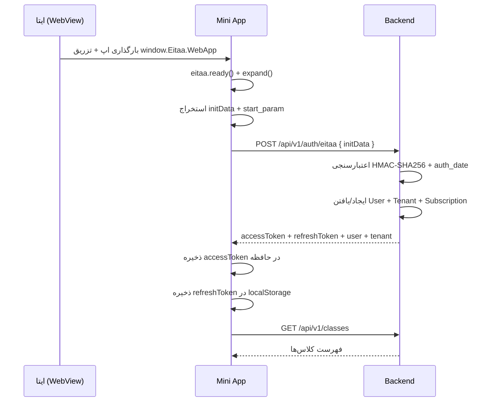

# معماری Mini App

> بخش I، ۳۶، ۴۵، ۴۶، ۷۵ و ۷۷ خواسته‌ها · نسخه 1.0

---

## ۱. تصمیم فناوری

بخش ۴۵ خواسته‌ها دو گزینه داده: **React + TypeScript + Vite** یا **TypeScript + Vite** (بدون فریم‌ورک).

> **تصمیم: React 19 + TypeScript + Vite**

**دلیل:**
- اپلیکیشن ۱۳ صفحه اصلی دارد با State پیچیده (کلاس، دانش‌آموز، تکلیف، آزمون، کتاب، AI، اشتراک).
- مدیریت این حجم State با TypeScript خالص به یک فریم‌ورک دست‌ساز و شکننده منتهی می‌شود — دقیقاً برخلاف اصل «Maintainable».
- React 19 + Vite با Code Splitting، باندل اولیه را حدود ۴۵KB (gzip) نگه می‌دارد — به‌راحتی زیر سقف ۳۰۰KB.
- بودجه باندل **اندازه‌گیری و در CI کنترل می‌شود** (بخش ۱۲ همین سند).

اگر در آینده اندازه‌گیری نشان دهد که WebView ایتا محدودیت جدی دارد، مسیر بازگشت به Vanilla TS برای صفحات سنگین (مثل کتابخانه) وجود دارد — ولی پیش‌فرض React است.

---

## ۲. پشته فناوری

| مؤلفه | انتخاب | وضعیت در فاز ۲ |
|---|---|---|
| فریم‌ورک | React 19 + TypeScript | ✅ نصب |
| بیلد | Vite | ✅ نصب |
| مسیریابی | React Router | ✅ نصب |
| State سرور | TanStack Query | ✅ نصب |
| State کلاینت | Zustand (سبک) | ✅ نصب |
| فرم | React Hook Form + Zod | ⬜ نخستین فرم واقعی در فاز ۳ |
| UI | shadcn/ui + Radix (کد در اختیار ما) | ⚠️ کامپوننت‌ها دست‌نویس Tailwind هستند — بخش ۲.۱ |
| استایل | Tailwind CSS | ✅ نصب (نسخه ۴) |
| فونت | Vazirmatn (Self-hosted، بدون CDN) | ✅ نصب |
| آیکون | Lucide (Tree-shakeable) | ✅ نصب |
| نمودار | Recharts (فقط در صفحات گزارش، Lazy-load) | ⬜ فاز ۱۱ |

### ۲.۱ ⚠️ انحراف: shadcn/ui نصب نشد

سند shadcn/ui را انتخاب کرده بود؛ در فاز ۲ **نصب نشد** و کامپوننت‌های موجود
(`ErrorCard`, `EmptyState`, `LoadingSkeleton`, `TabBar`) دست‌نویس با Tailwind
نوشته شده‌اند.

**دلیل:** shadcn/ui یک CLI است که کد را داخل مخزن تولید می‌کند؛ با Tailwind نسخه ۴ و
React ۱۹ در زمان نصب سازگاری کامل نداشت. چون تعداد کامپوننت‌های لازم در این فاز کم بود،
هزینه‌ی سازگارکردنش از نوشتن دستی بیشتر بود.

> ⚠️ **این تصمیم بازبینی‌پذیر است.** اگر در فاز ۴ (پنل ادمین) یا فاز ۶ به جدول، دیالوگ و
> فرم‌های پیچیده برسیم و کامپوننت دستی گران شود، shadcn/ui دوباره بررسی می‌شود. تفاوت
> ظاهری‌اش با سند، یک انحراف است — نه یک تصمیم بسته.

---

## ۳. ساختار پوشه‌ها

> ✅ = ساخته شد · ⬜ = فاز بعدی · ⚠️ = افزوده/تغییر‌یافته نسبت به نسخه ۱.۰

```text
miniapp/
├── index.html                          ✅
├── vite.config.ts                      ✅
├── playwright.config.ts                ✅ ⚠️ افزوده در فاز ۲
├── tsconfig.json                       ✅ ⚠️ فقط ارجاع به سه پروژه
├── tsconfig.app.json / .node.json / .e2e.json   ✅ ⚠️ پروژه‌های مرجع TS
├── scripts/
│   └── verify-bundle.mjs               ✅ ⚠️ افزوده — نگهبان نشت مقدار توسعه
├── e2e/                                ✅ ⚠️ افزوده — آزمون‌های Playwright
│   ├── auth.spec.ts                    ← جریان E2E شماره ۱ بخش ۱۲
│   ├── a11y.spec.ts                    ← اسکن axe در دو تم
│   └── support/
│       └── eitaa.ts                    ← SDK و بک‌اند جایگزین (Mock)
├── src/
│   ├── main.tsx                        ✅
│   ├── App.tsx                         ✅
│   ├── index.css                       ✅ ⚠️ Tailwind ۴ (@theme)، نه CSS Variables خام
│   ├── vite-env.d.ts                   ✅
│   ├── eitaa/
│   │   ├── sdk.ts                      ← پوشش SDK ایتا (Adapter)
│   │   ├── types.ts                    ✅ ⚠️ افزوده — تایپ‌های SDK
│   │   ├── init-data.ts                ✅ ← استخراج initData (دروازه بخش ۴)
│   │   └── write-access.ts             ✅ ⚠️ افزوده — بخش ۴.۶
│   ├── lib/
│   │   ├── api-client.ts               ✅ ← تنها نقطه تماس با HTTP
│   │   ├── auth-api.ts                 ✅ ⚠️ افزوده — ورود/تازه‌سازی/خروج
│   │   ├── token-storage.ts            ✅ ⚠️ افزوده — بخش ۵
│   │   ├── platform-guard.ts           ✅ ← همان مسیری که سند گفته بود
│   │   └── query-client.ts             ✅
│   ├── stores/
│   │   ├── auth.store.ts               ✅
│   │   └── ui.store.ts                 ✅
│   ├── router/
│   │   ├── routes.tsx                  ✅ ⚠️ افزوده
│   │   ├── start-param.ts              ✅ ⚠️ افزوده — مسیریابی Deep Link
│   │   ├── use-start-param.ts          ✅ ⚠️ افزوده
│   │   └── navigation.ts               ✅ ⚠️ افزوده — تعریف پنج تب
│   ├── components/
│   │   ├── ui/                         ⬜ shadcn — بخش ۲.۱
│   │   ├── layout/
│   │   │   ├── TabBar.tsx              ✅ ← نوار پایین موبایل
│   │   │   ├── AppShell.tsx            ✅
│   │   │   ├── DevDataBanner.tsx       ✅ ⚠️ افزوده — هشدار حالت توسعه
│   │   │   └── PlatformNotice.tsx      ✅ ⚠️ افزوده — بنر بخش ۴.۵
│   │   └── shared/
│   │       ├── Button.tsx              ✅
│   │       ├── PageHeader.tsx          ✅
│   │       ├── EmptyState.tsx          ✅
│   │       ├── LoadingSkeleton.tsx     ✅
│   │       ├── ErrorCard.tsx           ✅
│   │       ├── PhaseNote.tsx           ✅ ⚠️ افزوده — یادداشت «فاز بعد»
│   │       └── PlatformBlocked.tsx     ✅ ⚠️ افزوده — صفحه مسدودسازی
│   ├── features/
│   │   ├── auth/LoginGate.tsx          ✅ ⚠️ افزوده — گارد ورود
│   │   ├── dashboard/DashboardPage.tsx ✅ (اسکلت)
│   │   ├── books/BooksPage.tsx         ✅ فهرست/ساخت واقعی · جزئیات BookDetailPage
│   │   ├── books/BookDetailPage.tsx    ✅ ⚠️ افزوده — جزئیات + صفحات (گام ۱ فاز ۶)
│   │   ├── assignments/AssignmentsPage.tsx ✅ فهرست/ساخت واقعی (گام ۱ فاز ۷)
│   │   ├── assignments/AssignmentDetailPage.tsx ✅ ⚠️ افزوده — جزئیات + انتشار + ثبت پاسخ
│   │   ├── assistant/…Page.tsx         ✅ (اسکلت) · محتوا فاز ۵
│   │   ├── settings/SettingsPage.tsx   ✅ (اسکلت)
│   │   ├── deep-link/EntityPlaceholder.tsx  ✅ ⚠️ افزوده — مقصد start_param
│   │   ├── misc/NotFoundPage.tsx       ✅ ⚠️ افزوده — مسیر ۴۰۴
│   │   ├── classes/ · students/        ✅ فاز ۳
│   │   ├── exams/                      ⬜ فاز ۸
│   │   ├── groups/ · channels/         ⬜ فاز ۹
│   │   ├── reports/                    ⬜ فاز ۱۱
│   │   └── subscription/               ⬜ فاز ۱۰
│   ├── test/
│   │   ├── setup.ts                    ✅ ⚠️ افزوده — راه‌اندازی Vitest
│   │   └── fake-eitaa.ts               ✅ ⚠️ افزوده — SDK جعلی آزمون‌های واحد
│   └── types/
│       ├── api.ts                      ✅ ⚠️ نام واقعی `api.ts` است، نه `api.d.ts`
│       └── error-codes.ts              ✅ ⚠️ آینه دست‌ساز — تفکیک در فاز ۱۲
└── dist/                               (خروجی — در Git نیست)
```

> ⚠️ **انحراف‌های ساختاری نسبت به نسخه ۱.۰ — همه افزودنی، هیچ‌کدام جابه‌جایی:**
>
> | افزوده | چرا |
> |---|---|
> | `e2e/` + `playwright.config.ts` | سند E2E را الزام کرده بود ولی مسیرش را نگفته بود |
> | `scripts/verify-bundle.mjs` | نگهبان ترتیب شرط‌ها در بخش ۴ |
> | `router/` با چهار فایل | سند فقط `start_param` را نشان داده بود؛ مسیریابی واقعی سه فایل دیگر هم لازم داشت |
> | `lib/auth-api.ts` + `token-storage.ts` | تفکیک «تماس شبکه» از «محل ذخیره» — بخش ۵ |
> | `features/auth/`, `features/misc/`, `features/deep-link/` | مقصدهای گارد و Deep Link جای دیگری نداشتند |
> | `test/fake-eitaa.ts` | SDK جعلی برای آزمون‌های واحد |
>
> ⚠️ و یک تفاوت نام: `types/api.d.ts` → `types/api.ts`. دلیل: فایل `.d.ts` در بیلد
> TypeScript با `noEmit` و `verbatimModuleSyntax` رفتار متفاوتی دارد و برای import
> واقعی مناسب نیست.

---

## ۴. یکپارچه‌سازی با ایتا — لایه Adapter

مهم‌ترین اصل: **هیچ کامپوننتی مستقیماً با SDK ایتا حرف نمی‌زند.** همه از یک Adapter عبور می‌کنند.

```html
<!-- index.html — باید در <head> و پیش از هر اسکریپت دیگری باشد -->
<script src="https://developer.eitaa.com/eitaa-web-app.js"></script>
```

> ⚠️ **الزام مستندات:** این فایل **هرگز** به‌صورت محلی ذخیره یا Self-host نمی‌شود.
> دلیل: به‌روزرسانی‌های امنیتی و ناهمخوانی نسخه با کلاینت.
> (منبع: `developer.eitaa.com/docs/Develop/JsSDK/`)

```typescript
// eitaa/sdk.ts
export interface EitaaWebAppApi {
  readonly initData: string;
  readonly initDataUnsafe: {
    user?: {
      id: number;              // ⚠️ تا ۵۲ بیت اهمیت — در TS هم number امن است
      first_name: string;
      last_name?: string;
      language_code?: string;
      allows_write_to_pm?: boolean;
    };
    auth_date: number;
    hash: string;
    start_param?: string;      // ← Deep Link
    chat_type?: 'private' | 'group' | 'channelOrSupergroup';
  };
  readonly version: string;
  readonly platform: string;
  readonly colorScheme: 'light' | 'dark';
  readonly themeParams: Record<string, string>;
  readonly isExpanded: boolean;
  readonly MainButton: BottomButton;
  readonly SecondaryButton: BottomButton;
  readonly BackButton: { show(): void; hide(): void; onClick(cb: () => void): void };
  readonly HapticFeedback: {
    impactOccurred(style: 'light' | 'medium' | 'heavy' | 'rigid' | 'soft'): void;
    notificationOccurred(type: 'error' | 'success' | 'warning'): void;
    selectionChanged(): void;
  };
  ready(): void;
  expand(): void;
  close(): void;
  isVersionAtLeast(version: string): boolean;
  onEvent(type: string, handler: () => void): void;
  offEvent(type: string, handler: () => void): void;
  showAlert(message: string, cb?: () => void): void;
  showConfirm(message: string, cb?: (ok: boolean) => void): void;
  openLink(url: string, options?: { try_browser?: boolean }): void;
  openEitaaLink(url: string): void;
  requestWriteAccess(cb?: (granted: boolean) => void): void;
  requestContact(cb?: (shared: boolean, data?: string) => void): void;
}

interface BottomButton {
  text: string; isVisible: boolean; isActive: boolean;
  show(): void; hide(): void; enable(): void; disable(): void;
  onClick(cb: () => void): void; setText(text: string): void;
}

declare global {
  interface Window { Eitaa?: { WebApp?: EitaaWebAppApi } }
}

export const eitaa = {
  /** ✅ تأییدشده — شیء Global: window.Eitaa.WebApp */
  get app(): EitaaWebAppApi | undefined {
    return window.Eitaa?.WebApp;
  },
  isAvailable(): boolean {
    return Boolean(window.Eitaa?.WebApp?.initData);
  },
  initData(): string {
    return window.Eitaa?.WebApp?.initData ?? '';
  },
  /** پارامتر Deep Link — مثلاً asg_123 برای باز شدن مستقیم یک تکلیف */
  startParam(): string | undefined {
    return window.Eitaa?.WebApp?.initDataUnsafe?.start_param;
  },
  colorScheme(): 'light' | 'dark' {
    return window.Eitaa?.WebApp?.colorScheme ?? 'light';
  },
  platform(): string {
    return window.Eitaa?.WebApp?.platform ?? 'unknown';
  },
  ready() { window.Eitaa?.WebApp?.ready(); },
  expand() { window.Eitaa?.WebApp?.expand(); },
  haptic() { window.Eitaa?.WebApp?.HapticFeedback?.selectionChanged(); },
  /** فراخوانی فقط اگر نسخه SDK پشتیبانی کند — Feature Detection */
  atLeast(v: string): boolean {
    try { return window.Eitaa?.WebApp?.isVersionAtLeast(v) ?? false; }
    catch { return false; }
  },
};
```

> ✅ **راستی‌آزمایی‌شده (منبع: `developer.eitaa.com/docs/Develop/JsSDK/`):** شیء Global **`window.Eitaa.WebApp`** است و
> **فهرست کامل متدها** در [`docs/eitaa.md`](eitaa.md) بخش ۳ ثبت شده است.
> (در نسخه ۱.۰ این سند، `window.EitaaWebApp` حدس زده شده بود و متدها «نیازمند تأیید» بودند — **اکنون همه تأییدشده‌اند.**)
>
> **قاعده:** هر متد SDK فقط پس از `eitaa.atLeast('1.3')` فراخوانی می‌شود.
> اگر موجود نبود، **Fallback خودمان** اجرا می‌شود — نه اینکه به وجود آن تکیه کنیم.
>
> نکته مهم: **فقط همین یک فایل** در صورت تغییر نام‌ها اصلاح می‌شود — هیچ کامپوننتی.

### نمونه واقعی `initData` (طبق مستندات)

```text
user=%7B%22id%22%3A123456%2C%22first_name%22%3A%22%D8%B9%D9%84%DB%8C%22%2C%22language_code
%22%3A%22fa%22%7D&chat_instance=...&chat_type=private&auth_date=1759000000&hash=abc123...
```

فیلدهای مستندشده: `user` (شامل `id`, `first_name`, `last_name`, `language_code`, `allows_write_to_pm`)، `chat_instance`، `chat_type`، `auth_date`، `device_id`، `hash`.

اعتبارسنجی `hash` در بک‌اند انجام می‌شود — جزئیات در [`docs/eitaa.md`](eitaa.md).

### حالت توسعه (بدون ایتا)

```typescript
export function getInitData(): string {
  // 🔴 این شرط باید نخست بیاید — دلیلش پایین‌تر
  if (import.meta.env.PROD) {
    devDataInUse = false;
    const fromEitaa = eitaa.initData();
    if (fromEitaa) return fromEitaa;
    throw new InitDataUnavailableError('not-in-eitaa', INIT_DATA_MESSAGES['not-in-eitaa']);
  }

  const devData = import.meta.env.VITE_DEV_INIT_DATA ?? '';
  if (devData.length > 0) {
    devDataInUse = true;
    return devData;
  }
  throw new InitDataUnavailableError('dev-data-missing', INIT_DATA_MESSAGES['dev-data-missing']);
}
```

بک‌اند در پروفایل `dev` با `app.mock.eitaa=true` این `initData` جعلی را می‌پذیرد.

> 🔴 **ترتیب این دو شرط، خودش یک کنترل امنیتی است.** `import.meta.env.PROD` در زمان
> بیلد به `true` تبدیل می‌شود، پس bundler **کل شاخه توسعه را به‌عنوان کد مرده حذف
> می‌کند** و نه فقط مقدار را. اگر کسی ترتیب را عوض کند (مثلاً `VITE_DEV_INIT_DATA` را
> بالا ببرد)، دروازه باز می‌شود.
>
> نگهبان این ترتیب `scripts/verify-bundle.mjs` است که در زنجیره `npm run build` اجرا
> می‌شود و در صورت باز شدن دروازه، **بیلد را با شکست متوقف می‌کند** — و خودش با یک
> «قناری» آزموده شده که مطمئن شویم واقعاً شکست می‌خورد. جزئیات و اندازه‌گیری‌ها:
> [`docs/verification-log.md`](verification-log.md) بخش ۱۲.۲.
>
> ⚠️ **و محل درست `VITE_DEV_INIT_DATA` فایل `.env.development.local` است، نه
> `.env.local`** — چون Vite فایل `.env.local` را در *همه* حالت‌ها می‌خواند، از جمله
> `build`.

---

## ۴.۵ 🔴 محدودیت پلتفرم — باید در UI دیده شود

> ✅ **منبع:** `developer.eitaa.com/docs/QuickStart/`
>
> «برنامه‌ها و برنامک‌ها در حال حاضر فقط از طریق نسخه **اندروید** و **نسخه دسکتاپ (ویندوز)** ایتا
> قابل اجرا هستند. نسخه **iOS** یا **مرورگرهای دیگر** پشتیبانی نمی‌شوند.»

**این یک واقعیت خارجی است، نه انتخاب ما. پس شفاف اعلام می‌شود.**

```typescript
// lib/platform-guard.ts
export function checkPlatform(): { ok: boolean; message?: string } {
  const app = eitaa.app;
  if (!app) {
    return {
      ok: false,
      message: 'این برنامه باید از داخل ایتا باز شود.',
    };
  }
  // platform مقادیر مستندشده دارد؛ اگر ناشناخته بود، مانع نمی‌شویم
  const p = app.platform?.toLowerCase() ?? '';
  if (p.includes('ios')) {
    return {
      ok: false,
      message: 'این برنامه در نسخه iOS ایتا پشتیبانی نمی‌شود. ' +
               'لطفاً از نسخه اندروید یا ویندوز استفاده کنید.',
    };
  }
  return { ok: true };
}
```

**پیام‌های فارسی لازم در محصول:**

| موقعیت | پیام |
|---|---|
| ورود از iOS | «این برنامه در نسخه iOS ایتا پشتیبانی نمی‌شود. لطفاً از اندروید یا ویندوز استفاده کنید.» |
| ورود از مرورگر | «این برنامه باید از داخل ایتا باز شود.» |
| صفحه فرود / مستندات | ذکر صریح پشتیبانی: اندروید ✅ · ویندوز ✅ · iOS ❌ · مرورگر ❌ |

**مسیر جایگزین برای معلم iOS** (در [`docs/eitaa.md`](eitaa.md) بخش ۱۱.۳ کامل توضیح داده شده):
ربات ایتا را به گروه اضافه می‌کند و اعلان‌ها را در چت می‌گیرد؛ برای ساخت محتوا از نسخه دسکتاپ استفاده می‌کند.

### ✅ وضعیت پیاده‌سازی (فاز ۲)

هر سه پیام بالا پیاده شده‌اند و **آزمون E2E** دارند:

| موقعیت | آزمون |
|---|---|
| خارج از ایتا | `e2e/auth.spec.ts` — صفحه گارد نمایش داده می‌شود، **هیچ درخواست احراز هویتی نمی‌رود**، و نوار تب هم نیست |
| iOS | `e2e/auth.spec.ts` — پیام iOS نمایش داده می‌شود |

> ⚠️ **هر دو مورد از یک قاعده پیروی می‌کنند:** گارد **پیش از** هر تماس شبکه‌ای اجرا
> می‌شود. این عمدی است — اگر کاربر iOS اول یک درخواست ورود بفرستد و بعد پیام «پشتیبانی
> نمی‌شود» ببیند، هم یک نشست بی‌مصرف ساخته شده و هم تجربه‌اش متناقض است. آزمون، نبودِ
> درخواست را هم می‌سنجد، نه فقط وجود پیام را.

**بنر «فقط اندروید و ویندوز»:** ✅ پیاده شد —
`src/components/layout/PlatformNotice.tsx`، که `AppShell` بالای محتوا رندر می‌کند.

| پلتفرم | رفتار بنر |
|---|---|
| اندروید | **نمایش داده نمی‌شود** — آنجا همه‌چیز پشتیبانی می‌شود و بنر فقط فضای مفید می‌گیرد |
| دسکتاپ ویندوز | نمایش داده می‌شود: «برنامک‌های ایتا فقط روی اندروید و دسکتاپ ویندوز اجرا می‌شوند…» |
| بیرون از ایتا | رندر نمی‌شود — آن حالت صفحه مسدود کامل دارد |

> ⚠️ **متن بنر عمداً «ممکن است» دارد، نه ادعای قطعی.** نمی‌دانیم کدام قابلیت روی کدام
> نسخه دسکتاپ ویندوز کار می‌کند — این یکی از موارد باز فهرست بخش ۱۴ `docs/eitaa.md`
> است. ادعای قطعی درباره‌ی چیزی که آزموده نشده، همان حدس زدن است که ممنوع است.

### ۴.۶ دروازه توسعه — `VITE_DEV_ALLOW_BROWSER`

> 🔴 **افزوده‌شده پس از یک بن‌بست واقعی.** اسکریپت SDK ایتا
> (`developer.eitaa.com/eitaa-web-app.js`) روی شبکه‌ای که آن دامنه در دسترس نیست
> بارگذاری نمی‌شود. نتیجه: `window.Eitaa` ساخته نمی‌شود، گارد پلتفرم **پیش از هر
> تماس شبکه‌ای** صفحه «این برنامه باید از داخل ایتا باز شود» را نشان می‌دهد، و کار
> روی Mini App در مرورگر **کاملاً مسدود** می‌شود. `VITE_DEV_INIT_DATA` هم نجات
> نمی‌دهد، چون گارد *پیش از* خواندن `initData` اجرا می‌شود.

راه‌حل، یک Opt-in صریح است — نه باز کردن پیش‌فرض گارد:

```typescript
// lib/platform-guard.ts
function isDevBrowserAllowed(): boolean {
  if (import.meta.env.PROD) return false;              // اول Production
  return import.meta.env.VITE_DEV_ALLOW_BROWSER === 'true';
}
```

| ویژگی | مقدار |
|---|---|
| پیش‌فرض | **خاموش** — نبودن متغیر یعنی رفتار قبلی دست‌نخورده |
| شرط فعال‌شدن | `VITE_DEV_ALLOW_BROWSER` **دقیقاً** `true` (نه `1`، نه `yes`) |
| در Production | هرگز — شرط `PROD` اول می‌آید و کل شاخه حذف می‌شود |
| محل تنظیم | `.env.development.local` (ساخته‌شده توسط `scripts/New-DevInitData.ps1`) |

> ⚠️ **چرا روی `VITE_DEV_INIT_DATA` سوار نشد؟** چون آزمون E2E «بیرون از ایتا» همان
> فایل محیطی را می‌خواند و سبزِ دروغ می‌شد. به همین دلیل هم
> `playwright.config.ts` مقدار `VITE_DEV_ALLOW_BROWSER` را برای سرور آزمون **خالی**
> می‌کند (Vite مقدار `process.env` را بر فایل `.env` مقدم می‌داند) و هم
> `reuseExistingServer` به `false` رفت تا این override هرگز دور زده نشود.

> 🔴 **عوارض جانبی این دروازه، که باید بدانید:** با روشن بودنش، کاربر iOS هم دیگر
> مسدود نمی‌شود (چون گارد فقط مسیر «نبود SDK» را عوض می‌کند، ولی وقتی SDK نیست
> `platform` هم خوانده نمی‌شود). این فقط در توسعه و فقط روی دستگاه خودتان است —
> بیلد Production دست‌نخورده است.

#### خطاهای رایج پس از این دروازه

| نشانه | علت | راه‌حل |
|---|---|---|
| «نشست ایتا منقضی شده است» | `initData` جعلی از ۵ دقیقه گذشته | `scripts\run-dev.ps1` را دوباره اجرا کنید |
| «ارتباط با سرور برقرار نشد» + `ERR_FAILED` | مبدأ در `app.cors.allowed-origins` نیست | پروفایل `dev` را بالا بیاورید (بخش ۴.۷) |
| درخواست به `/api/v1/...` روی پورت ۵۱۷۳ و ۴۰۴ | خط اول `.env.development.local` با BOM ذخیره شده | فایل را با `New-DevInitData.ps1` بازتولید کنید |

### ۴.۷ CORS — چرا لازم است و چرا پیش‌فرض بسته است

Mini App از مبدأیی غیر از API اجرا می‌شود (`localhost:5173` → `localhost:8080`، و در
WebView ایتا از مبدأ ایتا به مبدأ ما). مرورگر پیش از چنین درخواستی یک `OPTIONS`
می‌فرستد؛ بدون پاسخ درست، تماس **هرگز فرستاده نمی‌شود** و خطا هم **هیچ ردی در لاگ
سرور نمی‌گذارد** (خودِ مرورگر جلوی درخواست را می‌گیرد) — عیب‌یابی‌اش دقیقاً به همین
دلیل سخت است.

```yaml
app:
  cors:
    allowed-origins: []        # پیش‌فرض: هیچ‌کدام — Fail-Closed
```

- **پیش‌فرض `application.yml` خالی است.** هر استقرار باید مبدأهایش را صریحاً بگذارد.
- **پروفایل `dev`** دو مبدأ را باز می‌کند: `http://localhost:5173` و
  `http://127.0.0.1:5173` (مرورگر این دو را دو مبدأ متفاوت می‌بیند).
- **`allowCredentials=false`** — برنامک با هدر `Authorization` و
  `credentials: 'omit'` کار می‌کند. اگر روزی پنل مدیریت هم از مبدأ دیگری سرو شد، آن
  مسیر کوکی HttpOnly دارد و این پرچم باید `true` شود — و آن یک **تصمیم امنیتی** است.
- پیاده‌سازی: `config/CorsProperties.java` + `security/CorsConfig.java`؛ در
  `SecurityConfig` هر دو زنجیره `.cors(withDefaults())` دارند.
- ⚠️ `@CrossOrigin` روی کنترلر **کافی نیست**: بعد از زنجیره فیلتر امنیت اجرا می‌شود،
  یعنی وقتی preflight پیش‌تر با ۴۰۱ رد شده باشد.

> ⚠️ علاوه بر CORS، یک **پروکسی Vite** هم برای `/api` تنظیم شده
> (`miniapp/vite.config.ts`). آن فقط Fallback است برای وقتی `VITE_API_URL` تنظیم
> نشده و `BASE_URL` به `/api/v1` نسبی برمی‌گردد؛ مسیر اصلی همان URL مطلق + CORS است.


> ⚠️ **پوشش:** این بنر آزمون **واحد** دارد — دو مورد در `LoginGate.test.tsx` که کل
> برنامه را رندر می‌کنند (ورود، سپس `AppShell`): نمایش روی `platform: 'tdesktop'` و عدم
> نمایش روی `platform: 'android'`. ولی آزمون **E2E** ندارد؛ برای آن باید
> `platform: 'tdesktop'` هم به `installFakeEitaa` در `e2e/support/eitaa.ts` داده شود،
> که فعلاً فقط برای `'ios'` استفاده می‌شود.

---

## ۴.۶ 🔑 اجازه ارسال پیام — `requestWriteAccess`

> ✅ **منبع:** `developer.eitaa.com/docs/Develop/SendMassage/`
>
> «ارسال پیام تنها زمانی ممکن است که کاربر به شما دسترسی ارسال داده باشد.»

```typescript
// eitaa/write-access.ts
export type WriteAccessResult =
  | 'already-granted'   // در همان initData اعلام شده
  | 'granted'           // کاربر همین حالا اجازه داد
  | 'denied'            // کاربر رد کرد
  | 'unsupported';      // SDK این متد را ندارد، یا پاسخ نداد

const RESPONSE_TIMEOUT_MS = 10_000;
let askedThisSession = false;

export async function ensureWriteAccess(): Promise<WriteAccessResult> {
  const app = eitaa.app;
  if (!app) return 'unsupported';

  // از قبل دارد
  if (app.initDataUnsafe?.user?.allows_write_to_pm === true) return 'already-granted';

  // در همین نشست قبلاً پرسیده‌ایم — دوباره نپرس
  if (askedThisSession) return 'denied';

  if (typeof app.requestWriteAccess !== 'function') return 'unsupported';
  askedThisSession = true;

  return new Promise((resolve) => {
    let settled = false;
    const finish = (r: WriteAccessResult) => {
      if (settled) return;          // ⚠️ محافظ دو-بار-حل
      settled = true;
      clearTimeout(timer);
      resolve(r);
    };
    const timer = setTimeout(() => finish('unsupported'), RESPONSE_TIMEOUT_MS);

    try {
      app.requestWriteAccess((granted) => finish(granted ? 'granted' : 'denied'));
    } catch {
      finish('unsupported');
    }
  });
}
```

**سیاست محصولی:**

```text
۱. هنگام ورود، یک‌بار با توضیح فارسی روشن درخواست می‌شود:
   «برای دریافت اعلان تکالیف و نمرات در ایتا، اجازه ارسال پیام لازم است.»
۲. اگر کاربر رد کرد → هرگز دوباره پرسیده نمی‌شود
۳. در آن حالت اعلان‌ها فقط داخل Mini App (تب «اعلان‌ها») دیده می‌شوند
۴. وضعیت در پروفایل سرور ذخیره می‌شود، نه localStorage
```

> ⚠️ **چرا «مهلت ۱۰ ثانیه» و «محافظ دو-بار-حل»؟** چون رفتار `requestWriteAccess`
> روی **دسکتاپ ویندوز راستی‌آزمایی نشده** است. اگر آن نسخه کال‌بک را هرگز صدا نزند،
> بدون مهلت این Promise تا ابد معلق می‌ماند و صفحه ورود **بی‌صدا** قفل می‌شود.
>
> 🔴 **این «تاب‌آوری» است، نه «تأیید رفتار».** یعنی: نبودِ کال‌بک برنامه را خراب
> نمی‌کند — ولی هنوز *نمی‌دانیم* کال‌بک روی ویندوز چه می‌کند. این مورد در فهرست باز
> بخش ۱۴ `docs/eitaa.md` می‌ماند و بدون توکن واقعی تیک نمی‌خورد.

> ⚠️ **وضعیت در رابط کاربری:** ماژول و آزمونش هست، و از فاز ۲ **یک مصرف‌کننده
> دارد**: `stores/auth.store.ts` پس از یک ورود/تازه‌سازی **موفق** آن را یک‌بار صدا
> می‌زند (نتیجه در `writeAccess` فروشگاه می‌نشیند تا UI بتواند اعلان درون‌برنامه‌ای
> را توضیح دهد). اگر کاربر وارد **نشده** باشد اصلاً صدا زده نمی‌شود — پرسیدن اجازه
> ارسال روی صفحه «ورود انجام نشد» بی‌معنی است. مصرف‌کننده دوم، صفحه ارسال تکلیف در
> فاز ۷ است.

### 💡 `start_param` — Deep Link واقعی

`initDataUnsafe.start_param` تنها مسیر Deep Link در ایتا است و جایگزین «دکمه شیشه‌ای» می‌شود:

```text
لینک تکلیف:   https://eitaa.com/<bot>?startapp=asg_123
لینک کلاس:    https://eitaa.com/<bot>?startapp=cls_45
لینک آزمون:   https://eitaa.com/<bot>?startapp=exm_7
```

```typescript
// router/start-param.ts — مسیریابی بر اساس پارامتر شروع
export function resolveStartParam(param?: string): string | null {
  if (!param) return null;
  const [type, id] = param.split('_');
  if (!/^\d+$/.test(id ?? '')) return null;   // ⚠️ فقط عدد — هرگز به‌عنوان دستور اجرا نمی‌شود

  switch (type) {
    case 'asg': return `/assignments/${id}`;
    case 'cls': return `/classes/${id}`;
    case 'exm': return `/exams/${id}`;
    default:    return null;
  }
}
```

> 🔒 **امنیت:** `start_param` **داده غیرقابل‌اعتماد** است. فقط الگوی `type_<عدد>` پذیرفته می‌شود.
> هر مقدار دیگری نادیده گرفته می‌شود. سپس بک‌اند **مستقل** بررسی می‌کند که آن منبع به مستأجر جاری تعلق دارد.

---

## ۵. جریان احراز هویت



**محل ذخیره توکن:**

| توکن | محل | دلیل |
|---|---|---|
| Access (۱۵ دقیقه) | حافظه (Zustand، بدون persist) | XSS نمی‌تواند به حافظه دسترسی پایدار داشته باشد |
| Refresh (۳۰ روز) | `localStorage` — کلید `smart-teacher.session.v1` | **باید** از بسته‌شدن WebView جان سالم ببرد |

> 🔴 **تغییر تصمیم — و دلیلش.** پیش‌تر Refresh Token در `sessionStorage` بود، با
> این استدلال که «با بستن اپ پاک می‌شود». آن استدلال یک باگ پروداکشنی می‌ساخت:
> با هر پس‌زمینه‌شدن WebView، توکن می‌رفت و تنها راه ورود `initData` می‌شد — که
> یک‌بارمصرف و ۵دقیقه‌معتبر است. نتیجه: حلقه بی‌پایان «دوباره تلاش کنین».
>
> ریسک XSSِ باقی‌مانده با **چرخش یک‌بارمصرف**، **تشخیص استفاده مجدد خانوادگی**
> (مصرف دوباره → باطل‌شدن کل خانواده) و **پاک‌سازی در خروج** مهار شده است.
> تحلیل کامل: [`docs/security.md`](security.md) بخش ۳.
>
> ⚠️ `sessionStorage` همچنان به‌عنوان **Fallback** استفاده می‌شود: اگر
> `localStorage` در دسترس نباشد (WebView با ذخیره‌سازی غیرفعال)، نوشتن به آن
> برمی‌گردد تا ورود نشکند. کلید قدیمی هم یک‌بار و بی‌صدا منتقل می‌شود.
> پیاده‌سازی: `src/lib/token-storage.ts`

---

## ۶. ناوبری — نوار پایین موبایل

```text
┌─────────────────────────────────────┐
│  دستیار هوشمند معلم        [☰]      │  ← Topbar
├─────────────────────────────────────┤
│                                     │
│         محتوای صفحه                 │
│                                     │
├─────────────────────────────────────┤
│  🏠     📚     📝     🤖     ⚙️      │  ← TabBar
│داشبورد کتابخانه تکالیف دستیار تنظیمات│
└─────────────────────────────────────┘
```

**پنج تب اصلی** (بخش ۷۷ خواسته‌ها):

| تب | مسیر | محتوا |
|---|---|---|
| داشبورد | `/` | خلاصه، میان‌بُرها، اعلان‌ها |
| کتابخانه | `/books` | کتاب‌ها، صفحه‌ها، تحلیل |
| تکالیف | `/assignments` | تکالیف و آزمون‌ها (دو بخش) |
| دستیار | `/assistant` | چت با AI |
| تنظیمات | `/settings` | پروفایل، اشتراک، گروه‌ها، گزارش‌ها |

> **تصمیم UX:** ۱۳ صفحه در ۵ تب فشرده شده. صفحات فرعی (کلاس‌ها، دانش‌آموزان، گروه‌ها، کانال‌ها، گزارش‌ها، اشتراک) از داخل تب‌های مربوطه باز می‌شوند، نه تب جداگانه. دلیل: نوار پایین با بیش از ۵ آیتم در موبایل غیرقابل استفاده می‌شود.

### مسیرها

```text
/                         داشبورد
/classes                  کلاس‌های من
/classes/:id              جزئیات کلاس
/classes/:id/students     دانش‌آموزان
/students/:id             پروفایل دانش‌آموز
/books                    کتابخانه
/books/:id                کتاب
/books/:id/pages/:n       صفحه کتاب
/assignments              تکالیف
/assignments/new          تکلیف جدید
/assignments/:id          جزئیات + تصحیح
/assignments/:id/evaluate/:submissionId   تصحیح با AI
/exams                    آزمون‌ها
/exams/new                آزمون جدید
/exams/:id                جزئیات
/assistant                دستیار هوشمند
/groups                   گروه‌های ایتا
/groups/:id               پیام‌رسانی
/channels                 کانال‌ها
/reports                  گزارش‌ها
/subscription             اشتراک من
/settings                 تنظیمات
```

---

## ۷. هفت صفحه کلیدی

### ۷.۱ داشبورد

```text
┌─────────────────────────────────┐
│ سلام، آقای احمدی 👋              │
│ پنجم الف · ۳۲ دانش‌آموز          │
├─────────────────────────────────┤
│ ┌────────┐ ┌────────┐ ┌────────┐│
│ │۳ کلاس  │ │۵ تکلیف │ │۱۲ ارسال││
│ │فعال    │ │باز     │ │امروز   ││
│ └────────┘ └────────┘ └────────┘│
├─────────────────────────────────┤
│ 🔔 ۵ ارسال در انتظار تصحیح       │
│    [مشاهده]                     │
├─────────────────────────────────┤
│ میان‌بُرها                       │
│ [+ تکلیف] [+ آزمون] [🤖 دستیار]  │
├─────────────────────────────────┤
│ مصرف AI این ماه                  │
│ ████████░░░░░░░░ ۴۲۱۰ / ۵۰۰۰    │
└─────────────────────────────────┘
```

### ۷.۲ تصحیح تکلیف با AI

```text
┌─────────────────────────────────┐
│ ← تصحیح پاسخ علی احمدی           │
├─────────────────────────────────┤
│ سؤال: حاصل ۲۴ ÷ ۶ چند است؟      │
│ پاسخ: ۴                          │
├─────────────────────────────────┤
│ 🤖 ارزیابی هوش مصنوعی            │
│ ┌─────────────────────────────┐ │
│ │ نمره پیشنهادی:  ۰ / ۲۰       │ │
│ │ اطمینان: ۹۵٪  🟢 بالا        │ │
│ ├─────────────────────────────┤ │
│ │ ✗ پاسخ نادرست است            │ │
│ │                             │ │
│ │ نقاط ضعف:                    │ │
│ │ • تقسیم ۲۴ بر ۶ اشتباه شده  │ │
│ │                             │ │
│ │ بازخورد:                     │ │
│ │ علی جان، دوباره جدول ضرب ۶  │ │
│ │ را مرور کن. ۲۴ ÷ ۶ = ۴ است  │ │
│ │ پس ۲۴ ÷ ۶ = ۴ درست است...   │ │
│ └─────────────────────────────┘ │
├─────────────────────────────────┤
│ بازبینی معلم (اجباری)            │
│ نمره نهایی: [۲۰____]             │
│ یادداشت:   [________________]    │
│                                  │
│ [✓ تأیید]  [✎ ویرایش]  [↻ دوباره]│
└─────────────────────────────────┘
```

> **نکته طراحی:** نمره AI **همیشه** با برچسب «پیشنهادی» نمایش داده می‌شود و فیلد «نمره نهایی» جداگانه و اجباری است. این بخش ۴۰ خواسته‌ها (Human Review) را در سطح UI هم تقویت می‌کند — معلم هرگز احساس نمی‌کند که AI جای او تصمیم گرفته.

اگر `confidence < 0.7` باشد، یک هشدار زرد بالای کارت نمایش داده می‌شود: «اطمینان هوش مصنوعی پایین است — لطفاً با دقت بررسی کنید.»

### ۷.۳ کتابخانه و صفحه کتاب

```text
┌─────────────────────────────────┐
│ ← ریاضی پنجم — صفحه ۴۵          │
├─────────────────────────────────┤
│ ┌─────────────────────────────┐ │
│ │                             │ │
│ │    [تصویر صفحه کتاب]        │ │
│ │                             │ │
│ └─────────────────────────────┘ │
├─────────────────────────────────┤
│ [◀ قبلی]  صفحه ۴۵ از ۱۲۰  [بعدی ▶]│
├─────────────────────────────────┤
│ متن استخراج‌شده (OCR)            │
│ «فصل سوم: تقسیم...»              │
├─────────────────────────────────┤
│ اقدامات:                         │
│ [📝 تولید سؤال]                  │
│ [📋 طرح درس]                     │
│ [📄 ساخت تکلیف]                  │
│ [📊 ساخت آزمون]                  │
│ [✏️ خلاصه‌سازی]                  │
└─────────────────────────────────┘
```

### ۷.۴ دستیار هوشمند

```text
┌─────────────────────────────────┐
│ 🤖 دستیار هوشمند معلم            │
│ زمینه: پنجم الف · ریاضی · ص ۴۵  │
├─────────────────────────────────┤
│         ┌───────────────────┐   │
│         │ یک طرح درس برای  │   │
│         │ صفحه ۴۵ بنویس     │   │
│         └───────────────────┘   │
│ ┌───────────────────────────┐   │
│ │ طرح درس — تقسیم بر اعداد  │   │
│ │ یک‌رقمی                    │   │
│ │                           │   │
│ │ ۱. اهداف: ...             │   │
│ │ ۲. وسایل: ...             │   │
│ │ ۳. زمان‌بندی: ۴۵ دقیقه    │   │
│ │ ...                       │   │
│ └───────────────────────────┘   │
├─────────────────────────────────┤
│ زمینه خودکار:                    │
│ [کلاس][کتاب][صفحه] (قابل تغییر) │
├─────────────────────────────────┤
│ [پیام خود را بنویسید...    ] [➤]│
└─────────────────────────────────┘
```

**Context خودکار:** سیستم زمینه را از موقعیت فعلی معلم می‌سازد (کلاس فعال، کتاب، صفحه). معلم می‌تواند زمینه را با Chipها تغییر دهد — بدون تایپ دستی.

### ۷.۵ ساخت آزمون

```text
┌─────────────────────────────────┐
│ ← ساخت آزمون                     │
├─────────────────────────────────┤
│ کلاس:        [پنجم الف      ▼]   │
│ کتاب:        [ریاضی پنجم    ▼]   │
│ از صفحه:     [۴۵]  تا: [۵۰]      │
│ تعداد سؤال:  [۱۰]                │
│ نوع سؤال:    [☑ چهارگزینه‌ای]     │
│              [☑ کوتاه‌پاسخ]       │
│              [☐ تشریحی]           │
│              [☐ درست/غلط]         │
│ سطح دشواری:  [آسان ۲۰٪ / متوسط ۶۰٪│
│               / سخت ۲۰٪]         │
│ مدت:         [۴۵] دقیقه          │
├─────────────────────────────────┤
│ [🤖 تولید آزمون]                 │
│                                  │
│ هزینه تقریبی: ~۱ درخواست AI      │
└─────────────────────────────────┘
```

معلم پس از تولید، می‌تواند هر سؤال را **ویرایش، حذف یا اضافه** کند — آزمون نهایی همیشه تحت کنترل معلم است.

### ۷.۶ اشتراک من

```text
┌─────────────────────────────────┐
│ اشتراک من                        │
├─────────────────────────────────┤
│ پلن فعلی: حرفه‌ای                │
│ وضعیت: فعال 🟢                   │
│ اعتبار: ۱۲ روز                   │
│ تمدید: ۱۴۰۵/۰۷/۰۱               │
│ [تمدید] [ارتقا]                  │
├─────────────────────────────────┤
│ مصرف این ماه                     │
│ دانش‌آموزان  ۱۲۰ / ۵۰۰  ███░     │
│ کلاس‌ها      ۸ / ∞      ████     │
│ درخواست AI   ۴۲۱۰/۵۰۰۰  ███████░ │
├─────────────────────────────────┤
│ موجودی کیف پول: ۲۵۰,۰۰۰ تومان    │
│ [افزایش موجودی]                  │
├─────────────────────────────────┤
│ [مشاهده فاکتورها و پرداخت‌ها]     │
└─────────────────────────────────┘
```

### ۷.۷ گروه‌های ایتا

```text
┌─────────────────────────────────┐
│ گروه‌های ایتا                     │
├─────────────────────────────────┤
│ 🟢 پنجم الف — ریاضی   (۳۲ عضو)   │
│    کلاس متصل: پنجم الف           │
│    [پیام] [تکلیف] [آزمون]        │
├─────────────────────────────────┤
│ ⚪ گروه اولیا          (۲۸ عضو)   │
│    متصل نشده                     │
│    [اتصال به کلاس]               │
├─────────────────────────────────┤
│ [↻ همگام‌سازی با ایتا]           │
└─────────────────────────────────┘
```

---

## ۸. مدیریت State

```typescript
// stores/auth.store.ts — State احراز هویت
interface AuthState {
  user: User | null;
  tenant: Tenant | null;
  subscription: Subscription | null;
  accessToken: string | null;       // فقط در حافظه
  isAuthenticated: boolean;
  login: (response: AuthResponse) => void;
  logout: () => void;
  switchTenant: (tenantId: string) => Promise<void>;
}
```

**قاعده:** داده‌ای که از سرور می‌آید (`classes`, `students`, `assignments`, ...) **هرگز** در Zustand نگهداری نمی‌شود. فقط TanStack Query.

```typescript
// features/classes/hooks.ts
export function useClasses() {
  return useQuery({
    queryKey: ['classes'],
    queryFn: () => classesApi.list(),
    staleTime: 5 * 60 * 1000,
  });
}

export function useCreateClass() {
  const qc = useQueryClient();
  return useMutation({
    mutationFn: classesApi.create,
    onSuccess: () => qc.invalidateQueries({ queryKey: ['classes'] }),
  });
}
```

> **برای شما به‌عنوان توسعه‌دهنده بک‌اند:** اگر بک‌اند تغییر کند، **فقط `features/<name>/api.ts`** عوض می‌شود. هوک‌ها، کامپوننت‌ها و State دست‌نخورده می‌مانند.

---

## ۹. طراحی بصری

### اصول
| اصل | مقدار |
|---|---|
| جهت | `dir="rtl"` روی `<html>`، استفاده از Tailwind Logical Properties (`ps-`, `pe-`, `ms-`, `me-`) |
| حداقل ناحیه لمس | ۴۴×۴۴ پیکسل |
| فونت | Vazirmatn، اندازه پایه ۱۶px |
| فاصله | مضرب ۴px |
| گوشه‌ها | `rounded-xl` (۱۲px) |
| سایه | ملایم، فقط روی کارت‌ها |
| انیمیشن | حداکثر ۲۰۰ms، `ease-out` |

### رنگ‌ها (CSS Variables)

```css
:root {
  --primary: 221 83% 53%;        /* آبی آموزشی */
  --success: 142 76% 36%;        /* سبز — نمره قبولی، وضعیت فعال */
  --warning: 38 92% 50%;         /* نارنجی — هشدار مصرف */
  --danger:  0 84% 60%;          /* قرمز — خطا، سقف پر (پرکننده) */
  --danger-strong: 0 72% 51%;    /* ⚠️ افزوده — قرمز وقتی خودش «متن» است */
  --info:    199 89% 48%;        /* فیروزه‌ای — اطلاعات */
  --background: 0 0% 100%;
  --foreground: 222 47% 11%;
  --muted: 210 40% 96%;
  --border: 214 32% 91%;
}

[data-theme="dark"] {
  --background: 222 47% 11%;
  --foreground: 210 40% 98%;
  --muted: 217 33% 17%;
  --border: 217 33% 22%;
  --danger-strong: 0 84% 60%;    /* ⚠️ در تم تاریک، همان قرمز روشن به‌کار می‌رود */
}
```

### ⚠️ ۹.۱ انحراف افزوده: `--danger-strong`

این توکن در نسخه ۱.۰ این سند **نبود** و در فاز ۲ افزوده شد.

**دلیل اندازه‌گیری‌شده:** `--danger: 0 84% 60%` روی زمینه روشن حدود **۳.۸:۱** می‌دهد —
زیر آستانه ۴.۵:۱ سطح AA. یک رنگ پرکننده (نشان، نوار، پس‌زمینه حذف) با آن اشکالی ندارد،
ولی وقتی **خودش رنگ متن** شود، رد می‌شود.

| کاربرد | توکن | تم روشن | تم تاریک |
|---|---|---|---|
| پرکننده (Badge، نوار خطا) | `--danger` | `hsl(0 84% 60%)` | `hsl(0 84% 60%)` |
| متن (عنوان کارت خطا) | `--danger-strong` | `hsl(0 72% 51%)` ≈ ۴.۸:۱ | `hsl(0 84% 60%)` ≈ ۵.۳:۱ |

> 🔴 **چرا دو توکن و نه یک مقدار تیره‌تر برای همه؟** چون تم روشن و تاریک جهت اصلاح
> **مخالف** دارند. روی سفید باید تیره‌تر شود تا کنتراست بسازد؛ روی زمینه تیره باید
> روشن‌تر بماند. یک مقدار واحد، یکی از دو تم را می‌شکند.
>
> ⚠️ این نقص را `axe` پیدا کرد، **ولی فقط پس از رفع یک نقص دیگر**: تا وقتی
> `maximum-scale` بزرگ‌نمایی را بسته بود، `axe` روی همان یک تخلف می‌ایستاد و به
> کنتراست نمی‌رسید. جزئیات: [`docs/verification-log.md`](verification-log.md) بخش ۱۲.۱.

### حالت تاریک
- تشخیص از `eitaa.colorScheme()` در ایتا
- تشخیص از `prefers-color-scheme` در مرورگر
- ذخیره انتخاب کاربر در **پروفایل سرور** (نه `localStorage`) تا بین دستگاه‌ها هماهنگ باشد

> 🔴 **باگ رگرسیونی که در فاز ۲ رفع شد:** تابع `detectTheme()` نوشته شده بود ولی
> **هیچ‌جا صدا زده نمی‌شد** — صفحه ورود مستقیم وضعیت اولیه فروشگاه را می‌خواند که همیشه
> `light` است. یعنی `eitaa.colorScheme()` کاملاً نادیده می‌ماند و برنامه هرگز تاریک
> نمی‌شد. آزمون واحدِ آن تابع این را نمی‌گرفت، چون تابع *درست* بود و *مسیر استفاده‌اش*
> غلط. جزئیات: [`docs/verification-log.md`](verification-log.md) بخش ۱۲.۱ مورد ۳.

---

## ۱۰. کارایی

| هدف | راهکار |
|---|---|
| باندل اولیه < ۱۵۰KB (gzip) | Code Splitting بر اساس مسیر |
| رندر اول < ۱.۵s | Lazy-load صفحات سنگین |
| تصاویر کتاب | Lazy-load + `width`/`height` صریح |
| نمودار | فقط در صفحات گزارش، `React.lazy` |
| فونت | `font-display: swap` + Subset فارسی |
| TanStack Query | `staleTime` مناسب، بدون Refetch اضافی |

### بودجه باندل — کنترل در CI

```json
// package.json
{
  "scripts": {
    "build": "tsc -b && vite build && node scripts/verify-bundle.mjs",
    "size-check": "size-limit"
  },
  "size-limit": [
    {
      "name": "باندل اولیه Mini App",
      "path": "dist/assets/index-*.js",
      "limit": "150 kB",
      "gzip": true
    }
  ]
}
```

> اگر PR بودجه باندل را بشکند، **CI fail می‌کند.** این تنها راه جلوگیری از رشد خزنده حجم است.

> ✅ **وضعیت جاری:** `131.25 kB gzip` از سقف ۱۵۰ kB — حدود ۱۲.۵٪ حاشیه.
>
> ⚠️ **دو نکته که در فاز ۲ اصلاح شدند:**
>
> ۱. **`preset-app` به `file` عوض شد.** پریست قبلی برای گزارش «زمان بارگذاری» یک زنجیره
> کامل Chrome بی‌سر با **۱۲ هشدار امنیتی** می‌آورد. بودجه ما حجم gzip است و پریست
> `file` همان را بی‌واسطه می‌سنجد. عدد تغییر نکرد، هشدارها صفر شدند.
>
> ۲. **`chunkSizeWarningLimit` وتوی Vite روی حجم خام است، نه gzip.** این عدد پیش‌تر
> ۱۵۰ بود (یعنی همان سقف gzip) و چون باندل خام ~۳۶۳ kB است، **هشدار در هر بیلد روشن
> می‌ماند** — و هشداری که همیشه روشن باشد دیر یا زود نادیده گرفته می‌شود. حالا ۴۰۰ kB
> خام است (≈۱۲۶ kB gzip)، پس همچنان *پیش از* بودجه هشدار می‌دهد. **دروازه واقعی،
> `size-check` است.**

---

## ۱۱. خطا و حالت‌های خاص

| حالت | رفتار |
|---|---|
| خارج از ایتا باز شود | پیام فارسی: «این برنامه باید از داخل ایتا باز شود» + راهنما |
| **باز شدن در iOS** | پیام: «در نسخه iOS ایتا پشتیبانی نمی‌شود — اندروید یا ویندوز» (بخش ۴.۵) |
| `initData` نامعتبر / منقضی / تکراری | **حالت مسدود**: پیام سرور («برنامک را دوباره باز کنید») + دکمه «بستن برنامک» — **بدون** دکمه تلاش مجدد (پایین را ببینید) |
| خطای گذرا (شبکه، ۵xx، ۴۲۹) | کارت خطا + دکمه «تلاش مجدد» |
| کاربر اجازه ارسال پیام نداده | اعلان فقط درون‌برنامه‌ای؛ بدون مزاحمت دوباره (بخش ۴.۶) |
| نشست منقضی | تازه‌سازی خودکار؛ در صورت شکست → صفحه ورود |
| قطع اینترنت | نوار هشدار + استفاده از کش |
| خطای سقف مصرف | دیالوگ با دکمه «ارتقای پلن» |
| Provider AI در دسترس نیست | پیام «سرویس هوش مصنوعی موقتاً در دسترس نیست» + تلاش مجدد |
| بارگذاری | Skeleton (نه Spinner تمام‌صفحه) |
| فهرست خالی | تصویر + متن راهنما + دکمه اقدام |

### ۱۱.۱ «مسدود» در برابر «ناموفق» — و چرا این تفکیک حیاتی است

🔴 **این تفکیک، خودِ رفع یک باگ پروداکشنی است.** دو حالت جدا نگه داشته می‌شوند
چون تنها یکی از آن‌ها با تکرار درست می‌شود:

| حالت | وضعیت | دکمه | چرا |
|---|---|---|---|
| خطای گذرا (شبکه، ۵xx، ۴۲۹) | `unauthenticated` | **تلاش مجدد** | درخواست بعدی ممکن است موفق شود |
| `initData` رد شد (`EITAA_INIT_DATA_INVALID`) | `blocked` | **بستن برنامک** | تکرار محکوم به شکست است |
| بیرون از ایتا / در iOS | `blocked` | — | مشکل در محیط است، نه درخواست |

**چرا تکرار `initData` بی‌فایده است؟** `getInitData()` رشته را از SDK می‌خواند و
آن رشته تا پایان عمر WebView **ثابت** است. پس درخواست دوباره، همان رشته‌ای را
می‌فرستد که سرور قبلاً ردش کرده — و هر سه بررسی سرور روی یک رشته ثابت یک‌طرفه
بدتر می‌شوند: امضا ثابت است، `auth_date` فقط کهنه‌تر می‌شود، و اثر انگشت
ضدبازپخش ثبت شده می‌ماند. تنها اقدامی که `initData` **تازه** می‌سازد، بستن و باز
کردن برنامک از داخل ایتا است.

⚠️ پیاده‌سازی حتی از فرستادن درخواست هم خودداری می‌کند: `auth.store` آخرین
`initData` ردشده را به خاطر می‌سپارد و در تلاش دوباره با همان رشته، مستقیم به
حالت مسدود می‌رود. پیش از این، هر فشار دکمه یک درخواست محکوم‌به‌شکست و یک
خطای امنیتی تازه در لاگ می‌ساخت.

> 🔴 و **ریشه** مشکل جای دیگری بود: تا وقتی Refresh Token در `sessionStorage` بود،
> هر پس‌زمینه‌شدن WebView کاربر را به همین مسیر می‌فرستاد. ماندگاری نشست در
> `localStorage` (بخش ۵) آن مسیر را به‌کل بست.

---

## ۱۲. تست

| نوع | ابزار | پوشش | وضعیت فاز ۲ |
|---|---|---|---|
| Unit | Vitest | توابع کمکی، Adapter ایتا، اعتبارسنجی | ✅ ۱۵۶ تست · ۱۳ فایل |
| Component | React Testing Library | فرم‌ها، حالت‌های خطا | ✅ همراه Vitest (jsdom) |
| E2E | Playwright | جریان‌های کلیدی | ✅ ۱۷ تست |
| دسترس‌پذیری | axe-core | هر صفحه | ✅ ۶ صفحه × ۲ تم + ۳ حالت خاص |
| معماری باندل | `scripts/verify-bundle.mjs` | نشت مقدار توسعه | ✅ با «قناری» آزموده شده |

### جریان‌های E2E الزامی
1. ✅ **ورود با `initData` جعلی (Mock)** — پیاده شد (`e2e/auth.spec.ts`)
2. ⬜ ایجاد کلاس → افزودن دانش‌آموز — فاز ۳
3. ⬜ بارگذاری کتاب → تحلیل صفحه — فاز ۶
4. ⬜ ایجاد تکلیف → ارسال → تصحیح AI → بازبینی معلم — فاز ۷
5. ⬜ ساخت آزمون با AI — فاز ۸
6. ⬜ گفت‌وگو با دستیار — فاز ۵
7. ⬜ مشاهده اشتراک و مصرف — فاز ۱۰
8. ⬜ تلاش برای Feature غیرمجاز → نمایش پیام ارتقا — فاز ۱۰

> **قاعده:** هر فاز، جریان E2E خودش را می‌سازد. جریان‌های ۲ تا ۸ **تیک نمی‌خورند** تا
> صفحه‌شان وجود داشته باشد — نه اینکه با آزمون واحد جبران شوند.

### ۱۲.۱ دسترس‌پذیری — چرا یک اسکن کافی نیست

`e2e/a11y.spec.ts` هر صفحه را با `axe` می‌سنجد، **و هر صفحه را در دو تم**:

```text
۶ مسیر (شامل یک مسیر ۴۰۴) × ۲ تم  +  صفحه مسدود  +  ورود ناموفق
```

> 🔴 **دلیل تکرار در دو تم:** قرمز روشن `hsl(0 84% 60%)` روی زمینه تیره **قابل قبول**
> است ولی روی زمینه روشن **رد می‌شود**. اگر فقط تم روشن اسکن شود، همین یک قرمز هر دو
> تم را می‌گذراند یا هر دو را می‌اندازد — و هیچ‌کدام تصویر درستی از مسئله نمی‌دهد.
>
> ⚠️ آزمون تم تاریک **پیش از** اسکن ادعا می‌کند `data-theme="dark"` روی `<html>` نشسته
> است. بدون این ادعا، اگر تم تاریک اصلاً اعمال نشود، آزمون روی همان تم روشن اجرا می‌شد
> و **بی‌صدا بی‌اثر** می‌شد — یعنی «سبز» بدون هیچ پوششی.
>
> ⚠️ و آستانه ندارد: گزارش `axe` باید **دقیقاً خالی** باشد، نه «بدون مورد جدی». آستانه
> یعنی تصمیم درباره اینکه کدام تخلف مهم است، و ما نمی‌خواهیم آن تصمیم در آزمون گرفته شود.

---

## ۱۳. راهنمای توسعه Frontend (بخش ۷۵ خواسته‌ها)

مستندات در `miniapp/README.md`:

| پرسش | پاسخ |
|---|---|
| این Component چیست؟ | JSDoc بالای فایل |
| این فایل چه کاری می‌کند؟ | JSDoc بالای فایل |
| API کجاست؟ | `features/<name>/api.ts` |
| State کجا مدیریت می‌شود؟ | سرور: TanStack Query · کاربر/نشست: `stores/auth.store.ts` |
| UI را کجا تغییر دهم؟ | `features/<name>/components/` |
| API تغییر کرد، کجا عوض کنم؟ | `features/<name>/api.ts` — **نه کامپوننت‌ها** |
| رنگ یا فونت را کجا عوض کنم؟ | `src/index.css` (CSS Variables) |
| یک تب جدید اضافه کنم؟ | `components/layout/TabBar.tsx` + `router/routes.tsx` |

### نمونه

```typescript
/**
 * کارت تصحیح تکلیف با هوش مصنوعی
 *
 * API:      features/assignments/api.ts → POST /assignments/submissions/{id}/evaluate
 * State:    TanStack Query (کلید: ['submission', id])
 * تغییر UI: همین فایل
 * تغییر منطق بازبینی: features/assignments/components/TeacherReviewForm.tsx
 */
export function AiEvaluationCard({ submissionId }: Props) { ... }
```
