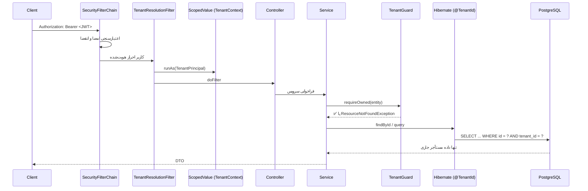

# معماری چندمستأجری (Multi-Tenancy)

> بخش C سند طراحی · نسخه 1.0

---

## ۱. تصمیم بنیادی: «مستأجر» چیست؟

این مهم‌ترین تصمیم معماری این سند است. اگر اشتباه گرفته شود، بازنویسی کل سیستم لازم می‌شود.

**تعریف رسمی:**

> **مستأجر (Tenant) = واحد جداسازی داده + واحد مالکیت صورتحساب.**

هر مستأجر یک «فضای کاری» است که داده‌هایش از سایر مستأجرها کاملاً جدا است و یک اشتراک/پلن مشخص دارد.

### چرا این تعریف؟

در خواسته‌ها آمده:

```text
Organization → School → Teachers → Classes → Students
```

اگر «مستأجر = معلم» بگیریم، مدرسه نمی‌تواند داده معلمانش را ببیند (چون هر معلم یک جزیره است). اگر «مستأجر = مدرسه» بگیریم، معلم مستقل که مدرسه ندارد بی‌جا می‌ماند.

### راه‌حل: مستأجر با نوع و والد

```text
Tenant (type=SCHOOL,  name="دبیرستان شهید بهشتی")
   ├── Tenant (type=TEACHER, name="آقای احمدی")   ← معلم عضو مدرسه
   ├── Tenant (type=TEACHER, name="خانم رضایی")
   └── ...

Tenant (type=TEACHER, name="آقای مستقل")          ← معلم بدون مدرسه
```

- معلمی که مدرسه ندارد → هنگام ثبت‌نام یک مستأجر شخصی از نوع `TEACHER` برایش ساخته می‌شود.
- مدرسه → یک مستأجر از نوع `SCHOOL` با فرزندان `TEACHER`.
- سازمان (فاز آینده) → مستأجر از نوع `ORGANIZATION` با فرزندان `SCHOOL` — **بدون بازنویسی، فقط یک رکورد جدید در `tenants`.**

### قاعده طلایی

> **جداسازی همیشه در سطح مستأجر برقرار است.** یک معلم هرگز داده معلم دیگر را نمی‌بیند. دسترسی مدرسه به داده معلمانش، **استثنای صریح و کنترل‌شده** است، نه شکستن جداسازی.

مدیر مدرسه از طریق یک مسیر جداگانه (`SchoolAggregationService`) که فقط **تجمیع و آمار** برمی‌گرداند — نه دسترسی به جدول‌های معلمان — داده می‌بیند. این کار عمداً محدود نگه داشته می‌شود تا جداسازی هرگز سوراخ نشود.

---

## ۲. استراتژی جداسازی: Shared Database + Shared Schema + Discriminator

سه استراتژی رایج:

| استراتژی | جداسازی | هزینه عملیاتی | مهاجرت Schema | تعداد مستأجر |
|---|---|---|---|---|
| Database-per-Tenant | بالاترین | بسیار بالا | N بار | محدود (ده‌ها) |
| Schema-per-Tenant | بالا | بالا | N بار | متوسط (صدها) |
| **Shared Schema + tenant_id** | کافی (با کنترل‌های نرم‌افزاری) | **پایین** | **۱ بار** | **نامحدود** |

### انتخاب: Shared Schema + `tenant_id`

**دلایل:**
1. مدل کسب‌وکار «Freemium با معلمان تک‌نفره» است — ممکن است هزاران معلم رایگان داشته باشیم. Schema-per-Tenant در این مقیاس غیرقابل مدیریت است (هزاران Schema، هزاران Migration).
2. تمام Migrationها **یک‌بار** با Flyway اجرا می‌شوند، نه N بار.
3. کوئری‌های تجمیعی (درآمد کل، مصرف کل AI، آمار پلتفرم) ساده و سریع‌اند.
4. جداسازی از طریق **دو لایه دفاعی مستقل** تضمین می‌شود، نه با فرض بر درستی کد.

**مسیر مهاجرت آینده:** چون تمام دسترسی داده از JPA و با `@TenantId` انجام می‌شود و Native Query ممنوع است، برای مهاجرت به Schema-per-Tenant فقط کافی است `CurrentTenantIdentifierResolver` عوض شود. هیچ کوئری دامنه‌ای تغییر نمی‌کند. این قابلیت **عمداً** حفظ می‌شود.

---

## ۳. لایه دفاعی اول: Hibernate `@TenantId`

Hibernate (از 6.2) annotation `@org.hibernate.annotations.TenantId` را دارد که:

- در **هر SELECT** به‌صورت خودکار شرط `WHERE tenant_id = :current` را اضافه می‌کند.
- در **هنگام INSERT** مقدار `tenant_id` را خودکار پر می‌کند.
- در **UPDATE و DELETE** هم فیلتر را اعمال می‌کند.

```java
@Entity
@Table(name = "students")
public class Student extends TenantAwareEntity {
    // TenantAwareEntity یک فیلد @TenantId دارد
}

@MappedSuperclass
public abstract class TenantAwareEntity extends BaseEntity {

    @TenantId
    @Column(name = "tenant_id", nullable = false, updatable = false)
    private UUID tenantId;

    // getter بدون setter عمومی — فقط توسط زیرساخت مقدار می‌گیرد
}
```

### تأمین مستأجر جاری

```java
@Component
public class CurrentTenantIdentifierResolverImpl
        implements CurrentTenantIdentifierResolver<UUID> {

    @Override
    public UUID resolveCurrentTenantIdentifier() {
        return TenantContext.currentTenantId()   // از ScopedValue
                .orElseThrow(() -> new TenantNotResolvedException());
    }

    @Override
    public boolean validateExistingCurrentSessions() { return true; }
}
```

ثبت در Spring Boot:

```java
@Configuration
class HibernateTenantConfig implements HibernatePropertiesCustomizer {
    @Override
    public void customize(Map<String, Object> props) {
        props.put(AvailableSettings.MULTI_TENANT_IDENTIFIER_RESOLVER, resolver);
        props.put(AvailableSettings.MULTI_TENANT, MultiTenancyStrategy.DISCRIMINATOR);
        // هرگز اجازه نده بدون مستأجر کوئری اجرا شود
        props.put(AvailableSettings.MULTI_TENANT_CONNECTION_PROVIDER, null);
    }
}
```

> **نکته:** `MULTI_TENANT = DISCRIMINATOR` یعنی در نبود مستأجر، استثنا پرتاب می‌شود. این عمدی است: **Fail-Closed، نه Fail-Open.** سیستم ترجیح می‌دهد خطا بدهد تا اینکه داده مستأجر دیگری را برگرداند.

### پوشش‌نداده‌شده‌ها (مهم)

`@TenantId` هایبرنیت روی موارد زیر اعمال **نمی‌شود**:

| مورد | راه‌حل |
|---|---|
| Native Query (`nativeQuery = true`) | ممنوع — با تست ArchUnit کنترل می‌شود |
| `@Query` با JPQL که `nativeQuery` ندارد | ✅ پوشش داده می‌شود |
| کوئری‌های `EntityManager.createNativeQuery` | ممنوع |
| Bulk update/delete با JPQL | ✅ پوشش داده می‌شود |
| جداول پلتفرم‌سطح (`users`, `plans`, `ai_providers`) | `@TenantId` ندارند و **نباید** داشته باشند |

---

## ۴. لایه دفاعی دوم: `TenantGuard` در لایه سرویس

لایه اول از فراموشی شرط `WHERE` جلوگیری می‌کند، ولی **جلوگیری از دسترسی افقی** (User A از Tenant X به رکورد Tenant Y) را کامل پوشش نمی‌دهد؛ چون اگر `TenantContext` اشتباه ست شود، لایه اول بی‌فایده است.

```java
@Component
@RequiredArgsConstructor
public class TenantGuard {

    /**
     * هر سرویسی که رکوردی با شناسه می‌گیرد، باید این را صدا بزند.
     * رکورد اگر متعلق به مستأجر جاری نباشد، NotFound برمی‌گرداند (نه Forbidden).
     */
    public <T extends TenantAwareEntity> T requireOwned(T entity) {
        if (entity == null) throw new ResourceNotFoundException();
        if (!Objects.equals(entity.getTenantId(), TenantContext.requireTenantId())) {
            // لاگ امنیتی: تلاش دسترسی بین‌مستأجری
            SecurityAuditLog.idorAttempt(entity, TenantContext.requireTenantId());
            // عمداً NotFound، نه Forbidden — تا وجود رکورد لو نرود
            throw new ResourceNotFoundException();
        }
        return entity;
    }
}
```

> **چرا `404` و نه `403`؟** اگر `403` برگردانیم، مهاجم می‌فهمد رکورد با آن شناسه **وجود دارد** — این خودش نشت اطلاعات است (شناسایی موجودیت رکوردهای سایر مستأجرها). `404` این کانال را می‌بندد.

---

## ۵. نگهداری مستأجر جاری: `ScopedValue`

در Java 25، `ScopedValue` نهایی شده است (راستی‌آزمایی شد). از `ThreadLocal` استفاده **نمی‌کنیم** چون:

- با Virtual Thread و `StructuredTaskScope` نشت می‌کند.
- در کد `@Async` و Reactor به‌راحتی گم می‌شود.
- نیاز به `remove()` دستی دارد که فراموش می‌شود.

```java
public final class TenantContext {

    private static final ScopedValue<TenantPrincipal> CURRENT = ScopedValue.newInstance();

    public static <R> R runAs(TenantPrincipal principal, Supplier<R> action) {
        return ScopedValue.where(CURRENT, principal).call(action::get);
    }

    public static Optional<UUID> currentTenantId() {
        return CURRENT.isBound() ? Optional.of(CURRENT.get().tenantId()) : Optional.empty();
    }

    public static UUID requireTenantId() {
        return currentTenantId().orElseThrow(TenantNotResolvedException::new);
    }

    public static Optional<UUID> currentUserId() {
        return CURRENT.isBound() ? Optional.of(CURRENT.get().userId()) : Optional.empty();
    }
}
```

### تعریف `TenantPrincipal` (رکورد Java)

```java
public record TenantPrincipal(
        UUID userId,
        UUID tenantId,
        Set<Role> roles,
        UUID activeSubscriptionPlanId,
        Locale locale
) {
    public boolean hasRole(Role r) { return roles.contains(r); }
    public boolean isPlatformStaff() {
        return roles.contains(Role.SUPER_ADMIN) || roles.contains(Role.ADMIN);
    }
}
```

### فیلتر ورودی

```java
@Component
@Order(Ordered.LOWEST_PRECEDENCE - 10)
public class TenantResolutionFilter extends OncePerRequestFilter {

    @Override
    protected void doFilterInternal(HttpServletRequest req, HttpServletResponse res,
                                    FilterChain chain) throws ServletException, IOException {
        TenantPrincipal principal = JwtPrincipalExtractor.extract(req)
                .orElse(TenantPrincipal.anonymous());
        TenantContext.runAs(principal, () -> {
            try { chain.doFilter(req, res); }
            catch (Exception e) { throw new UncheckedServletException(e); }
        });
    }
}
```

این فیلتر **بعد از** `SecurityFilterChain` اجرا می‌شود تا JWT قبلاً اعتبارسنجی شده باشد.

---

## ۶. چرخه عمر یک درخواست



---

## ۷. ثبت‌نام و ایجاد مستأجر

### سناریو ۱ — معلم مستقل (از Mini App ایتا)

```text
1. کاربر Mini App را باز می‌کند → initData ایتا ارسال می‌شود
2. اعتبارسنجی initData (docs/eitaa.md)
3. جست‌وجوی User با eitaa_user_id
   ├── موجود → ورود
   └── جدید → ایجاد:
         a. User
         b. Tenant (type=TEACHER, name = نام کاربر, slug = یکتا)
         c. TenantMember (user, tenant, role=TEACHER, OWNER)
         d. Subscription (plan = پلن پیش‌فرض FREE, status=ACTIVE)
         e. UsageCounter برای دوره جاری
4. صدور JWT با tenantId فعال
```

### سناریو ۲ — مدرسه (توسط Super Admin)

```text
1. Super Admin از پنل، مدرسه می‌سازد
   → Tenant (type=SCHOOL)
2. Super Admin معلمان را اضافه می‌کند
   → Tenant (type=TEACHER, parent_tenant_id = school)
3. اشتراک SCHOOL روی Tenant مدرسه
4. معلمان از سهمیه مدرسه مصرف می‌کنند (Entitlement Resolution:
   USER → TENANT(معلم) → TENANT(مدرسه) → PLAN → GLOBAL)
```

> نکته: زنجیره والد در رزولوشن Entitlement **صریحاً** پیمایش می‌شود (معلم → مدرسه)، نه با ارث‌بری خودکار هایبرنیت.

---

## ۸. جداول کلیدی مستأجر

```sql
CREATE TABLE tenants (
    id                UUID PRIMARY KEY,
    type              VARCHAR(20)  NOT NULL,   -- TEACHER | SCHOOL | ORGANIZATION
    name              VARCHAR(200) NOT NULL,
    slug              VARCHAR(100) NOT NULL UNIQUE,
    parent_tenant_id  UUID         NULL REFERENCES tenants(id),
    owner_user_id     UUID         NOT NULL REFERENCES users(id),
    status            VARCHAR(20)  NOT NULL DEFAULT 'ACTIVE',
    settings          JSONB        NOT NULL DEFAULT '{}',
    created_at        TIMESTAMPTZ  NOT NULL DEFAULT now(),
    updated_at        TIMESTAMPTZ  NOT NULL DEFAULT now()
);

CREATE TABLE tenant_members (
    id          UUID PRIMARY KEY,
    tenant_id   UUID        NOT NULL REFERENCES tenants(id) ON DELETE CASCADE,
    user_id     UUID        NOT NULL REFERENCES users(id)   ON DELETE CASCADE,
    role        VARCHAR(30) NOT NULL,   -- OWNER | TEACHER | ASSISTANT | SCHOOL_ADMIN
    status      VARCHAR(20) NOT NULL DEFAULT 'ACTIVE',
    joined_at   TIMESTAMPTZ NOT NULL DEFAULT now(),
    UNIQUE (tenant_id, user_id)
);

CREATE INDEX idx_tenant_members_user ON tenant_members(user_id);
CREATE INDEX idx_tenants_parent      ON tenants(parent_tenant_id);
```

هیچ کاربری به‌طور پیش‌فرض عضو دو مستأجر نمی‌شود، ولی مدل داده **این را پشتیبانی می‌کند** (یک معلم که در دو مدرسه درس می‌دهد). تغییر مستأجر فعال در Mini App با یک سوئیچ انجام می‌شود و `tenantId` در JWT عوض می‌شود.

---

## ۹. جداول Tenant-Owned در برابر Platform-Owned

| گروه | جدول‌ها | `tenant_id` |
|---|---|---|
| **Platform-Owned** | `users`, `tenants`, `plans`, `plan_features`, `features`, `ai_providers`, `ai_models`, `prompt_templates`, `prompt_versions`, `coupons`, `audit_logs`, `system_settings` | ❌ ندارد |
| **Tenant-Owned** | `classrooms`, `students`, `books`, `book_pages`, `assignments`, `assignment_submissions`, `exams`, `exam_questions`, `exam_attempts`, `eitaa_groups`, `eitaa_channels`, `messages`, `scheduled_messages`, `automation_rules` | ✅ دارد + `@TenantId` |
| **Hybrid** | `subscriptions`, `payments`, `invoices`, `wallet_transactions`, `usage_counters`, `ai_usage_records` | ✅ دارد (چون مصرف و پرداخت به مستأجر تعلق دارد) ولی توسط سیستم/SUPER_ADMIN قابل خواندن در سطح پلتفرم با bypass صریح |
| **Assignment-Based** | `ai_provider_assignments`, `ai_prompt_assignments`, `feature_overrides`, `limit_overrides` | `tenant_id` nullable — `NULL` یعنی تخصیص پلتفرم‌سطح (GLOBAL) |

---

## ۱۰. مسیر Bypass کنترل‌شده (تنها استثناها)

فقط این سه مورد می‌توانند `@TenantId` را دور بزنند، و همه در `internal.platform` قرار دارند:

1. **Super Admin Panel** — کوئری‌های گزارش پلتفرم‌سطح.
2. **Jobهای زمان‌بندی‌شده** — مانند انقضای اشتراک‌ها که باید روی همه مستأجرها کار کنند. با `TenantContext.runAsSystem(...)`.
3. **Webhookهای پرداخت** — درگاه پرداخت مستأجر را نمی‌شناسد و با `authority`/`referenceId` پیدا می‌شود.

```java
public final class SystemTenantScope {
    /** تنها راه قانونی برای کار فرامستأجری. در AuditLog ثبت می‌شود. */
    public static <R> R runAsSystem(String reason, Supplier<R> action) {
        AuditLog.systemBypass(reason);
        return TenantContext.runAs(TenantPrincipal.system(), action);
    }
}
```

هر فراخوانی `runAsSystem` با `reason` اجباری **در `audit_logs` ثبت می‌شود**. این قابل حسابرسی است.

---

## ۱۱. تست‌های الزامی چندمستأجری

| تست | نوع | توضیح |
|---|---|---|
| `TenantIsolationTest` | Integration (Testcontainers) | Tenant A نمی‌تواند رکورد Tenant B را با ID بخواند → 404 |
| `TenantFilterAutoApplyTest` | Integration | کوئری بدون شرط صریح، خودکار فیلتر می‌شود |
| `TenantAutoPopulateTest` | Integration | `INSERT` بدون ست‌کردن `tenantId`، خودکار پر می‌شود |
| `TenantMissingContextTest` | Integration | بدون `TenantContext` → استثنا (Fail-Closed) |
| `TenantBypassAuditedTest` | Integration | `runAsSystem` حتماً `audit_log` می‌سازد |
| `NoNativeQueryArchTest` | ArchUnit | هیچ Native Query در ماژول‌های دامنه نباشد |
| `CrossTenantUpdateDeleteTest` | Integration | `UPDATE`/`DELETE` بین‌مستأجری صفر رکورد تأثیر می‌گذارد |
| `SchoolAggregationScopeTest` | Integration | مدیر مدرسه فقط آمار تجمیعی می‌بیند، نه داده خام معلمان |

---

## ۱۲. ضدالگوهایی که ممنوع‌اند

| ❌ ممنوع | ✅ جایگزین |
|---|---|
| `findById(id)` بدون بررسی مستأجر | `repo.findByIdAndTenantId(...)` یا `tenantGuard.requireOwned(...)` |
| گرفتن `tenantId` از `@RequestParam` یا Body | فقط از `TenantContext` (استخراج‌شده از JWT) |
| `@Query(nativeQuery = true)` | JPQL یا Criteria API |
| `ThreadLocal` برای مستأجر | `ScopedValue` |
| نوشتن `WHERE tenant_id = ?` دستی | `@TenantId` |
| دسترسی مستقیم به Repository ماژول دیگر | Facade یا رویداد دامنه |
| `@Transactional` روی Controller | فقط روی Service |
