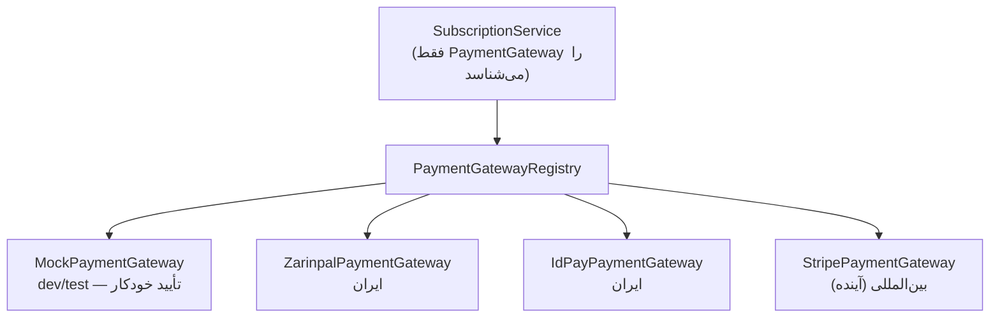
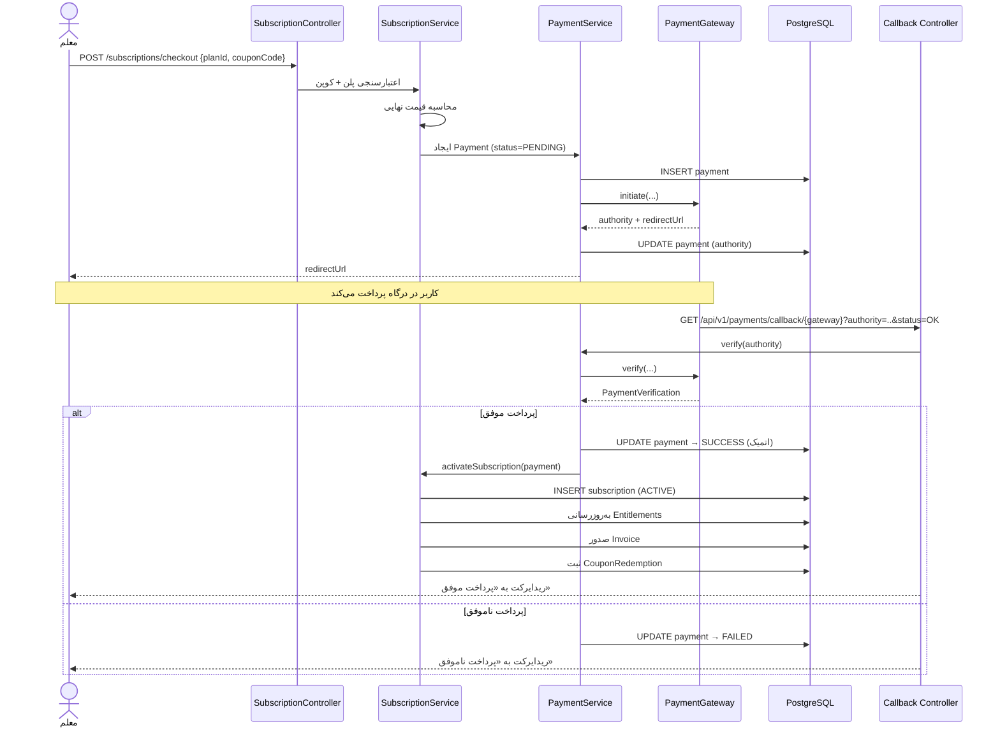

# معماری پرداخت (Payment Architecture)

> بخش ۲۹ خواسته‌ها · نسخه 1.0

---

## ۱. اصل طراحی

> **هیچ درگاه پرداختی در Core سیستم Hardcode نمی‌شود.** Core فقط `PaymentGateway` را می‌شناسد. افزودن «زرین‌پال»، «IDPay»، «Stripe» یا هر درگاه دیگر = افزودن یک کلاس، بدون تغییر در منطق اشتراک.

---

## ۲. اینترفیس درگاه

```java
public interface PaymentGateway {

    /** کد یکتای درگاه — با ستون payments.gateway_code مطابقت دارد */
    String code();

    /** آیا این درگاه در تنظیمات فعلی قابل استفاده است */
    boolean isAvailable();

    /** شروع پرداخت — کاربر را به درگاه هدایت می‌کند */
    PaymentInitiation initiate(PaymentInitiationRequest request);

    /** تأیید پرداخت پس از بازگشت کاربر */
    PaymentVerification verify(PaymentVerificationRequest request);

    /** بازگشت وجه */
    RefundResult refund(RefundRequest request);

    /** پشتیبانی از بازگشت وجه */
    default boolean supportsRefund() { return false; }
}
```

### مدل‌های داده

```java
public record PaymentInitiationRequest(
    UUID paymentId,
    BigDecimal amount,
    String currency,        // IRT | IRR | USD
    String description,
    String callbackUrl,
    String mobile,          // اختیاری — برخی درگاه‌ها لازم دارند
    String email,
    Map<String, String> metadata
) {}

public record PaymentInitiation(
    String authority,       // شناسه تراکنش در درگاه
    String redirectUrl,     // آدرس هدایت کاربر
    Instant expiresAt
) {}

public record PaymentVerificationRequest(
    String authority,
    BigDecimal amount,
    Map<String, String> callbackParams
) {}

public record PaymentVerification(
    boolean successful,
    String referenceId,     // کد پیگیری نهایی
    BigDecimal paidAmount,
    Instant paidAt,
    String failureReason,
    Map<String, Object> rawResponse
) {}

public record RefundRequest(
    String authority,
    String referenceId,
    BigDecimal amount,
    String reason
) {}

public record RefundResult(
    boolean successful,
    String refundReference,
    String failureReason
) {}
```

---

## ۳. پیاده‌سازی‌ها



### ثبت و انتخاب درگاه

```java
@Component
@RequiredArgsConstructor
public class PaymentGatewayRegistry {

    private final List<PaymentGateway> gateways;

    public PaymentGateway get(String code) {
        return gateways.stream()
            .filter(g -> g.code().equalsIgnoreCase(code))
            .filter(PaymentGateway::isAvailable)
            .findFirst()
            .orElseThrow(() -> new PaymentGatewayNotAvailableException(code));
    }

    public List<GatewayInfo> available() {
        return gateways.stream()
            .filter(PaymentGateway::isAvailable)
            .map(g -> new GatewayInfo(g.code(), g.supportsRefund()))
            .toList();
    }
}
```

### حالت Mock (توسعه)

```java
@Component
@ConditionalOnProperty(name = "app.mock.payment", havingValue = "true")
public class MockPaymentGateway implements PaymentGateway {

    @Override public String code() { return "MOCK"; }
    @Override public boolean isAvailable() { return true; }

    @Override
    public PaymentInitiation initiate(PaymentInitiationRequest req) {
        String authority = "MOCK-" + UUID.randomUUID();
        return new PaymentInitiation(authority,
            "/mock-payment?authority=" + authority + "&amount=" + req.amount(),
            Instant.now().plus(30, ChronoUnit.MINUTES));
    }

    @Override
    public PaymentVerification verify(PaymentVerificationRequest req) {
        // در حالت Mock، هر پرداخت موفق است مگر authority شامل "fail" باشد
        boolean ok = !req.authority().contains("fail");
        return new PaymentVerification(ok, "MOCK-REF-" + req.authority(),
            req.amount(), Instant.now(), ok ? null : "شبیه‌سازی پرداخت ناموفق",
            Map.of("mock", true));
    }
}
```

این به ما اجازه می‌دهد **کل جریان پرداخت** را بدون هیچ درگاه واقعی تست کنیم — و در تست‌های یکپارچه، مسیر ناموفق را هم بسازیم.

---

## ۴. جریان کامل پرداخت



### نکات حیاتی امنیتی

| # | نکته |
|---|---|
| 1 | **مبلغ همیشه سمت سرور محاسبه می‌شود.** هرگز از کلاینت گرفته نمی‌شود. |
| 2 | **`verify` اجباری است.** بازگشت کاربر با `status=OK` به‌تنهایی دلیل پرداخت نیست — باید مستقیماً از درگاه تأیید شود. |
| 3 | **مبلغ برگشتی از درگاه با مبلغ ثبت‌شده مقایسه می‌شود.** اگر کمتر بود → رد. |
| 4 | **Callback باید Idempotent باشد.** اگر درگاه دو بار Callback بزند، نباید دو اشتراک ساخته شود. |
| 5 | **قفل روی `payment`** هنگام Verify (`SELECT ... FOR UPDATE`). |
| 6 | **`authority` یکتا** است (Unique Index) — ضد جعل. |

```java
@Service
@RequiredArgsConstructor
public class PaymentService {

    @Transactional
    public PaymentCallbackResult handleCallback(String gatewayCode,
                                                Map<String, String> params) {
        String authority = params.get("authority");

        // قفل ردیف — ضد Callback همزمان
        Payment payment = paymentRepo.findByAuthorityForUpdate(authority)
                .orElseThrow(ResourceNotFoundException::new);

        // Idempotency — اگر قبلاً تأیید شده، همان نتیجه برگردانده می‌شود
        if (payment.getStatus() == PaymentStatus.SUCCESS) {
            log.info("Callback تکراری برای پرداخت {}", payment.getId());
            return PaymentCallbackResult.alreadyProcessed(payment);
        }

        PaymentGateway gateway = registry.get(gatewayCode);
        PaymentVerification verification = gateway.verify(
            new PaymentVerificationRequest(authority, payment.getAmount(), params));

        if (!verification.successful()) {
            payment.markFailed(verification.failureReason());
            paymentRepo.save(payment);
            return PaymentCallbackResult.failed(verification.failureReason());
        }

        // ⚠️ بررسی مبلغ — ضد دستکاری
        if (verification.paidAmount().compareTo(payment.getAmount()) < 0) {
            payment.markFailed("مبلغ پرداخت‌شده کمتر از مبلغ صورتحساب است");
            paymentRepo.save(payment);
            securityAudit.critical(SecurityEvent.PAYMENT_AMOUNT_MISMATCH, payment);
            return PaymentCallbackResult.failed("مبلغ نامعتبر");
        }

        payment.markSuccessful(verification.referenceId(), verification.paidAt());
        paymentRepo.save(payment);

        subscriptionService.activateFromPayment(payment);   // همان تراکنش
        return PaymentCallbackResult.success(payment);
    }
}
```

---

## ۵. درگاه زرین‌پال (پیاده‌سازی مرجع)

> ⚠️ **وضعیت:** ساختار این Adapter بر اساس الگوی عمومی REST درگاه‌های ایرانی طراحی شده است. **مسیرها، نام فیلدها و کدهای وضعیت باید پیش از استفاده در Production مستقیماً از مستندات رسمی زرین‌پال تأیید شوند.** تا آن زمان فقط `MockPaymentGateway` در محیط توسعه استفاده می‌شود.

```java
@Component
@ConditionalOnProperty(name = "app.mock.payment", havingValue = "false")
@ConfigurationProperties("app.payment.zarinpal")
public class ZarinpalPaymentGateway implements PaymentGateway {

    private String merchantId;
    private String baseUrl;          // از تنظیمات — نه در کد
    private String callbackUrl;
    private Duration timeout;
    private final RestClient restClient;

    @Override public String code() { return "ZARINPAL"; }

    @Override
    public boolean isAvailable() {
        return StringUtils.hasText(merchantId) && StringUtils.hasText(baseUrl);
    }

    @Override
    public PaymentInitiation initiate(PaymentInitiationRequest req) {
        // ساختار درخواست طبق مستندات رسمی — TODO: تأیید قبل از Production
        ZarinpalRequest body = new ZarinpalRequest(
            merchantId, req.amount().multiply(BigDecimal.valueOf(10)),  // ریال
            req.description(), req.callbackUrl(), req.mobile(), req.email());

        ZarinpalResponse response = restClient.post()
            .uri(baseUrl + "/pg/v4/payment/request.json")
            .contentType(MediaType.APPLICATION_JSON)
            .body(body)
            .retrieve()
            .body(ZarinpalResponse.class);

        if (response == null || response.data() == null) {
            throw new PaymentGatewayException("پاسخ نامعتبر از زرین‌پال");
        }
        return new PaymentInitiation(
            response.data().authority(),
            baseUrl + "/pg/StartPay/" + response.data().authority(),
            Instant.now().plus(30, ChronoUnit.MINUTES));
    }

    // verify و refund به همین شکل
}
```

**قواعد این Adapter:**
- تمام URLها از `application.yml` می‌آیند، نه در کد.
- `merchantId` از متغیر محیطی و **رمزنگاری‌شده** در DB.
- Timeout و Retry قابل تنظیم.
- پاسخ خام در `payments.gateway_response` (JSONB) ذخیره می‌شود — برای دیباگ.
- هیچ Log حاوی `merchantId` یا داده کارت.

---

## ۶. فاکتور (Invoice)

```java
@Entity
@Table(name = "invoices")
public class Invoice {
    private String invoiceNumber;    // INV-1404-000123
    private BigDecimal subtotal;
    private BigDecimal discount;
    private BigDecimal tax;
    private BigDecimal total;
    private InvoiceStatus status;
    private List<InvoiceLine> lineItems;   // JSONB
}
```

**قالب شماره فاکتور:** `INV-{سال شمسی}-{شماره ترتیبی ۶ رقمی}`

شماره‌گذاری با یک توالی دیتابیس انجام می‌شود تا در درخواست‌های همزمان شماره تکراری ساخته نشود:

```sql
CREATE SEQUENCE invoice_number_seq START 1;
```

```java
private String nextInvoiceNumber() {
    Long seq = jdbcTemplate.queryForObject("SELECT nextval('invoice_number_seq')", Long.class);
    String year = PersianDateUtils.currentJalaliYear();
    return String.format("INV-%s-%06d", year, seq);
}
```

> **چرا Sequence و نه `count(*) + 1`؟** `count(*) + 1` در درخواست‌های همزمان شماره تکراری می‌سازد. این یک باگ کلاسیک در سیستم‌های صورتحساب است.

---

## ۷. مسیرهای API

| متد | مسیر | دسترسی | توضیح |
|---|---|---|---|
| `GET` | `/api/v1/payments/gateways` | احراز هویت‌شده | فهرست درگاه‌های فعال |
| `POST` | `/api/v1/subscriptions/checkout` | TEACHER | شروع خرید |
| `GET` | `/api/v1/payments/callback/{gateway}` | عمومی | بازگشت از درگاه |
| `GET` | `/api/v1/payments` | TEACHER | پرداخت‌های خودم |
| `GET` | `/api/v1/payments/{id}` | TEACHER | جزئیات پرداخت |
| `GET` | `/api/v1/invoices` | TEACHER | فاکتورهای من |
| `GET` | `/api/v1/invoices/{id}` | TEACHER | جزئیات فاکتور |
| `POST` | `/api/v1/admin/payments/{id}/refund` | SUPER_ADMIN | بازگشت وجه |
| `GET` | `/api/v1/admin/payments` | ADMIN | همه پرداخت‌ها |

---

## ۸. تست‌های الزامی

| تست | نوع | بررسی |
|---|---|---|
| `MockGatewayInitiateAndVerifyTest` | Unit | جریان پایه |
| `PaymentCallbackIdempotencyTest` | Integration | دو Callback = یک اشتراک |
| `PaymentAmountMismatchRejectedTest` | Integration | پرداخت کمتر → رد + Audit |
| `PaymentConcurrentCallbackTest` | Integration | ۱۰ Callback همزمان = یک اشتراک |
| `PaymentVerifyFailureTest` | Integration | پرداخت ناموفق، اشتراک فعال نشود |
| `SubscriptionActivationAtomicityTest` | Integration | خطا در فعال‌سازی → کل تراکنش Rollback |
| `InvoiceNumberUniquenessTest` | Integration | ۱۰۰ فاکتور همزمان، بدون تکرار |
| `CouponAppliedCorrectlyTest` | Integration | تخفیف درست در مبلغ و فاکتور |
| `RefundUpdatesSubscriptionTest` | Integration | بازگشت وجه، اشتراک را باطل می‌کند |
| `GatewayNotConfiguredTest` | Unit | درگاه غیرفعال → استثنای واضح |
