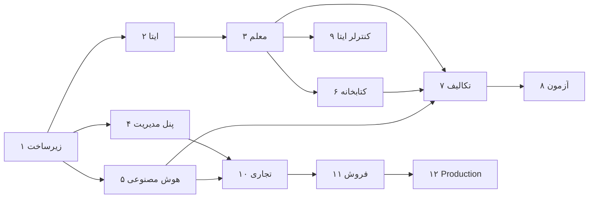

# نقشه راه توسعه

> بخش J و ۷۰ خواسته‌ها · نسخه 1.0

---

## اصل حاکم بر نقشه راه

> **هر فاز باید در پایان خودش قابل استفاده باشد.** هیچ فازی «نیمه‌کاره» تحویل داده نمی‌شود.

بخش ۷۲ خواسته‌ها تأکید می‌کند هر Feature باید کامل باشد. پس هر فاز با این چرخه بسته می‌شود:

```text
BUILD → TEST → SECURITY CHECK → CODE REVIEW → DOCUMENTATION
```

هیچ فازی بدون سبز شدن این پنج مرحله تمام‌شده اعلام نمی‌شود.

---

## فاز ۱ — زیرساخت

**هدف:** یک اسکلت اجراشدنی، امن و تست‌شده که همه فازهای بعد روی آن سوار شوند.

### محدوده

| # | مورد |
|---|---|
| ۱ | ساختار مخزن (`backend`, `miniapp`, `admin-panel`, `docs`, `docker`, `scripts`) |
| ۲ | پروژه Maven با Java 25 + Spring Boot 4.1.1 + Toolchain |
| ۳ | Modular Monolith با Spring Modulith و پکیج‌بندی ماژول‌ها |
| ۴ | PostgreSQL 17 + Flyway + Migration پایه |
| ۵ | موجودیت‌های پایه: `BaseEntity`, `TenantAwareEntity`, تولید UUID v7 |
| ۶ | Multi-Tenant: `@TenantId` + `CurrentTenantIdentifierResolver` + `TenantContext` (ScopedValue) |
| ۷ | امنیت: JWT (Access/Refresh)، چرخش، تشخیص استفاده مجدد |
| ۸ | `TenantGuard` + `SecurityAuditLog` |
| ۹ | رمزنگاری: `SecretEncryptor` (AES-256-GCM) + `EncryptedStringConverter` |
| ۱۰ | مدیریت خطا: `ErrorCode`، `GlobalExceptionHandler`، `traceId` |
| ۱۱ | Auditing پایه (`@CreatedBy`, `@LastModifiedBy`) + جدول `audit_logs` |
| ۱۲ | OpenAPI / Swagger با گروه‌بندی |
| ۱۳ | حالت Mock با `@ConditionalOnProperty` |
| ۱۴ | Docker Compose (postgres + backend) |
| ۱۵ | Actuator + سلامت + Metrics پایه |
| ۱۶ | تست‌های معماری (ArchUnit) + تست‌های چندمستأجری |
| ۱۷ | اسناد: `development.md`, `architecture.md`, `multi-tenancy.md`, `security.md` |

### معیار پذیرش

- [ ] `mvn clean verify` سبز است
- [ ] `docker compose up` بدون خطا بالا می‌آید
- [ ] `/actuator/health` پاسخ `UP` می‌دهد
- [ ] `/swagger-ui.html` کار می‌کند
- [ ] تست `tenantA_cannotReadTenantB_resource` سبز است
- [ ] تست `noNativeQuery_inDomainModules` سبز است
- [ ] تست `ApplicationModules.verify()` سبز است
- [ ] هیچ Secretی در کد نیست (`gitleaks` تمیز)

### خارج از محدوده فاز ۱
هیچ Feature آموزشی، AI یا ایتا. فقط زیرساخت.

---

## فاز ۲ — یکپارچه‌سازی ایتا

**هدف:** معلم بتواند از داخل ایتا وارد شود و سیستم بتواند به گروه/کاربر پیام بفرستد.

> **🟡 وضعیت: هر دو نیمه ساخته و دروازه‌شان گرفته شد.** نیمه Backend
> (`Tests run: 315, Failures: 0`، شامل هر ۱۸ تست الزامی `docs/eitaa.md` بخش ۱۳) و نیمه
> Mini App (`tsc -b` سبز · ۱۱۷ تست واحد · ۱۷ تست Playwright · ESLint پاک · باندل
> `114.63 kB` gzip از بودجه ۱۵۰ kB).
> گام ۱۱ (توکن واقعی ایتا) **باز** است و هیچ‌کدام از مواردش حدس زده نشده.
> جزئیات و چهار نقص Production که اجرا لو داد:
> [`docs/verification-log.md`](verification-log.md) بخش ۱۱ و ۱۲.

> ✅ **مستندات رسمی ایتا در فاز ۰ راستی‌آزمایی شد** (به‌جای فاز ۲).
> نتیجه در [`docs/eitaa.md`](eitaa.md) نسخه ۲.۰ ثبت شده است:
> Bot API فقط **۳ متد** دارد (`getMe`, `sendMessage`, `sendFile`) و **هیچ مسیر ورودی وجود ندارد.**

| # | مورد |
|---|---|
| ۱ | ✅ راستی‌آزمایی مستندات رسمی — **انجام شد** (فاز ۰) |
| ۲ | `EitaaAdapter` — اینترفیس + `EitaaYarBotAdapter` (گروه/کانال) + `EitaaAppMessageAdapter` (کاربر) + `MockEitaaAdapter` |
| ۳ | `EitaaHttpClient` — Timeout · Retry · Rate Limit · **بررسی اجباری `ok`** |
| ۴ | اعتبارسنجی `initData` (HMAC-SHA256 + `auth_date` + ضد Replay) |
| ۵ | `POST /auth/eitaa` — ورود + ایجاد User/Tenant خودکار |
| ۶ | **`GET /auth/me`, `POST /auth/refresh`, `POST /auth/logout`** |
| ۷ | ✅ Mini App: اسکلت + لایه Adapter + جریان ورود + **گارد پلتفرم (Android/Windows)** |
| ۸ | ✅ Mini App: پنج تب اصلی (صفحات خالی) |
| ۹ | ✅ **`start_param` — مسیریابی Deep Link** (`asg_`, `cls_`, `exm_`) |
| ۱۰ | ✅ **`requestWriteAccess` — جریان اجازه ارسال پیام** |
| ۱۱ | ⬜ آزمون واقعی با توکن ایتایار: نرخ، طول پیام، حجم فایل، `date`، دسکتاپ |
| ۱۲ | ❌ **حذف‌شده:** دریافت Update (Webhook/Long-Polling) — **در ایتا وجود ندارد** |

### معیار پذیرش

> **وضعیت پس از فاز ۲ (Verification Log بخش ۱۱ و ۱۲):** موارد ۱ تا ۳ و ۵ تا ۷ و ۹
> **محقق شده‌اند**؛ ۴ و ۸ به توکن واقعی ایتا نیاز دارند و **باز مانده‌اند**. هیچ‌کدام
> «تقریباً» تیک نمی‌خورند — یا هست یا نیست.

- [✅] `initData` دست‌کاری‌شده رد می‌شود
- [✅] `initData` قدیمی‌تر از ۵ دقیقه رد می‌شود
- [✅] تست‌های `eitaaInitData*` سبزند
- [✅] تست `ArchUnit_noWebhookControllerTest` سبز است
- [✅] ورود از Mini App داخل ایتا کار می‌کند — *جریان کامل با SDK جعلی آزموده شد (§۱۲.۰)؛ نشست **واقعی** ایتا همچنان آزموده نشده*
- [ ] کاربر جدید، مستأجر شخصی و اشتراک رایگان می‌گیرد — *زیرساختش هست؛ اتصال به‌اشتراک فاز ۱۰*
- [ ] **ارسال واقعی به یک گروه ایتا با توکن واقعی موفق است** — *نیازمند توکن واقعی ایتایار*
- [✅] **کاربر در iOS پیام روشن می‌بیند، نه صفحه سفید** — *صفحه گارد پلتفرم با آزمون E2E پوشش داده شد (§۱۲.۰)*
- [✅] **`start_param` کاربر را به صفحه درست می‌برد** — *رمزگشایی سمت سرور (§۱۱.۲) و مسیریابی سمت Mini App (§۱۲.۰) هر دو آزموده شدند*

### ریسک
⚠️ **دریافت پیام در ایتا ممکن نیست.** هیچ Fake‌ای ساخته نمی‌شود؛ جایگزین معماری در
[`docs/eitaa.md`](eitaa.md) بخش ۶.۳ طراحی شده است. پیامد آن در فاز ۷ اعمال می‌شود.

---

## فاز ۳ — دامنه معلم

**هدف:** معلم بتواند کلاس و دانش‌آموز مدیریت کند.

**وضعیت:** ✅ **هر سه گام تمام شد** (Backend گام ۱–۲ + Mini App گام ۳).
ثبت کامل: [`verification-log.md`](verification-log.md) بخش ۱۳ تا ۱۵.

| # | مورد | وضعیت |
|---|---|---|
| ۱ | `classroom`: Entity، Repository، Service، Controller، DTO، Mapper، Validation، Tests | ✅ گام ۱ |
| ۲ | `student`: همان زنجیره کامل | ✅ گام ۲ |
| ۳ | `subjects` و اتصال به کلاس | ✅ گام ۱ |
| ۴ | ثبت‌نام دانش‌آموز در کلاس | ✅ گام ۲ |
| ۵ | داشبورد معلم (`GET /classes/{id}/dashboard`) | ✅ گام ۲ |
| ۶ | Mini App: صفحه کلاس‌ها، دانش‌آموزان، داشبورد واقعی | ✅ گام ۳ |
| ۷ | تست‌های جداسازی: معلم A به دانش‌آموز معلم B دسترسی ندارد | ✅ |

### معیار پذیرش

- [x] CRUD کامل کلاس — ✅ گام ۱
- [x] CRUD کامل دانش‌آموز — ✅ گام ۲
- [x] `teacherA_cannotReadTeacherB_students` سبز — ✅ گام ۲
- [x] داشبورد Mini App داده واقعی نشان می‌دهد — ✅ گام ۳
- [x] مستندات هر Endpoint در Swagger کامل است — ✅
- [x] جداسازی مستأجر روی جدول‌های تازه با تست دیتابیسی ثابت شده — ✅

---

## فاز ۴ — پنل مدیریت پایه

**هدف:** Super Admin بتواند کاربران و مستأجرها را مدیریت کند.

| # | مورد |
|---|---|
| ۱ | `admin` ماژول + تفکیک مسیر و `SecurityFilterChain` جدا |
| ۲ | ورود ادمین با رمز (Argon2id) + قفل حساب |
| ۳ | RBAC کامل: `roles`, `permissions`, `role_permissions` |
| ۴ | `@PreAuthorize` روی همه Endpointهای تغییردهنده |
| ۵ | مدیریت کاربران (CRUD + غیرفعال + تعلیق + تغییر نقش) |
| ۶ | مدیریت مستأجرها و مدارس |
| ۷ | Feature Flags + `feature_overrides` + `user_feature_overrides` |
| ۸ | Admin Panel: اسکلت + ورود + داشبورد + مدیریت کاربران |
| ۹ | Audit Log برای همه عملیات حساس |
| ۱۰ | تست: `teacher_cannotModifyGlobalProviderConfig`, `student_cannotAccessTeacherEndpoints` |

### معیار پذیرش

- [x] Super Admin می‌تواند کاربر بسازد، غیرفعال کند، نقش بدهد
- [x] Feature را برای یک کاربر یا گروهی از کاربران فعال/غیرفعال کند
- [x] هر تغییر در `audit_logs` ثبت شود
- [x] پنل ادمین با کوکی HttpOnly + CSRF کار کند — *دوگانه: Bearer یا کوکی؛ SPA با credentials + CSRF*
- [x] همه Endpointهای تغییردهنده `@PreAuthorize` دارند (تست ArchUnit)

> **وضعیت پذیرش:** حذف نرم کاربر، مدارس (`/admin/schools` + UI)، Feature Flags،
> کوکی HttpOnly افزودنی + CSRF در پنل. تست‌های ممنوعیت معلم/دانش‌آموز سبزند.

---

## فاز ۵ — هوش مصنوعی

**هدف:** Provider، Model، Prompt و دستیار معلم.

| # | مورد | وضعیت |
|---|---|---|
| ۱ | `AiProvider` interface + `AbstractHttpAiProvider` + نگاشت خطا | ✅ Interface + Mock + AbstractHttp skeleton |
| ۲ | `OpenAiCompatibleProvider` (پایه مشترک ۵ Provider) | ✅ اسکلت — بدون نام فیلد JSON حدسی |
| ۳ | `AnthropicProvider` — **پس از تأیید مستندات رسمی** | ⏳ |
| ۴ | `XaiProvider`, `OpenAiProvider`, `OpenRouterProvider`, `OllamaProvider`, `GeminiProvider` | ⏳ |
| ۵ | `MockAiProvider` + `StructuredOutputFixtures` | ✅ + `MOCK_SECONDARY` برای failover |
| ۶ | Model Catalog + همگام‌سازی از API Provider | 🔄 CRUD مدل؛ sync نه |
| ۷ | `ProviderResolver` (۶ سطح) + `ProviderBroker` (failover) + Circuit Breaker | ✅ + CB حافظه‌ای |
| ۸ | `AiCostCalculator` + `ai_usage_records` | ✅ stub هزینه + ثبت مصرف |
| ۹ | سیستم Prompt کامل (Template, Version, Assignment, Renderer) | ✅ V21 + CRUD |
| ۱۰ | `PromptResolver` (۶ سطح) + نسخه‌بندی + Publish/Rollback/Compare | ✅ + Compare |
| ۱۱ | دستیار معلم (`POST /ai/chat`) با زمینه خودکار | ✅ chat + Mini App + usage metering |
| ۱۲ | Admin Panel: مدیریت Provider، Model، تخصیص، Prompt Editor، Playground | ✅ Prompt/Provider UI + resolve-trace |
| ۱۳ | ابزار «چرا این Provider؟» (resolve-trace) | ✅ |
| ۱۴ | Endpointهای مصرف AI | ✅ گزارش فاز ۱۱ |

### معیار پذیرش

- [x] Admin می‌تواند Provider اضافه کند و تست اتصال بگیرد (Mock OK)
- [x] Admin می‌تواند Prompt بسازد، تست کند، منتشر کند، Rollback کند
- [x] رزولوشن ۶ سطحی درست کار می‌کند (تست — سطوح با داده: GLOBAL/TENANT/FEATURE)
- [x] Failover در قطعی Provider کار می‌کند (دو Mock)
- [x] هزینه هر درخواست ثبت می‌شود (stub صفر وقتی نرخ نیست)
- [x] `apiKeys_neverLeak_inAnyResponse` سبز
- [x] همه Providerهای فعال با Mock قابل تست‌اند

### ریسک
⚠️ جزئیات API هر Provider باید **مستقیماً از مستندات رسمی** تأیید شود. هیچ Endpoint یا نام فیلدی حدس زده نمی‌شود.

---

## فاز ۶ — کتابخانه

**هدف:** بارگذاری کتاب، OCR، تحلیل با AI.

| # | مورد |
|---|---|
| ۱ | ✅ `file` ماژول: `FileStorage` + `LocalFileStorage` + `FileCatalog` (گام ۱) |
| ۲ | ✅ `book` + `book_page` + `book_chapter` — Schema + CRUD کتاب/صفحه + API فصل (گام ۲) |
| ۳ | ✅ بارگذاری PDF و تصویر (`POST .../pdf` و multipart روی pages/create) |
| ۴ | ✅ استخراج صفحه از PDF (PDFBox → placeholder متنی) |
| ۵ | ✅ OCR Interface + `MockOcrService` + `POST .../ocr` |
| ۶ | ✅ تحلیل AI صفحه: خلاصه، سؤال، طرح درس (`ContentAnalysisAi` + Mock) |
| ۷ | ✅ ذخیره تحلیل‌ها در `content_analyses` (Migration `V22`) |
| ۸ | ✅ Mini App: آپلود صفحه/PDF + نمایش OCR + دکمه تحلیل |
| ۹ | ✅ `storageBytes` از `sum(files.size_bytes)` + سقف اختیاری `plan_limits` |

### معیار پذیرش

- [x] معلم PDF بارگذاری می‌کند و صفحه‌ها استخراج می‌شوند
- [x] OCR روی تصویر صفحه کار می‌کند (Mock)
- [x] از یک صفحه، سؤال و طرح درس تولید می‌شود (Mock)
- [x] مصرف ذخیره‌سازی در سقف پلن لحاظ می‌شود (اختیاری اگر متریک باشد)

---

## فاز ۷ — تکالیف

**هدف:** چرخه کامل تکلیف با تصحیح AI و بازبینی معلم.

| # | مورد |
|---|---|
| ۱ | ✅ `assignment` + `assignment_submission` — زنجیره کامل (گام ۱؛ Migration `V15`) |
| ۲ | ✅ `ai_evaluations` با خروجی Structured کامل — Migration `V23` |
| ۳ | ✅ `teacher_reviews` (لاگ Append-Only) — Migration `V23` |
| ۴ | ✅ `POST /assignments/{id}/publish` + ارسال اختیاری به ایتا با لینک `asg_` (Mock؛ شکست rollback نمی‌کند) |
| ۵ | ✅ **ثبت پاسخ متنی توسط دانش‌آموز در Mini App** — ⚠️ نه در چت ایتا |
| ۶ | ✅ تصحیح AI + Schema Mock (`POST .../submissions/{sid}/evaluate`) |
| ۷ | ✅ بازبینی معلم (`POST .../review`) — تأیید/ویرایش نمره/رد |
| ۸ | ✅ ارزیابی گروهی (`POST .../reevaluate-all`) |
| ۹ | ✅ اعلان به دانش‌آموز و معلم از مسیر ب (اگر write access؛ شکست بی‌صدا) |
| ۱۰ | ✅ Mini App: تصحیح/بازبینی روی جزئیات تکلیف |
| ۱۱ | ✅ تست‌های سقف مصرف زیر بار همزمان |

### معیار پذیرش

- [x] معلم تکلیف می‌سازد — ارسال گروه ایتا اختیاری با Mock (گام ۱)
- [x] **دانش‌آموز با کلیک روی لینک، مستقیم داخل همان تکلیف در Mini App می‌رود** — deep-link با UUID
- [x] **دانش‌آموز پاسخ را در فرم Mini App ثبت می‌کند** (متن؛ تصویر بعداً)
- [x] AI با خروجی Structured تصحیح می‌کند (Mock)
- [x] معلم بازبینی و نمره نهایی می‌دهد
- [x] `usageLimit_isEnforcedAtomicUnderConcurrency` سبز
- [x] `student_cannotSeeOtherStudentsSubmission` سبز

> 🔴 **تفاوت با طرح اولیه:** در نسخه ۱.۰ فرض شده بود دانش‌آموز پاسخ را **در چت ایتا** می‌فرستد
> و سیستم آن را برمی‌دارد. **این ممکن نیست** — ایتا مسیر دریافت پیام ندارد
> ([`docs/eitaa.md`](eitaa.md) بخش ۶). مسیر واقعی، فرم Mini App است که با `start_param` باز می‌شود.

---

## فاز ۸ — آزمون

**هدف:** ساخت آزمون با AI، برگزاری، تصحیح.

| # | مورد |
|---|---|
| ۱ | `exam` + `exam_question` — زنجیره کامل |
| ۲ | `exam_blueprint` — طرح تولید |
| ۳ | تولید آزمون با AI از کتاب/فصل/صفحه |
| ۴ | `exam_attempt` + `exam_answer` |
| ۵ | برگزاری آزمون آنلاین با زمان‌سنج |
| ۶ | تصحیح خودکار (چهارگزینه‌ای/درست‌غلط) + تصحیح AI (تشریحی) |
| ۷ | نتایج و کارنامه |
| ۸ | Mini App: ساخت آزمون، برگزاری، نتایج |

### معیار پذیرش

- [x] معلم با انتخاب صفحه و تنظیمات، آزمون تولید می‌کند — *Mock stub + Mini App Generate*
- [x] می‌تواند سؤال‌ها را ویرایش/حذف/اضافه کند — *ExamManagePage*
- [x] دانش‌آموز در آزمون شرکت می‌کند — *Take + studentId از session/manual*
- [x] تصحیح خودکار و AI کار می‌کند — *MCQ/TF + essay stub*
- [x] نمرات در گزارش‌ها دیده می‌شوند — *Teacher Results + API*

---

## فاز ۹ — کنترلر ایتا

**هدف:** پیام‌رسانی، زمان‌بندی، خودکارسازی — **در جهت خروجی**.

> 🔴 **تفاوت با طرح اولیه:** این فاز ابتدا «خودکارسازی بر اساس پیام دریافتی» طراحی شده بود.
> چون ایتا **مسیر دریافت پیام ندارد** ([`docs/eitaa.md`](eitaa.md) بخش ۶)،
> موتور قواعد بازطراحی شد تا روی **رویدادهای داخلی سیستم** کار کند.

| # | مورد |
|---|---|
| ۱ | `eitaa_group` + اتصال به کلاس (با تأیید یکتایی `chat_id`) |
| ۲ | `eitaa_channel` + مدیریت |
| ۳ | ارسال پیام، فایل، تکلیف، نتیجه به گروه — از هر دو مسیر (گروه/کاربر) |
| ۴ | `scheduled_message` + جاب زمان‌بندی + **استفاده از پارامتر بومی `date` به‌عنوان لایه دوم** |
| ۵ | `automation_rule` + موتور قواعد — **تریگر از رویدادهای داخلی**: `ASSIGNMENT_PUBLISHED` · `SUBMISSION_EVALUATED` · `EXAM_COMPLETED` · `SCORE_BELOW_THRESHOLD` · `SUBSCRIPTION_EXPIRING` |
| ۶ | **سنجاق کردن پیام فعال** (`pin`) + **حذف خودکار پیام حساس** (`viewCountForDelete`) |
| ۷ | تولید محتوای کانال با AI + صف انتشار |
| ۸ | Mini App: گروه‌ها، کانال‌ها، قواعد خودکار |
| ۹ | Admin Panel: مشاهده ربات‌ها، گروه‌ها، کانال‌ها، مصرف اعتبار |

### معیار پذیرش

- [x] معلم گروه ایتا را به کلاس متصل می‌کند
- [x] تکلیف به گروه ارسال می‌شود — پیام حاوی Deep Link است
- [x] پیام زمان‌بندی‌شده در زمان مقرر ارسال می‌شود — *job + Mini App schedule*
- [x] **زمان‌بندی هم در Scheduler ما و هم در پارامتر `date` ایتا تنظیم می‌شود**
- [x] قاعده «اگر نمره < ۵۰ → به معلم اطلاع بده» کار می‌کند — *thresholdPercent*
- [x] ❌ **قاعده‌ای که منتظر پیام ورودی باشد وجود ندارد** — چون تریگر آن ممکن نیست
- [x] مصرف اعتبار پیام (۵۰٬۰۰۰ رایگان) در پنل ادمین دیده می‌شود — *AdminEitaa overview*

---

## فاز ۱۰ — تجاری

**هدف:** پلن، اشتراک، پرداخت، کوپن، کیف پول.

**وضعیت:** ✅ **API + Admin UI** — V26 coupons/wallets/plan_features؛ Admin Plans/Coupons/Subscriptions؛
expiry warning job (۷/۳/۱ روز)؛ Mini App اشتراک. درگاه واقعی و همگام‌سازی Provider باز است.

| # | مورد | وضعیت |
|---|---|---|
| ۱ | `plan` + `plan_feature` + `plan_limit` — کامل و از پنل قابل مدیریت | ✅ API + Admin PlansPage |
| ۲ | `subscription` + چرخه عمر کامل | ✅ ACTIVE/CANCELLED/EXPIRED |
| ۳ | جاب انقضا + هشدارهای پیش از انقضا | ✅ expiry + warning ۷/۳/۱ |
| ۴ | `PaymentGateway` interface + Registry | ✅ Mock + Unavailable |
| ۵ | `MockPaymentGateway` + جریان کامل خرید | ✅ + callback idempotent |
| ۶ | Adapter درگاه واقعی (پس از تأیید مستندات) | ⏳ |
| ۷ | `invoice` + شماره‌گذاری اتمیک | ✅ |
| ۸ | `coupon` + اعتبارسنجی + ثبت اتمیک | ✅ + AdminCouponController |
| ۹ | `wallet` + تراکنش‌ها | ✅ API credit/debit |
| ۱۰ | `usage_counter` + رزرو اتمیک | ✅ + concurrency |
| ۱۱ | `EntitlementService` + `FeatureNotEntitledException` | ✅ + plan_features + cache |
| ۱۲ | Mini App: اشتراک من، ارتقا، فاکتورها | ✅ SubscriptionPage |
| ۱۳ | Admin Panel: پلن‌ها، اشتراک‌ها، پرداخت‌ها، کوپن‌ها | ✅ Plans/Coupons/Subscriptions UI |

### معیار پذیرش

- [x] Admin بدون تغییر کد پلن می‌سازد و قیمت تعیین می‌کند — *API؛ UI کامل باز*
- [x] معلم خرید می‌کند و اشتراک فعال می‌شود
- [x] `expiredSubscription_blocksPremiumFeature` سبز
- [x] `usageLimit_isEnforced` سبز
- [x] Callback تکراری، اشتراک دوم نمی‌سازد

---

## فاز ۱۱ — فروش و گزارش

**هدف:** دید کامل به کسب‌وکار.

**وضعیت:** ✅ — churn/conversion، AI by model/provider/**user**، revenue series روزانه،
Excel، charts SVG، کش TTL، داشبورد با درآمد ۷روزه.

| # | مورد | وضعیت |
|---|---|---|
| ۱ | داشبورد مدیریتی با همه کارت‌ها و نمودارها | ✅ + revenue mini-chart |
| ۲ | گزارش درآمد (روزانه/ماهانه/سالانه) | ✅ مجموع + سری روزانه |
| ۳ | گزارش اشتراک‌ها + نرخ ریزش + نرخ تبدیل | ✅ تقریبی از وضعیت‌ها |
| ۴ | گزارش مصرف AI + هزینه به تفکیک کاربر/معلم/Feature/Provider/Model | ✅ مدل/ارائه‌دهنده/کاربر |
| ۵ | گزارش کاربران | ✅ |
| ۶ | خروجی Excel/CSV | ✅ `users.csv` + `users.xlsx` |
| ۷ | کش کردن گزارش‌های سنگین | ✅ ConcurrentHashMap TTL |

### معیار پذیرش

- [x] اعداد گزارش گام ۱ از داده واقعی می‌آیند (بدون صفر جعلی دامنهٔ غایب)
- [x] نمودارها در UI رندر می‌شوند — *میله‌ای ساده از charts API*
- [x] خروجی CSV کاربران کار می‌کند
- [x] خروجی Excel کاربران (`users.xlsx`)

---

## فاز ۱۲ — Production

**هدف:** آماده برای مشتری واقعی.

**وضعیت:** 🔄 **stubs Production** — V27 TOTP؛ Redis RL؛ CB/cache حافظه+stub Redis؛
MinIO stub؛ k6 smoke؛ `docker-compose.observability.yml`؛ OWASP/gitleaks اختیاری؛
runbook. **باز:** pen-test، Deploy، بازیابی واقعی، Grafana کامل، درگاه واقعی.

| # | مورد | وضعیت |
|---|---|---|
| ۱ | بازبینی امنیتی کامل + رفع یافته‌ها | 🔄 چک‌لیست بخشی |
| ۲ | 2FA اجباری برای Super Admin | ✅ TOTP (اختیاری با flag) |
| ۳ | Rate Limiting روی Redis | 🔄 پشت `app.redis.enabled`؛ پیش‌فرض حافظه |
| ۴ | Circuit Breaker روی Redis | ✅ CB حافظه‌ای AI + stub مشترک |
| ۵ | کش Redis برای Prompt و Entitlement | ✅ TTL حافظه؛ stub وقتی redis.enabled |
| ۶ | MinIO برای ذخیره‌سازی فایل | 🔄 stub `MinioFileStorage` بدون سرور |
| ۷ | Partitioning جداول پرحجم | 🔄 مستند در runbook |
| ۸ | پشتیبان‌گیری خودکار + تست بازیابی | 🔄 چک‌لیست عملی در runbook |
| ۹ | CI/CD کامل (Build, Test, Security Scan, Deploy) | 🔄 CI؛ بدون Deploy |
| ۱۰ | OWASP Dependency-Check + gitleaks در CI | ✅ اختیاری `continue-on-error` |
| ۱۱ | مانیتورینگ: Prometheus + Grafana | 🔄 compose observability + scrape |
| ۱۲ | هشدار خودکار (AI cost spike، خطای Provider، خطای پرداخت) | ⏳ |
| ۱۳ | تست بار | 🔄 `scripts/load-test/k6-smoke.js` |
| ۱۴ | مستندات عملیاتی و Runbook | ✅ |
| ۱۵ | تست نفوذ | ⏳ |

### معیار پذیرش

- [ ] چک‌لیست امنیتی `docs/security.md` بخش ۱۶ کامل تیک خورده
- [x] CI/CD سبز و خودکار — *build/test؛ Deploy باز*
- [ ] بازیابی از پشتیبان آزمایش شده — *رویه در runbook؛ اجرا روی staging باز*
- [ ] تست بار با ۵۰۰ کاربر همزمان موفق

---

## خلاصه وابستگی فازها



**مسیر بحرانی:** ۱ → ۲ → ۳ → ۶ → ۷ → ۸

**فازهایی که می‌توانند موازی شوند:** ۴ و ۵ پس از ۱ · ۹ پس از ۳ · بخش‌هایی از ۱۰ پس از ۴ و ۵

---

## اندازه‌گیری پیشرفت

در پایان هر فاز:

| سنجه | هدف |
|---|---|
| پوشش تست | ≥ ۷۰٪ (فاز ۱–۵)، ≥ ۸۰٪ (فاز ۱۰+) |
| تست‌های امنیتی سبز | ۱۰۰٪ |
| تست‌های معماری سبز | ۱۰۰٪ |
| Swagger کامل | ۱۰۰٪ Endpointها |
| مستندات به‌روز | ۱۰۰٪ |
| بدهی فنی ثبت‌شده | مستند در `docs/troubleshooting.md` |
